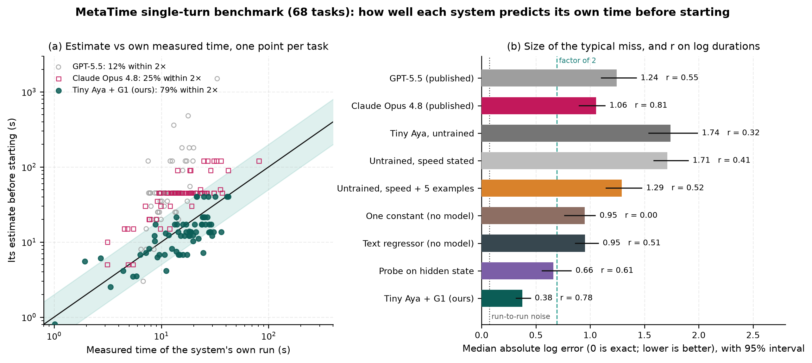

# Anthropochrony

### Ask an AI how long a task will take it and it answers on a human clock. We taught a small model to know its own.

_Built for the Lexsi AI Safety & Alignment Hackathon, Track 1 (CuratorKIT → AlignTune → AuditKIT)._

[Write-up](paper/article.md) · [Full results](docs/METATIME.md) · [For judges](docs/JUDGES.md) · [What was declared, and when](docs/PREREGISTRATION.md) · [Check the numbers](notebooks/benchmark_head_to_head.ipynb) · [Models](https://huggingface.co/collections/isHeSatoshi/anthropochrony-self-time-models-6af986a95a140f4184fae18f) · [Data and logs](https://huggingface.co/collections/isHeSatoshi/anthropochrony-self-time-data-6af986a99994d1dfbbad03aa)



## The problem

Ask a frontier model how long a piece of work will take. Give Claude a refactor, a new feature, a migration, and you'll hear "this is a few days of work" or "figure on a week". Then you let it run, and it's done in minutes.

The model isn't lying. It learned from text written by people, and when people say how long a job takes, they mean how long a person takes. So you get the time a human engineer would need, from something that isn't one. It's like asking a calculator how long long division takes and hearing "about ten minutes, with a pencil".

This matters because estimates drive decisions: how to queue jobs, when to time out a run, whether a task goes to a phone or a server, what to tell a customer about when their work will be done.

There is now a public test for it. MetaTime, a paper under review at ICLR 2027, asks a model how long a task will take it, runs the task, and compares. Its 68 single-turn tasks are everyday requests: write a function, fix a bug, summarise a text, solve a puzzle, write an essay or a story, answer a question. The paper's public files include what GPT-5.5 and Claude Opus 4.8 answered and how long each one really took. Both say about three times too long for nearly everything.

## The result

We took `CohereLabs/tiny-aya-global`, an open model with 3.35 billion parameters, and trained one small adapter (a LoRA, 121 MB) on how long its own answers were to 1,353 ordinary public prompts. We wrote the rules down and pushed them before running anything: all 68 tasks, the benchmark's own question and scoring, and no benchmark task anywhere in training. Then we told the model the measured speed of our graphics card, and asked.

| Estimating its own time | Typically off by | Within 2x of the real time |
|---|--:|--:|
| GPT-5.5 (published) | 3.5x | 12% |
| Claude Opus 4.8 (published) | 2.9x | 25% |
| Tiny Aya, untrained, told its speed | 5.5x | 4% |
| **Tiny Aya with our adapter** | **1.5x** | **79%** |
| Tiny Aya with a second adapter, told nothing about its speed | 1.5x | 76% |
| Tiny Aya with the CuratorKIT → AlignTune adapter, told its speed | 1.6x | 76% |

Ours was closer than GPT-5.5 on 62 of the 68 tasks, closer than Claude Opus 4.8 on 61, and closer on each of the seven kinds of task. That is the result we said in advance would count as success. The paper also trained an 8B open model for this job; its best version reaches a correlation of 0.44 with the real times, and ours reaches 0.66.

## The pipeline: CuratorKIT → AlignTune → AuditKIT

The track asks for its three libraries chained into one pipeline, so one more adapter, `G1-kit`, is built end to end by them. We declared it, with every setting, before training it.

1. **CuratorKIT** gates the 1,353 measured training prompts: schema gate, exact and MinHash deduplication, secrets gate, and one rule of ours as its hook (drop a prompt when a measured run hit the generation cap, because its label is then only a lower bound). 1,342 pass; 10 are dropped by the cap rule and 1 by the secrets gate.
2. **AlignTune** trains the LoRA on what passed, with its SFT trainer (TRL backend, PEFT LoRA, loss on the answer only).
3. **AuditKIT** evaluates the untrained model and `G1-kit` on the 68 tasks with three scorers of ours and its paired bootstrap, and runs ARC-Easy and ARC-Challenge with the adapter off and on.

**What came out.** `G1-kit` is typically 1.6x off (median absolute log error 0.45, 76% within 2x). It is scored against the untrained model's timed runs, because its ordinary answers are as long as the untrained model's (+1.1%). That is inside the spread of the main adapter's three training runs (1.45x to 1.65x against the same runs), and it is still closer than GPT-5.5 on 60 of the 68 tasks and than Claude Opus 4.8 on 57, with paired intervals that exclude zero. AuditKIT's own paired bootstrap agrees: against the untrained model, the mean log error falls from 1.78 to 0.50 and the share within 2x rises from 4% to 76% (p = 0.001).

AuditKIT also found the cost. With the adapter on, ARC-Easy accuracy drops from 73.0% to 71.1% and ARC-Challenge from 42.2% to 40.2%: small, but statistically significant. The adapter is a LoRA, so a deployment can switch it on only for the time question and keep the untrained model for everything else.

**What it costs to run.** 1,000 estimates take about 15 minutes of this GPU, 3 to 5 cents at a public hourly price. The same tokens at GPT-5.5 or Claude Opus 4.8 list prices cost $3.16 to $3.27, and even the bare question alone costs 57 to 60 cents, before any hidden reasoning tokens, which we cannot count ([article §8](paper/article.md#8-cost-and-roi)).

## Read it with care

- **Each model is judged on its own clock.** The result says a 3-billion-parameter model can be taught to know its own running time better than the largest models know theirs. It says nothing about which model is smarter.
- **The big models were asked cold, so we also asked ours cold.** The adapter in the main row is told its machine's speed, and without it is worse than both (off by 5.9x). So we trained a second adapter that learned one machine's speed during training and is told nothing (the "told nothing" row). Asked exactly as the big models were, it is closer than GPT-5.5 on 62 of the 68 tasks and closer than Claude Opus 4.8 on 59. Timed on its own runs afterwards, it scores about the same (off by 1.5x, 82% within 2x). It only knows that one machine, and we added it after seeing the first results. The big models were never trained for this question, so it is still not an even contest.
- **Their mistake is mostly one of scale.** Both say about three times too long for nearly everything. Claude Opus 4.8 sorts tasks from quick to slow as well as ours does, and one correction factor would bring it level with us or a little ahead. Finding that factor takes measurements, which is what our method supplies.
- **The untrained model already knows more than it says.** A simple readout of its internal state predicts its time about as well as the adapter does when both see the full task. The adapter teaches it to say so.
- **Smaller caveats.** Ours guesses short (about three-quarters of the real time). The range you get by asking it 16 times is too narrow; a range set from held-out training prompts holds 93% of the real times, but it is wide (2.5x either way). Two repeat training runs of the main adapter came out worse than the first (off by 1.5x and 1.7x, with 71% and 75% within 2x, still well ahead of both big models). This is one machine, and English only.

Every control, the full tables and the commands are in [`docs/METATIME.md`](docs/METATIME.md).

## How it works

1. **Measure.** We collected 1,523 public prompts (Dolly-15k, CodeAlpaca-20k, no_robots, GSM8K, and 100 coding tasks from an earlier study of ours), after removing 21 that looked like a benchmark task. We ran the untrained model on each one three times and recorded how long its answers were. 1,353 prompts are for training and 170 are held out for checking.
2. **Train.** The adapter learns to answer "how long will this take you?" with the work first and the time second, for example `Prompt: about 380 tokens. Response: about 520 tokens.` and then `Time: 15.4 seconds`. Each training prompt states a machine speed, drawn from a wide range (writing speeds from 2 to 2,500 tokens a second), and the time in the answer is worked out from the token counts at that speed. So the model learns how much work a task is for it, and that the time depends on the machine.
3. **Ask.** On the benchmark, the prompt states the speed we measured on our own machine (an RTX 4060 Ti: about 30 tokens a second writing and 3,300 reading), followed by the benchmark's own question. The benchmark's own parser reads the time out of the answer. We compare it with the median of five timed runs of the same model on the full task.

The second adapter has the same recipe with no stated speed: every training answer was computed at this one machine's speed. Everything was trained and timed on one desktop GPU, with no paid compute.

## Check it yourself

```bash
uv sync --locked
uv run pytest                              # recomputes the published rows and ours from the committed records
uv run python scripts/run_notebook.py      # the same check as a notebook, plus the paired comparison and the figure
uv run python scripts/metatime/report.py   # prints every table of docs/METATIME.md from results/metatime.json
```

None of this needs a GPU or the benchmark download. The commands that rebuild the training pool, retrain the adapters, run the CuratorKIT → AlignTune → AuditKIT pipeline and rerun the timing are in [`docs/METATIME.md`](docs/METATIME.md#reproduce).

## Try it on your own machine

[`space/`](space/) is a small Gradio app. It measures your CPU's speed, asks the untrained model and our adapter how long your task will take, then runs the task and times it. It uses the 4-bit files in [`isHeSatoshi/anthropochrony-tiny-aya-global-g1-gguf`](https://huggingface.co/isHeSatoshi/anthropochrony-tiny-aya-global-g1-gguf) and a llama.cpp build; [`space/README.md`](space/README.md) has the steps. A hosted Hugging Face Space needs a paid plan for this kind of app, so it runs locally.

## What is in this repository

| Path | What it is |
|---|---|
| [`paper/article.md`](paper/article.md) | The hackathon write-up |
| [`docs/METATIME.md`](docs/METATIME.md) | The full head-to-head: the rules, every control row, what it does not show, and the commands |
| [`docs/PREREGISTRATION.md`](docs/PREREGISTRATION.md) | Every declaration, word for word, with the commit that pushed it |
| [`docs/JUDGES.md`](docs/JUDGES.md) | Where to look for each judging criterion |
| [`scripts/metatime/`](scripts/metatime/) | Building the training pool, measuring answer lengths, CuratorKIT, training (our loop and AlignTune), asking, timing, scoring, AuditKIT, and the figure |
| [`results/metatime.json`](results/metatime.json), [`results/metatime/`](results/metatime/) | Every number in the tables, and the per-task records behind them (task ids and numbers, no benchmark text) |
| [`notebooks/`](notebooks/benchmark_head_to_head.ipynb), [`tests/`](tests/) | Recompute the rows from the records |
| [`space/`](space/) | The local demo |

## Where this came from

Earlier in the hackathon the project ran a first study on 1,465 Python coding tasks, with the same small model as a coding agent. It is no longer in this repository's tree and can be read at commit [`aa450e4`](https://github.com/isHeSatoshi/anthropochrony/tree/aa450e4c6a2fd6094b800d75fe26ad4216888796). The benchmark work reuses its training recipe, its ways of stating a machine's speed and 100 of its coding tasks.

## Limits

- The benchmark comparison is not an even contest, for the reasons under "Read it with care".
- It is one model, one machine, single-turn tasks and English. The rows for other machines' speeds use computed times, not runs on those machines.
- The main adapter's first training run is the best of three.
- The pipeline adapter costs about 2 points of ARC accuracy when it is switched on.
- The rows for GPT-5.5 and Claude Opus 4.8 are the paper's published numbers. We did not rerun those models.
- No hosted demo; the demo runs locally.

Subject model: `CohereLabs/tiny-aya-global` (3.35B, CC-BY-NC-4.0). Adapters and data: CC-BY-NC-4.0. Code: Apache-2.0.
