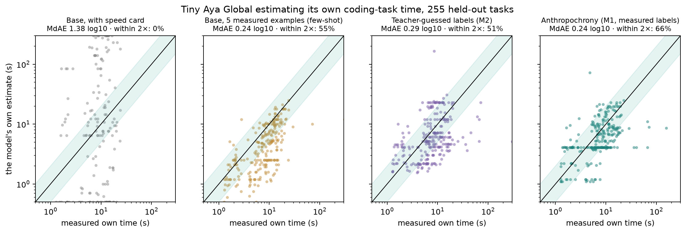

# Anthropochrony

### We asked an AI how long it would take to write a small Python function. It said two hours. It took 8 seconds.

_Built for the Lexsi AI Safety & Alignment Hackathon, Track 1. Monperrus and Stenqvist named this bias before us. We set out to measure it properly and see if it could be fixed._

[Write-up](paper/article.md) · [For judges](docs/JUDGES.md) · [Technical tables](docs/README-technical.md) · [Models](https://huggingface.co/collections/isHeSatoshi/anthropochrony-models-6af31e769e666b4001e8c5f2) · [Data](https://huggingface.co/collections/isHeSatoshi/anthropochrony-data-6af31e776d6f33265b0c33a8)



## How this started

We had a small coding model, `tiny-aya-global`, writing Python functions in a sandbox. It was fast. Most tasks took it about 8 seconds.

Then we asked it a simple question before each task: how long will this take you?

"About two hours."

It had never been slow in its life. But it had read millions of lines written by people, and for people, that is a fair answer. It wasn't lying. It was answering for the wrong species.

We ran this on 1,465 tasks. On average, the model's guess was 55 times too long. Telling it "you generate about 96 tokens a second" didn't help much. It nodded and ignored the number.

If you want to schedule jobs, set a timeout, or decide whether a task goes to a phone or a server, that guess is useless.

## So we taught it to know itself

First we measured the truth: we ran the model on every task, eight times each, and wrote down how long each run really took. Then we trained small adapters on those real times, so the model could learn what its own work costs.

That helped. But it still got something strange wrong. We asked for its estimate on a slow machine (1.5 tokens a second) and it wrote:

> 550 tokens at 1.5 tokens per second is about 2.1 minutes.

550 divided by 1.5 is 6.1 minutes. The model had committed to "2.1 minutes" first and then made the maths agree with it.

That told us something. The model is actually decent at guessing how much work a task is: how many tokens it will write, how many tries it will need. What it can't do is the division. So we stopped asking it to divide. We take its guess for tokens and tries, and a plain formula turns that into seconds. We call that version M1-Struct. It needs no extra training.

## Did it work?

A few tasks the model had never seen, in seconds:

| Task | What really happened | Untrained model said | Ours said |
|---|--:|--:|--:|
| HumanEval/138 | 2.3 | 424 | 4.8 |
| HumanEval/116 | 3.3 | 424 | 3.3 |
| BigCodeBench/903 | 11.3 | 300 | 7.9 |
| BigCodeBench/845 | 11.2 | 424 | 15.2 |

Then we put it on an ordinary CPU and gave it eight bigger jobs: a todo app, a URL shortener, a bank ledger, a snake game. They took 99 to 271 seconds. The untrained model predicted 7 minutes to 2.5 hours. The tuned one said 2 to 4.5 minutes. Neither version passed the hidden tests on those jobs, so this is about timing, not about the code being right.

Over the full test set, the untrained model is off by about 57 times and ours by about 1.6 times. On a machine 64 times slower than the one it trained on, the adapter alone is off by 3 times and with the formula by 1.4 times.

## Where we lost

Be warned: the boring tools are strong. For familiar kinds of tasks, a table of average times per task type, or a small statistical model with no AI in it, is as accurate as our adapter or better. A statistical model also did well on the one task family we kept hidden. We think our approach is worth having because it reads the task and responds to the hardware, which a lookup table can't. But we won't tell you it beat every baseline, because it didn't.

We also had $30 and one training run per model, so small gaps between our own variants don't mean much. One variant, trained without cleaning the data, accidentally saw some of the hidden test tasks. We don't draw any conclusion from it. The formula idea came after we saw the first results, so it isn't part of the plan we registered in advance. And we haven't hosted a live demo yet. It runs on your machine.

## Try it

```bash
uv sync && make figures    # rebuild every table and figure on CPU
make demo                  # the local demo
```

Built with the hackathon stack: CuratorKIT for the data, AlignTune for the training, AuditKIT for the evaluation. Subject model: `CohereLabs/tiny-aya-global` (3.35B).
