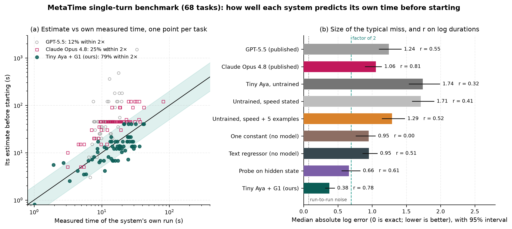

# Head-to-head on a public benchmark (MetaTime)

This page has the full results of the head-to-head: on a benchmark we did not build,
against the best published numbers, can a small model trained on measurements of itself
estimate its own running time? The model is Tiny Aya Global (3.35B) with `G1-kit`, one LoRA
adapter built by the hackathon track's pipeline: CuratorKIT gates the training data,
AlignTune trains the adapter, AuditKIT evaluates it. The write-up is
[`paper/article.md`](../paper/article.md).

**Short answer.** Yes, on the measure declared in advance. On all 68 single-turn tasks,
`G1-kit`, told its machine's speed, estimates its own running time with a median absolute
log error of 0.44 against the median of its own five timed runs, which is a typical factor of
1.55x, and 72% of its estimates are within 2x. The published estimates of GPT-5.5 and Claude
Opus 4.8 for their own time on the same tasks have errors of 1.24 (3.47x, 12% within 2x) and
1.06 (2.87x, 25% within 2x). Ours is closer on 60 and 55 of the 68 tasks, and both paired
intervals exclude zero. It does not rank tasks as well as Claude Opus 4.8 (correlation 0.71
against 0.81), and it needs the machine's speed stated in the prompt: asked with no speed, as
the frontier models were, it scores 1.53, worse than both. The section "What this does not
show" lists every caveat we know of.



## The benchmark

MetaTime (anonymous ICLR 2027 submission, OpenReview `CAQeizWcB2`) is the largest published
study of whether models know how long their own work takes. Its public artifact
(`https://anonymous.4open.science/r/Time-Estimation-B286`) contains 68 single-turn tasks
(the suite of Garikaparthi et al., arXiv 2604.00010: code, debugging, summaries, reasoning,
writing, creative, Q&A) and, for GPT-5.5 and Claude Opus 4.8, each task's measured time and
the model's estimate before starting.

We do not redistribute the tasks. The scripts download the artifact at run time and the
committed records contain task ids, numbers and our model's answers, but no task text.

## Protocol

The tasks, question, target, metrics, comparison and success criterion were written down
(entries of 2026-11-14 in [`PREREGISTRATION.md`](PREREGISTRATION.md), which lists the commit
of each entry) and pushed before any estimate of ours existed on the benchmark. That
criterion was first applied to an earlier adapter trained by our own PyTorch loop, which is
not part of the hackathon submission; its records stay in the log. `G1-kit` was declared with
every setting before it was trained (2026-11-15), and its headline row and every secondary
row on this page before they were run. Because `G1-kit` came after the benchmark had been
used once, its rows are post-hoc in the strict sense.

| Item | Choice |
|---|---|
| Tasks | All 68 single-turn tasks of the artifact |
| Question | The artifact's own prospective question, word for word, with the task's short description as the only task text |
| What is predicted | The model's own wall-clock time for the full task prompt: one request at a time on an RTX 4060 Ti, PyTorch bf16, 2,048-token cap, model-card sampling; median of 5 runs |
| Training data | The model's own response lengths (median of 3 runs) on 1,523 public instruction prompts (Dolly-15k, CodeAlpaca-20k, no_robots, GSM8K, 100 of our `train` coding tasks); 1,353 for training and 170 held out. Every prompt with TF-IDF cosine of 0.25 or more to any benchmark prompt or description was removed (21 prompts). CuratorKIT then passed 1,342 of the 1,353 training prompts |
| Never used | No benchmark task, response or duration for training, model selection or calibration |
| Estimator | `G1-kit`: one LoRA on Tiny Aya (rank 16, alpha 32, lr 2e-4, 2 epochs, seed 0), trained by AlignTune's SFT trainer. It answers the benchmark question with the measured speed of the deployment in the system prompt. The score uses the time it states, read by the benchmark's own parser, against runs of the same fine-tuned model |
| Metrics | The benchmark's: median estimate/actual ratio, median absolute log error (natural log), Pearson r on log durations; plus the share within 2x and mean absolute error |
| Comparison | The artifact's per-task estimates of GPT-5.5 and Claude Opus 4.8 (each against its own measured time), paired bootstrap over tasks (5,000 draws); and the paper's best trained open model (Qwen3-8B, Table 22) |
| Success criterion | Lower median absolute log error than both frontier models, with the paired 95% interval excluding zero |
| Secondary rows | The untrained model with and without the stated speed, and with five measured training examples in the prompt; three predictors that never ask the model (a constant, two text regressors); a linear probe on the untrained model's hidden state; `G1-kit` shown the full prompt, asked with the paper's wording, asked without the speed, read through its stated token count, read as the median of 16 sampled answers, and scored against the untrained model's runs; the same question with four other machines' speeds stated; a range calibrated on held-out training-pool prompts; AuditKIT's evaluation and ARC check |

## How to read the comparison

Each system predicts its own time, so the comparison is across models and deployments by
design. It shows which system knows its own running time better. It does not show which
model is more capable.

Three things differ between our row and the published frontier rows, and the tables report a
control for each:

1. **We state the deployment's speed in the prompt.** The frontier models were asked
   without it. The row "untrained, speed stated" shows what the stated speed alone does, and
   the row "G1-kit, no speed stated" shows what the adapter does without it.
2. **We trained on this model's own measurements.** The rows "same constant for every
   task", the text regressors and the hidden-state probe use the same training labels
   without asking the model, and show how much of the result is calibration of the average
   and how much is telling tasks apart.
3. **Durations are on different scales.** Mean absolute error in seconds depends on how
   fast a deployment is, so the ratio, the log error and the correlation are the fair
   comparisons. Seconds are reported for completeness.

"Typical factor off" is `e` raised to the median absolute log error: 1.0x is perfect and
2.0x means the typical estimate is half or double the measured time.

## Results

### The declared comparison

| System | Median estimate/actual | Median abs. log error [95% CI] | Typical factor off | r (log) | Within 2x | MAE (s) | Parsed |
|---|---|---|---|---|---|---|---|
| GPT-5.5 (published) | 3.47x | 1.24 [1.10, 1.42] | 3.47x | 0.55 | 12% | 92.2 | 68/68 |
| Claude Opus 4.8 (published) | 2.87x | 1.06 [0.90, 1.14] | 2.87x | 0.81 | 25% | 30.5 | 68/68 |
| Tiny Aya, untrained, speed stated | 5.39x | 1.71 [1.59, 1.90] | 5.53x | 0.41 | 4% | 70.9 | 68/68 |
| **Tiny Aya + G1-kit (primary)** | 0.73x | 0.44 [0.38, 0.51] | 1.55x | 0.71 | 72% | 7.3 | 68/68 |

| Comparison (ours minus theirs, median abs. log error) | Difference | Paired 95% CI | Tasks where ours is closer |
|---|---|---|---|
| **Tiny Aya + G1-kit (primary)** vs GPT-5.5 | -0.80 | [-1.00, -0.63] | 60/68 |
| **Tiny Aya + G1-kit (primary)** vs Claude Opus 4.8 | -0.62 | [-0.72, -0.45] | 55/68 |

A negative difference means our error is lower. Both paired intervals exclude zero, so the
success criterion is met. `G1-kit` is also closer than both frontier models in each of the
seven task categories:

| Median abs. log error by task category | code_generation (12) | creative (8) | debugging (8) | qa (8) | reasoning (12) | summarization (10) | writing (10) |
|---|---|---|---|---|---|---|---|
| GPT-5.5 (published) | 2.27 | 1.20 | 1.42 | 0.80 | 1.06 | 1.04 | 1.54 |
| Claude Opus 4.8 (published) | 1.17 | 0.91 | 1.21 | 0.53 | 0.99 | 1.17 | 1.09 |
| Tiny Aya + G1-kit | 0.54 | 0.60 | 0.39 | 0.44 | 0.56 | 0.41 | 0.28 |
| G1-kit predicting the untrained model's runs | 0.52 | 0.58 | 0.35 | 0.52 | 0.64 | 0.40 | 0.28 |

Category sizes are 8 to 12 tasks, so the per-category numbers are descriptive only.

### Asked as the frontier models were: no speed in the prompt

The frontier models got the question and nothing else. Asked the same way, with no system
prompt, `G1-kit` scores 1.53 (a typical factor of 4.60x, 12% within 2x), worse than both:
its error is higher than GPT-5.5's by 0.28 (paired interval 0.01 to 0.51) and than Claude
Opus 4.8's by 0.47 (0.25 to 0.71). Its training answers always came with a stated speed, and
without one it has no way to know how fast the machine is (median estimate/actual 0.23x). It
still knows how much it will write: in 56 of its 68 answers it states a token count, and
those counts put through the speed formula at this machine's speed score 0.52. So the stated
speed is part of the method. Measuring it takes a few seconds on any deployment, but the
frontier models were not given it, and the paper has no ablation on these 68 tasks that tells
us how much it would help them.

### Telling tasks apart

Lower error does not mean better ranking. Claude Opus 4.8 orders the tasks by duration better
than `G1-kit` does:

| Telling tasks apart | Pearson r, log durations [95% CI] | Spearman | Pairs ordered correctly | Pearson r, raw seconds |
|---|---|---|---|---|
| GPT-5.5 (published) | 0.55 [0.33, 0.73] | 0.55 | 69% | 0.40 |
| Claude Opus 4.8 (published) | 0.81 [0.71, 0.87] | 0.77 | 76% | 0.68 |
| Tiny Aya, untrained, speed stated | 0.41 [0.09, 0.67] | 0.46 | 65% | 0.47 |
| **Tiny Aya + G1-kit (primary)** | 0.71 [0.48, 0.84] | 0.58 | 71% | 0.56 |
| G1-kit, shown the full prompt | 0.79 [0.65, 0.88] | 0.78 | 79% | 0.66 |

`G1-kit` ranks tasks better than GPT-5.5 and less well than Claude Opus 4.8 (the intervals
overlap); shown the full prompt it comes close to Opus. The frontier models' error is mostly
an error of scale: both say roughly three times too long on almost every task. The next table
uses the benchmark's own outcomes, so no row in it is an estimator anyone could have run in
advance. "Own-median constant" predicts, for each task, the median measured time of the other
67 tasks. "Rescaled" divides each estimate by the median estimate/actual ratio of the other
67 tasks.

| Context (uses the benchmark's own outcomes) | Log error as asked | Own-median constant | Rescaled by one constant | r (log) |
|---|---|---|---|---|
| GPT-5.5 (published) | 1.24 | 0.26 | 0.41 | 0.55 |
| Claude Opus 4.8 (published) | 1.06 | 0.43 | 0.27 | 0.81 |
| Tiny Aya, untrained, benchmark question as is | 1.74 | 0.40 | 0.53 | 0.32 |
| Tiny Aya, untrained, speed stated | 1.71 | 0.40 | 0.42 | 0.41 |
| Tiny Aya, untrained, speed stated, 5 measured examples | 1.29 | 0.40 | 0.52 | 0.52 |
| Same constant for every task (no model call) | 0.95 | 0.40 | 0.40 | 0.00 |
| TF-IDF regressor on the description | 0.95 | 0.40 | 0.29 | 0.51 |
| Sentence-encoder regressor, description | 0.90 | 0.40 | 0.31 | 0.33 |
| Linear probe on the untrained hidden state | 0.66 | 0.40 | 0.29 | 0.61 |
| **Tiny Aya + G1-kit (primary)** | 0.44 | 0.38 | 0.35 | 0.71 |
| G1-kit, stated tokens through the speed formula | 0.45 | 0.38 | 0.33 | 0.70 |
| G1-kit, median of 16 sampled answers | 0.44 | 0.38 | 0.29 | 0.76 |
| G1-kit, the paper's question wording | 0.40 | 0.38 | 0.38 | 0.72 |
| G1-kit, no speed stated | 1.53 | 0.38 | 0.58 | 0.15 |
| G1-kit, shown the full prompt | 0.39 | 0.38 | 0.37 | 0.79 |
| G1-kit predicting the untrained model's runs | 0.45 | 0.40 | 0.32 | 0.75 |
| G1-kit, full prompt, the untrained model's runs | 0.32 | 0.40 | 0.35 | 0.82 |
| TF-IDF regressor on the full prompt | 0.75 | 0.40 | 0.37 | 0.36 |
| Sentence-encoder regressor, full prompt | 0.82 | 0.40 | 0.33 | 0.10 |
| Linear probe, state before answering the full prompt | 0.36 | 0.40 | 0.25 | 0.86 |

Two plain readings of this table:

- With one well-chosen correction factor, Claude Opus 4.8 would be more accurate than
  `G1-kit` (0.27 after rescaling, against 0.44 for `G1-kit` as asked and 0.35 for `G1-kit`
  rescaled). The factor has to come from measured outcomes, which is what our training
  supplies for our model.
- On our machine these 68 tasks take similar times, so a single number chosen with
  knowledge of the outcomes would already score 0.38. `G1-kit`'s raw error (0.44) is no
  better than that. What `G1-kit` adds is that it gets there without seeing any benchmark
  outcome (the honest constant from the training prompts scores 0.95, because benchmark
  responses are about 2.4 times longer than the training prompts' responses), and that it
  ranks the tasks (r = 0.71, where any constant has none).

### Every row

| System | Median estimate/actual | Median abs. log error [95% CI] | Typical factor off | r (log) | Within 2x | MAE (s) | Parsed |
|---|---|---|---|---|---|---|---|
| GPT-5.5 (published) | 3.47x | 1.24 [1.10, 1.42] | 3.47x | 0.55 | 12% | 92.2 | 68/68 |
| Claude Opus 4.8 (published) | 2.87x | 1.06 [0.90, 1.14] | 2.87x | 0.81 | 25% | 30.5 | 68/68 |
| Tiny Aya, untrained, benchmark question as is | 5.61x | 1.74 [1.54, 1.99] | 5.70x | 0.32 | 7% | 92.0 | 68/68 |
| Tiny Aya, untrained, speed stated | 5.39x | 1.71 [1.59, 1.90] | 5.53x | 0.41 | 4% | 70.9 | 68/68 |
| Tiny Aya, untrained, speed stated, 5 measured examples | 0.30x | 1.29 [1.15, 1.48] | 3.63x | 0.52 | 22% | 31.2 | 68/68 |
| Same constant for every task (no model call) | 0.42x | 0.95 [0.77, 1.05] | 2.59x | 0.00 | 34% | 10.4 | 68/68 |
| TF-IDF regressor on the description | 0.39x | 0.95 [0.87, 1.08] | 2.59x | 0.51 | 26% | 10.3 | 68/68 |
| Sentence-encoder regressor, description | 0.44x | 0.90 [0.72, 1.00] | 2.47x | 0.33 | 35% | 9.8 | 68/68 |
| Linear probe on the untrained hidden state | 0.53x | 0.66 [0.56, 0.83] | 1.94x | 0.61 | 54% | 8.6 | 68/68 |
| **Tiny Aya + G1-kit (primary)** | 0.73x | 0.44 [0.38, 0.51] | 1.55x | 0.71 | 72% | 7.3 | 68/68 |
| G1-kit, stated tokens through the speed formula | 0.73x | 0.45 [0.38, 0.51] | 1.56x | 0.70 | 74% | 7.3 | 68/68 |
| G1-kit, median of 16 sampled answers | 0.66x | 0.44 [0.38, 0.55] | 1.55x | 0.76 | 71% | 7.6 | 68/68 |
| G1-kit, the paper's question wording | 0.80x | 0.40 [0.34, 0.46] | 1.50x | 0.72 | 76% | 6.8 | 68/68 |
| G1-kit, no speed stated | 0.23x | 1.53 [1.33, 1.70] | 4.60x | 0.15 | 12% | 14.1 | 68/68 |
| G1-kit, shown the full prompt | 0.91x | 0.39 [0.27, 0.48] | 1.48x | 0.79 | 85% | 6.6 | 68/68 |
| G1-kit predicting the untrained model's runs | 0.69x | 0.45 [0.37, 0.59] | 1.57x | 0.75 | 76% | 6.2 | 68/68 |
| G1-kit, full prompt, the untrained model's runs | 0.85x | 0.32 [0.25, 0.43] | 1.38x | 0.82 | 84% | 5.3 | 68/68 |
| TF-IDF regressor on the full prompt | 0.50x | 0.75 [0.60, 0.84] | 2.11x | 0.36 | 44% | 9.1 | 68/68 |
| Sentence-encoder regressor, full prompt | 0.46x | 0.82 [0.70, 0.92] | 2.27x | 0.10 | 35% | 10.0 | 68/68 |
| Linear probe, state before answering the full prompt | 0.75x | 0.36 [0.25, 0.45] | 1.43x | 0.86 | 85% | 5.7 | 68/68 |

| Comparison (ours minus theirs, median abs. log error) | Difference | Paired 95% CI | Tasks where ours is closer |
|---|---|---|---|
| **Tiny Aya + G1-kit (primary)** vs GPT-5.5 | -0.80 | [-1.00, -0.63] | 60/68 |
| **Tiny Aya + G1-kit (primary)** vs Claude Opus 4.8 | -0.62 | [-0.72, -0.45] | 55/68 |
| G1-kit, stated tokens through the speed formula vs GPT-5.5 | -0.80 | [-1.00, -0.64] | 59/68 |
| G1-kit, stated tokens through the speed formula vs Claude Opus 4.8 | -0.61 | [-0.73, -0.44] | 57/68 |
| G1-kit, median of 16 sampled answers vs GPT-5.5 | -0.81 | [-0.99, -0.61] | 59/68 |
| G1-kit, median of 16 sampled answers vs Claude Opus 4.8 | -0.62 | [-0.73, -0.41] | 53/68 |
| G1-kit, the paper's question wording vs GPT-5.5 | -0.84 | [-1.03, -0.67] | 61/68 |
| G1-kit, the paper's question wording vs Claude Opus 4.8 | -0.65 | [-0.75, -0.49] | 59/68 |
| G1-kit, no speed stated vs GPT-5.5 | +0.28 | [+0.01, +0.51] | 30/68 |
| G1-kit, no speed stated vs Claude Opus 4.8 | +0.47 | [+0.25, +0.71] | 17/68 |
| G1-kit, shown the full prompt vs GPT-5.5 | -0.85 | [-1.08, -0.68] | 61/68 |
| G1-kit, shown the full prompt vs Claude Opus 4.8 | -0.67 | [-0.85, -0.47] | 60/68 |
| G1-kit predicting the untrained model's runs vs GPT-5.5 | -0.79 | [-1.01, -0.59] | 60/68 |
| G1-kit predicting the untrained model's runs vs Claude Opus 4.8 | -0.60 | [-0.74, -0.40] | 57/68 |
| G1-kit, full prompt, the untrained model's runs vs GPT-5.5 | -0.92 | [-1.12, -0.72] | 62/68 |
| G1-kit, full prompt, the untrained model's runs vs Claude Opus 4.8 | -0.74 | [-0.85, -0.53] | 61/68 |

What the controls show:

- **`G1-kit` needs the stated speed.** Without it, it is worse than both frontier models
  (1.53). The adapter learned how much it will write; it has no way to know how fast the
  machine is unless told.
- **The stated speed is not sufficient.** The untrained model with the same speed in the
  prompt is no better than without it; 59 of its 68 answers are "1 minute" or "2 minutes".
  Adding five measured examples to the prompt moves its scale but not its accuracy.
- **Predictors that never ask the model are worse from the description.** A constant, a
  TF-IDF regressor and a sentence-encoder regressor trained on the same labels all miss by
  about 2.5x, mostly because benchmark responses are longer than training responses and
  those predictors cannot tell.
- **The untrained model already carries the information.** A linear probe on the untrained
  model's hidden state, trained on the same labels, reaches 0.66 from the benchmark
  question. Read just before the model starts answering the full prompt, the probe scores
  0.36, a little better than the adapter shown the full prompt (0.39). So the adapter is not
  creating knowledge that was absent. It makes the model say, in the benchmark's format,
  something its internal state already predicts.
- **The wording and the sampling do not matter much.** The paper's question wording gives
  0.40, the median of 16 sampled answers 0.44.
- **The adapter did not change how long the model's responses are** (+1.1% on held-out
  prompts), so its estimates are about as accurate for the untrained model's runs (0.45) as
  for its own (0.44).

For reference, the two frontier models were also asked after finishing each task. Our
estimate, made before starting, is closer than Claude Opus 4.8's estimate made afterwards
and not as close as GPT-5.5's:

| After completing the task (published, context only) | Median estimate/actual | Median abs. log error | Typical factor off | r (log) | Within 2x |
|---|---|---|---|---|---|
| GPT-5.5 | 0.93x | 0.30 | 1.35x | 0.67 | 94% |
| Claude Opus 4.8 | 1.80x | 0.59 | 1.80x | 0.81 | 56% |

### Stating another machine's speed

The same question was asked again with four other speeds in the system prompt. We do not
have those machines, so the targets are the measured runs replayed through the speed
formula (prompt tokens / reading speed + response tokens / writing speed). This checks
whether the estimate follows the stated speed, not whether it is right on real hardware of
that speed.

| Estimator | Stated speed (tokens/s writing, reading) | Median target (s) | Median estimate (s) | Median estimate/actual | Median abs. log error | r (log) | Within 2x | Tokens through the formula | Stated writing speed vs this machine | Estimate vs its estimate at this machine's speed (median per task) |
|---|---|---|---|---|---|---|---|---|---|---|
| G1-kit | 1.5, 10 | 388.9 | 282.5 | 0.67x | 0.47 | 0.51 | 68% | 0.39 | 20x slower | 22.3x longer |
| G1-kit | 8, 60 | 72.0 | 52.5 | 0.70x | 0.47 | 0.38 | 72% | 0.38 | 3.75x slower | 4.15x longer |
| G1-kit | 30, 3300 (this machine, measured) | 17.0 | 13.5 | 0.73x | 0.44 | 0.71 | 72% | 0.45 | same | same |
| G1-kit | 190, 19000 | 2.7 | 2.1 | 0.74x | 0.44 | 0.70 | 78% | 0.43 | 6.33x faster | 6.23x shorter |
| G1-kit | 400, 40000 | 1.3 | 1.0 | 0.75x | 0.40 | 0.71 | 74% | 0.43 | 13.3x faster | 13.2x shorter |
| Untrained | 1.5, 10 | 404.1 | 120.0 | 0.25x | 1.39 | 0.24 | 9% | n/a | 22.7x slower | unchanged |
| Untrained | 8, 60 | 74.9 | 120.0 | 1.32x | 0.38 | 0.32 | 75% | n/a | 4.25x slower | unchanged |
| Untrained | 34, 5700 (this machine, measured) | 15.4 | 60.0 | 5.39x | 1.71 | 0.41 | 4% | n/a | same | same |
| Untrained | 190, 19000 | 2.8 | 60.0 | 30.58x | 3.42 | 0.39 | 3% | n/a | 5.59x faster | unchanged |
| Untrained | 400, 40000 | 1.3 | 60.0 | 63.78x | 4.16 | 0.27 | 3% | n/a | 11.8x faster | unchanged |

`G1-kit`'s estimates follow the stated speed across a 270-fold range. Told the machine writes
20 times slower, it gives estimates a median of 22 times longer for the same task (the
targets grow 23-fold, because reading is slowed even more than writing). Told the machine is
6.3 or 13 times faster, it gives estimates 6.2 or 13 times shorter. The error stays between
0.40 and 0.47 at every speed. The untrained model gives the same answer to a task at every
stated speed, so the one speed at which it looks accurate (8 tokens a second) is a
coincidence of scale.

At 8 tokens a second `G1-kit`'s stated time ranks tasks poorly (r = 0.38) while the token
count it states, put through the formula, keeps its accuracy (0.38). The model knows how much
it will write better than it can divide by a speed, and computing the time outside the model
removes that weakness. The project's first study on coding tasks found the same.

### A range around each estimate

Asking 16 times and taking the 10th to 90th percentile of the answers gives a range that is
too narrow:

Sampled answers:
- G1-kit, benchmark question (primary): 16 draws, 10-90% range covers 53%
- G1-kit, shown the full prompt: 16 draws, 10-90% range covers 63%
- G1-kit, the paper's question wording: 16 draws, 10-90% range covers 59%
- G1-kit, no speed stated: 16 draws, 10-90% range covers 24%

For the primary question the range covers 53% of measured times where a calibrated one
would cover 80%.

A second range uses a rule written into the preregistration log on 2026-11-15, before it was
first computed: split-conformal calibration on the 170 held-out pool prompts. Take the
adapter's absolute log error on each of them, find the 137th smallest (the 80% level for 170
prompts), and call it `q`. Every benchmark estimate then gets the range from the stated time
divided by `e^q` to the stated time multiplied by `e^q`. No benchmark outcome enters the rule.
For `G1-kit` it uses the held-out pool estimates made before its benchmark runs.

| Range calibrated on held-out pool prompts (80% target) | Calibration prompts | q (log units) | Range: stated time divided and multiplied by | Benchmark measured times inside | 10-90% range of 16 samples covers |
|---|---|---|---|---|---|
| G1-kit, benchmark question (primary), its own runs | 170 | 1.03 | 2.79x | 91% | 53% |
| G1-kit, shown the full prompt, its own runs | 170 | 0.75 | 2.11x | 85% | 63% |
| G1-kit, benchmark question, the untrained model's runs | 170 | 1.03 | 2.79x | 94% | n/a |
| G1-kit, shown the full prompt, the untrained model's runs | 170 | 0.75 | 2.11x | 87% | n/a |

From the description, the range is the stated time divided and multiplied by 2.79, and 91%
of `G1-kit`'s measured times are inside it, more than the 80% aimed for. From the full
prompt the factor is 2.11 and 85% are inside. The edge of the description range (2.79x) is
about as wide as Claude Opus 4.8's typical miss (2.87x), so it is a safe bound rather than a
sharp one. The guarantee behind split-conformal ranges assumes the benchmark tasks resemble
the calibration prompts, which they do not exactly, so these shares are observations on 68
tasks, not guarantees.

### The CuratorKIT → AlignTune → AuditKIT pipeline

CuratorKIT 0.1.23 gates the 1,353 training prompts and passes 1,342 (10 dropped because a
measured run hit the 2,048-token cap, 1 by its secrets gate; deduplication removed none).
AlignTune 0.1.32 trains the LoRA on the prompts that passed (840 steps, 2.19 hours, training
loss 1.49 at the first log and 0.25 at the last). AuditKIT 1.1.6 then evaluates it twice: on
the 68 tasks with three scorers of ours, and on ARC with its lm-eval engine, each time
against the untrained model.

| Adapter | Stated time: log error | r (log) | Within 2x | Stated tokens through the formula: log error | r (log) | Stated time agrees with its own token counts (within 10%) | Full prompt, stated time: log error | Full prompt, tokens through the formula | Response-length drift |
|---|---|---|---|---|---|---|---|---|---|
| G1-kit, its own runs | 0.44 | 0.71 | 72% | 0.45 | 0.70 | 67/68 | 0.39 | 0.37 | +1.1% |
| G1-kit, the untrained model's runs | 0.45 | 0.75 | 76% | 0.45 | 0.74 | 67/68 | 0.32 | 0.32 | +1.1% |

The stated time and the stated token count put through the formula agree (67 of 68 stated
times are within 10% of what the stated tokens give), so the adapter learned the division
as well as the length.

| AuditKIT (68 tasks, greedy, speed stated, the untrained model's runs) | Untrained | `G1-kit` | Paired bootstrap |
|---|---|---|---|
| Mean absolute log error | 1.78 | 0.50 | -1.28, p = 0.001 |
| Within 2x | 4.4% | 76.5% | +72 points, p = 0.001 |
| Parsed | 68/68 | 68/68 | |
| Answers identical to `estimate.py`'s | 68/68 | 68/68 | |
| Prompt and answer tokens, wall time | 35,440, 516, 22.6 s | 35,440, 1,511, 62.3 s | |

| ARC, zero-shot, all questions (lm-eval through AuditKIT) | Untrained | `G1-kit` on | Paired bootstrap |
|---|---|---|---|
| ARC-Easy accuracy (2,376) | 73.0% | 71.1% | -1.9 points, p = 0.004 |
| ARC-Challenge accuracy (1,172) | 42.2% | 40.2% | -2.0 points, p = 0.04 |
| Both (3,548) | 62.8% | 60.9% | -1.9 points, p = 0.001 |
| ARC-Easy, normalized accuracy | 70.7% | 68.8% | |
| ARC-Challenge, normalized accuracy | 45.9% | 42.7% | |

AuditKIT's mean error is higher than the benchmark's median (0.45 on the same answers and
runs) because a few tasks are missed by a lot; both describe the same 68 answers. AuditKIT's
runs state the speed measured with the adapter off at the start of each run (34 and 5,700
tokens a second for the untrained arm, 35 and 5,900 for `G1-kit`) and score
against the untrained model's runs, as declared before they ran. The ARC loss is small but
real on both tasks. The adapter is a LoRA, so a deployment can switch it on for the time
question only, as these runs did, and keep the untrained weights for everything else.

The paired ARC tests pair questions by task and id. AuditKIT's `compare(...).significance()`
pairs by id alone, and lm-eval numbers the questions of each task from 0, so its pooled test
matched ARC-Easy questions with ARC-Challenge ones (n 2,376; it reported -2.1 points,
p = 0.002). That result is kept in `results/metatime-audit.json` next to ours, which uses
AuditKIT's own bootstrap function. AuditKIT also replays cached results by a run
fingerprint that does not include adapter weights, so `audit.py` gives every run a fresh
cache directory.

With one training run we cannot say whether CuratorKIT's filtering helped; on this pool,
which was already deduplicated and leak-checked, it changed 11 prompts.

### The timed runs

Executors:
- untrained model: runs per task [5], median 15.4 s (range 0.6 to 45.2), median response 522 tokens, capped runs 2, run-to-run abs. log error 0.070, measured length through the speed formula vs wall time 0.015, speed cards [(34.0, 5586), (34.2, 5657), (35.5, 5827)]
- fine-tuned model (G1-kit, adapter unmerged): runs per task [5], median 17.0 s (range 0.9 to 54.2), median response 518 tokens, capped runs 5, run-to-run abs. log error 0.065, measured length through the speed formula vs wall time 0.007, speed cards [(30.8, 3392), (30.9, 3382)]

Each task was run 5 times with the untrained model and 5 times with `G1-kit` (adapter
unmerged), with the GPU to itself; `G1-kit`'s benchmark estimates were produced before its
timed runs. A repeat run differs from the median of the others by about 7%, which is the
floor for any estimator here. The speed in the system prompt is the measured one rounded to
two digits (30 tokens a second writing and 3,300 reading for `G1-kit`; 34 and 5,700 for the
untrained model). `G1-kit` is slower because its adapter layers are left unmerged. The
measured response length put through the speed formula reproduces the measured wall time to
within 1% for `G1-kit`'s runs (2% for the untrained model's), so on this machine the whole
difficulty is predicting how much the model will write.

### Check on held-out training-pool prompts

Before the adapter saw any benchmark task we scored it on the 170 held-out prompts of the
training pool. This check, not the benchmark, was the place to catch a broken adapter.

Held-out pool prompts (170; run-to-run abs. log error 0.107):

| Estimator | Median estimate/actual | Median abs. log error | r (log) | Within 2x | Parsed | 10-90% range of the samples covers |
|---|---|---|---|---|---|---|
| g1-kit/card_description | 1.06x | 0.41 | 0.38 | 68% | 170/170 |  |
| g1-kit/card_full_prompt | 0.88x | 0.36 | 0.69 | 77% | 170/170 |  |
| static/pool_median_constant | 0.94x | 0.56 | n/a | 56% | 170/170 |  |
| static/text_regressor_description | 0.80x | 0.57 | 0.32 | 61% | 170/170 |  |
| static/embedding_regressor_description | 0.83x | 0.48 | 0.45 | 66% | 170/170 |  |
| static/text_regressor_full | 0.90x | 0.36 | 0.52 | 73% | 170/170 |  |
| static/embedding_regressor_full | 0.87x | 0.49 | 0.53 | 67% | 170/170 |  |
| untrained/card_description | 11.33x | 2.44 | 0.11 | 1% | 170/170 |  |
| untrained/card_fewshot | 0.43x | 1.16 | 0.22 | 36% | 170/170 |  |

Response length on the held-out pool prompts, against the untrained model:
- g1-kit: response length vs untrained +1.1% (median), median abs. log ratio 0.162

Row names are estimator/question: `card_description` is the benchmark question with the
description and the stated speed, `card_full_prompt` shows the whole prompt, `static/` rows
never ask the model, and `card_fewshot` adds five measured examples to the untrained model's
prompt. The targets here are response lengths put through the speed formula, not timed runs.

From the description alone `G1-kit` scores 0.41 on these prompts, close to its 0.44 on the
benchmark, against 0.56 for a constant and 0.48 for the better text regressor. Its
correlation here is modest (0.38), because many pool prompts have short answers of similar
length. With the full prompt it scores 0.36, the same as the best text regressor (0.36). The
untrained model with the speed stated is off by a factor of eleven. The fine-tuned model's
ordinary responses are the same length as the untrained model's (median difference +1.1%).

### The paper's own trained model

The paper trains Qwen3-8B to estimate its time on the same 68 tasks (its Appendix C, Table
22, estimates before generating). The best row there, RAFT with an asymmetric loss, has a
mean absolute error of 24.04 s and a Pearson correlation of 0.44 on raw durations; plain
fine-tuning with the speed stated has 30.45 s and 0.39. `G1-kit` has 7.3 s and 0.56. The
models and machines differ, so the seconds are not comparable (our runs have a median of
17.0 s). The correlation is the comparable number.

## What this does not show

- **It is not a like-for-like contest.** The frontier models were asked cold and were not
  trained for this. `G1-kit` was trained on its own measurements and told its speed; asked
  cold it scores 1.53, worse than both. The paper reports that stating the measured pace
  helps the frontier models on its long-horizon tasks (Table 10: GPT-5.5 1.18x and 0.84 log
  error, Claude Opus 4.8 1.12x and 0.52). That ablation does not exist for these 68 tasks,
  so we cannot say how close the frontier models would get with the same help here.
- **Our clock is easier to know.** A hosted model's time includes provider load and hidden
  reasoning. Ours runs alone on one local GPU, where a repeat run differs by a median of 7%.
- **Ranking is not as good as Claude Opus 4.8's** (r 0.71 against 0.81), and one correction
  factor would bring Opus ahead of us (see "Telling tasks apart").
- **Our raw error is no better than a single well-chosen number** for this suite on this
  machine (0.38). The gain over that number is in ranking and in not needing the outcomes.
- **The adapter adds little over a probe** when both see the full prompt.
- **Estimates run short**, at a median of 0.73x of the measured time.
- **The sampled range is too narrow** (53% coverage for a nominal 80%). The range calibrated
  on held-out training prompts covers 91% but is wide: a factor of 2.79 each way.
- **In-prompt examples did not work** for the untrained model.
- **One training run.** `G1-kit` has one seed, so the spread of the recipe and the effect of
  CuratorKIT's filtering are not measured.
- **Post-hoc.** `G1-kit` was declared, and each of its rows fixed, before it was run, but
  after the benchmark had been used once with an earlier adapter.
- **68 tasks, one model, one GPU, single-turn only.** The benchmark's agentic and
  long-horizon suites were not run.
- **The frontier rows are the artifact's published numbers.** We did not rerun those models.
- **The other-speed rows use computed targets**, not runs on other machines.
- **The adapter costs general ability.** With `G1-kit` on, ARC accuracy is about 2 points
  lower.

## What is committed

- `results/metatime.json`: every row of the tables above, with intervals and paired comparisons.
- `results/metatime/runs.jsonl`: every timed run (task id, prompt and response tokens, seconds) of the untrained model and of `G1-kit`.
- `results/metatime/estimates.jsonl`: every answer of ours with the time read from it. An answer that quotes a benchmark task is scored but not written out.
- `results/metatime/reference-published.csv`: the artifact's per-task times and estimates for the two frontier models, as downloaded.
- `results/metatime/pool-labels.jsonl`: the training pool's ids, sources and measured response lengths.
- `results/metatime-audit.json`: the AuditKIT report for `G1-kit`: per-task scores, paired bootstrap, token and time cost of the answers, and ARC accuracy per question (0 or 1, no question text).
- `tests/test_metatime_records.py` and `notebooks/benchmark_head_to_head.ipynb` recompute the table rows from these records.

The adapter `G1-kit` and the 4-bit GGUF files are in the
[models collection](https://huggingface.co/collections/isHeSatoshi/anthropochrony-self-time-models-6af986a95a140f4184fae18f);
the pool, labels, CuratorKIT report, training log, AuditKIT report and these records are in
[`isHeSatoshi/anthropochrony-metatime-data`](https://huggingface.co/datasets/isHeSatoshi/anthropochrony-metatime-data).

## Reproduce

Scoring runs on CPU in the pinned environment of the repository root. It downloads the
benchmark artifact once:

```bash
uv sync --locked
uv run python scripts/metatime/score.py --suite /path/to/metatime-artifact   # needs data/metatime/ for a full rescore
uv run python scripts/metatime/report.py                                     # prints the tables on this page
uv run python scripts/metatime/figure.py                                     # redraws the figure
```

The GPU steps need PyTorch, `transformers`, `peft`, CuratorKIT 0.1.23, AlignTune 0.1.32
(with TRL 1.7.1) and AuditKIT 1.1.6, which the pinned project environment does not have. With
such an environment active, from the repository root, on one 16 GB GPU:

```bash
M=CohereLabs/tiny-aya-global; D=data/metatime; SUITE=/path/to/metatime-artifact; X=scripts/metatime
python $X/build_pool.py --suite $SUITE --tasks tasks.jsonl --out $D/pool.jsonl  # training pool; drops look-alikes of benchmark tasks (tasks.jsonl: see below)
python $X/gen_labels.py --model $M --pool $D/pool.jsonl --out $D/pool-labels.jsonl   # the model's own response lengths, 3 passes
python $X/curate.py --pool $D/pool.jsonl --labels $D/pool-labels.jsonl --out $D/curated   # CuratorKIT
python $X/train_aligntune.py --model $M --pool $D/pool.jsonl --labels $D/pool-labels.jsonl --curated $D/curated/passed.json --output adapters/g1-kit   # AlignTune
python $X/estimate.py --model $M --adapter adapters/g1-kit --executor adapter --suite $SUITE --out $D/est-g1-kit.jsonl --samples 16
for card in "extrap-low 1.5 10" "seen-cpu 8 60" "heldout-190 190 19000" "seen-dc 400 40000"; do set -- $card
  python $X/estimate.py --model $M --adapter adapters/g1-kit --executor adapter --suite $SUITE --out "$D/est-g1-kit@$1.jsonl" --variants card_description --stated-speed $2 $3; done
python $X/time_runs.py --model $M --adapter adapters/g1-kit --suite $SUITE --out $D/time-g1-kit.jsonl --runs 5
python $X/time_runs.py --model $M --suite $SUITE --out $D/time-base.jsonl --runs 5
python $X/estimate.py --model $M --executor base --suite $SUITE --pool $D/pool.jsonl --labels $D/pool-labels.jsonl --out $D/est-untrained.jsonl --variants protocol card_description card_fewshot
python $X/estimate.py --model $M --adapter adapters/g1-kit --executor base --suite $SUITE --out "$D/est-g1-kit@base.jsonl" --variants card_description card_full_prompt
python $X/probe.py --model $M --suite $SUITE --pool $D/pool.jsonl --labels $D/pool-labels.jsonl --out $D/probe.json
python $X/audit.py --model $M --adapter adapters/g1-kit --suite $SUITE --runs $D/time-base.jsonl --base-estimates $D/est-untrained.jsonl --estimates "$D/est-g1-kit@base.jsonl" --out results/metatime-audit.json   # AuditKIT
```

Timed runs must have the GPU to themselves. Times depend on the machine, so a rerun on other
hardware gives other durations and other stated speeds; the comparison is always each model
against its own runs.

`--tasks` is the task file of the project's first study, from which 100 `train` coding tasks
join the pool. It is `tasks.jsonl` in
[`isHeSatoshi/anthropochrony-tasks`](https://huggingface.co/datasets/isHeSatoshi/anthropochrony-tasks).
There, 38 of those 100 statements are withheld for licence reasons (LeetCodeDataset,
CodeContests, TACO); the dataset's `rebuild_messages.py`, run from the first study's code at
commit [`aa450e4`](https://github.com/isHeSatoshi/anthropochrony/tree/aa450e4c6a2fd6094b800d75fe26ad4216888796),
restores them from the pinned public sources.
