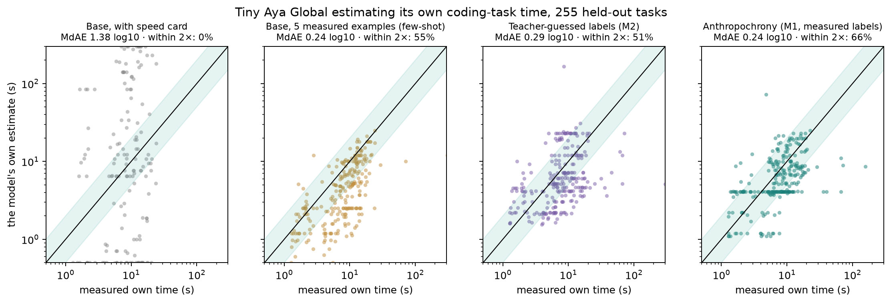
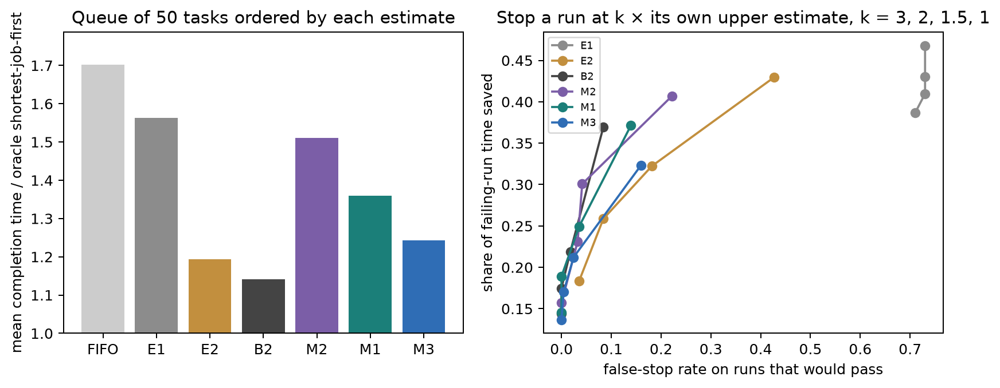

> Detailed results tables and reproduction steps. The short version is the [main README](../README.md).

# Anthropochrony

**Measuring and Correcting Human-Time Bias in LLM Self-Estimates**

*Lexsi AI Safety & Alignment Hackathon — **Track 1 (Fine-tuning and Data Curation)**, Problem **#8 (Data-scarce domains, primary)** + Problem **#2 (Replacing a closed-model API, ROI & accuracy comparison)**.*  
*Pipeline: **CuratorKIT `0.1.23` → AlignTune `0.1.32` → AuditKIT `1.1.6`**. Subject model: `CohereLabs/tiny-aya-global` (`3.35B`) @ `af89d219b53ed9b13b8a4645f9c8028973510324`.*

Ask a coding model *"how long will this task take you?"* and it routinely answers on a human software engineer's clock—minutes, hours, or days for work its own decoding loop finishes in eight seconds. Monperrus and Stenqvist call this *anthropocentric time bias*; **Anthropochrony** is our project name for judging machine runtime with human clocks (we do not claim the phenomenon is new).

**Why out-of-distribution generalization is the real test.** In-distribution—when 5-shot examples come from the same four task families (`FUNC`, `LIB`, `ALGO_FN`, `ALGO_IO`) at one fixed speed—few-shot prompting (`E2`, `0.240` MdAE) and per-family lookup tables (`B1`, `0.123`) look competitive with verbal SFT (`M1-S0`, `0.242`). **Out-of-distribution**, on multi-method stateful classes held 100% out of training (`CLASS`, `test_ood`, `n=93`) or 64× slower serving hardware (`1.5 tok/s`), both shortcuts break (`E2` degrades to **`0.503`**, `B1` to **`0.336`**). Across **1,465 executable Python tasks**, we show:
1. **Fine-tuning teaches genuine workload self-knowledge—especially OOD (`0.314` vs. `0.476` token MdAE on `CLASS`)—whereas verbal time tokens hit an autoregressive arithmetic bottleneck (`0.272` $\text{log}_{10}$ pre-breakdown division error).**
2. **Pairing fine-tuned workload decomposition with an exact timing model (`M1-Struct`, zero retraining)** eliminates verbal division error, cuts unseen `CLASS` OOD error to **`0.269`** (`4.6×` higher Spearman $\rho$, #1 OOD `SJF` queue scheduler), slashes `1.5 tok/s` slow-hardware error **`3.17×`** (`0.492` $\rightarrow$ **`0.155`**), and lifts live desktop CPU wall-clock accuracy (`X10`) from `3%` (`base`) and `52%` (verbal `M1-S0`) to **`63%` within 2×**.

The complete write-up (following all nine hackathon sections and mandatory subheadings) is **[`paper/article.md`](../paper/article.md)**.



---

## Results in brief

All fine-tuned numbers come from **one training seed (`S0`)** across **93 unseen-family class tasks (`test_ood`: `CLASS`)** and **255 held-out in-distribution tasks (`test`)**, evaluated at the reference speed card (`REF`: $S = 96\text{ tok/s}$, $P = 26{,}000\text{ tok/s}$) with 10,000-resample stratified bootstrap 95% CIs. Primary error is $\text{MdAE} = \text{median } |\log_{10}(\hat{t} / t)|$ (`0.301` = factor of `2.0×`; lower is better). Every table reports explicit **`Target source`**: `own` (scored against that checkpoint's own post-SFT re-measured $K = 8$ trajectories) vs. `base` (scored against untuned base $K = 8$ trajectories).

| Estimator | Target source | `test_ood` (`CLASS`, `n=93`) MdAE `[95% CI]` | `test_ood` within 2× | `test_ood` $\rho$ | `test` (`n=255`) MdAE `[95% CI]` | `test` within 2× | `test` $\rho$ |
|---|:---:|---:|---:|---:|---:|---:|---:|
| `E0` Base model, no speed card | `base` | `1.62 [1.55, 1.68]` | `0.0%` | `0.36` | `1.76 [1.73, 1.85]` | `0.4%` | `0.44` |
| `E1` Base model + speed card | `base` | `1.20 [1.14, 1.23]` | `1.1%` | `0.24` | `1.38 [1.32, 1.41]` | `0.4%` | `0.37` |
| `E2` Base + 5 measured examples (few-shot) | `base` | `0.50 [0.38, 0.57]` | `30.1%` | `0.35` | `0.24 [0.21, 0.30]` | `55.3%` | `0.69` |
| `B1` Per-family training median | `base` | `0.34 [0.28, 0.40]` | `46.2%` | — | `0.12 [0.09, 0.14]` | `81.6%` | `0.74` |
| `B4` Frontier teacher (`DeepSeek-V4-Pro`) | `base` | `0.29 [0.26, 0.33]` | `52.7%` | `0.46` | `0.24 [0.21, 0.26]` | `65.1%` | `0.62` |
| **`B2` Static text+embedding GBDT (no LM)** | `base` | **`0.13 [0.11, 0.16]`** | **`81.7%`** | `0.32` | **`0.14 [0.12, 0.16]`** | **`82.7%`** | **`0.80`** |
| `M2-S0` SFT on teacher-guessed labels | `own` | `0.29 [0.23, 0.39]` | `50.5%` | `0.28` | `0.29 [0.26, 0.32]` | `51.4%` | `0.49` |
| `M3-S0` SFT on raw measured labels (frozen)* | `base` | `0.24 [0.19, 0.29]`* | `60.2%` | `0.15` | `0.20 [0.18, 0.23]` | `72.5%` | `0.68` |
| `M3-S0` SFT on raw measured labels (matched)* | `own` | `0.24 [0.19, 0.32]`* | `59.1%` | `0.18` | `0.21 [0.18, 0.24]` | `70.6%` | `0.66` |
| **`M1-S0` SFT on curated measured labels** | `own` | **`0.30 [0.23, 0.40]`** | **`50.5%`** | `0.08` | **`0.24 [0.22, 0.27]`** | **`65.9%`** | `0.57` |
| **`M1-Struct` (workload + exact timing, 0-retrain)** | `own` | **`0.27 [0.20, 0.31]`** | **`58.1%`** | **`0.37`** | **`0.21 [0.18, 0.24]`** | **`71.8%`** | **`0.66`** |
| `M1-Struct + B2` (`val`-selected $w=0.80$, failed vs `B2`)† | `own` | `0.20 [0.16, 0.27]` | `65.6%` | `0.39` | `0.18 [0.14, 0.22]` | `74.1%` | `0.70` |

*\*See `paper/article.md` §7.5 for our forensic audit of `M3-S0` (`+894` extra rows expanding `ALGO_IO` by `+62.4%`, plus `40` historical `CLASS` rows from `raw_extra`—remediated and regression-tested in `splits.py`, `pipeline.py`, and `sft.py`).*  
*†See `paper/article.md` §7.3.1 for why `val` grid search selected $w = 0.80$ (`0.116` on `val` `base` targets) and underperformed standalone `B2` (`0.138` / `0.122`) and untuned `50/50` (`0.159` / `0.180`) on `own` targets.*

### Headline diagnostic: token-workload self-knowledge vs. verbal arithmetic

| Estimator | Target source | `test` token MdAE (2×) | `CLASS` OOD token MdAE (2×) | Bare verbal division error (`test`) | `1.5 tok/s` `extrap-low` MdAE (`test` / `CLASS`) |
|---|:---:|---:|---:|---:|---:|
| `E2` (5-shot base) | `base` | `0.313` (`48.0%`) | `0.476` (`31.2%`) | `0.198` | `0.253` / `0.445` |
| **`M1-S0` (verbal SFT)** | `own` | **`0.268` (`56.1%`)** | **`0.314` (`48.4%`)** | **`0.272`** | `0.492` / `0.728` |
| **`M1-Struct` (workload + exact timing)** | `own` | **`0.268` (`56.1%`)** | **`0.314` (`48.4%`)** | **`0.000` (exact)** | **`0.155` / `0.247`** |

### Key scientific & systems takeaways

1. **Out-of-distribution generalization & confirmatory hypotheses (`H1–H6`):** `H2` (`test` `65.9%` vs. `55.3%` within 2×, Holm $p = 0.0032$), `H3` (unseen `CLASS` OOD `0.300` vs. `0.503`, Holm $p = 0.00025$), `H4` (held-out speeds `0.224`, elasticity `0.801`), `H5` (measured `M1` beats teacher-guessed `M2`, Holm $p = 0.00056`), and `H6a/H6b` (`pass@1` $\Delta$ CI `[-2.2, +3.0]` pp; `0.000` human-frame drift) were met on seed `S0`. **`H1` was not met as pre-registered** (`E0` overestimates `55.3×`, whereas adding a speed card in `E1` stops hour-scale units yet leaves `1.38`-decade dispersion).
2. **Token-bottleneck headline & workload decomposition with an exact timing model (`M1-Struct`):** `M1-S0` predicts its own output tokens significantly better than 5-shot `E2` (`0.268` vs. `0.313` `test`; `0.314` vs. `0.476` `CLASS` OOD), but committing to `Time estimate: T s` *before* emitting `(tokens, attempts)` introduces `0.272` $\text{log}_{10}$ bare arithmetic inconsistency. Evaluating the exact serving formula on `M1-S0`'s emitted `(tokens, attempts)` with `train`-only execution/feedback medians (**`M1-Struct`**, zero retraining) beats **both** `E2` and frontier teacher `B4` on `REF`, lifts `CLASS` OOD Spearman $\rho$ `4.6×` (`0.080` $\rightarrow$ `0.369`), and cuts `1.5 tok/s` error **3.17×** (`0.492` $\rightarrow$ **`0.155`**, `73.7%` within 2×)!
3. **Conformal calibration & downstream systems utility (`M1-Struct+CP`):** Calibrating intervals on `val` (`n = 114`) lifts fresh-trajectory coverage (`2,040` `test` runs) from `17.7%` to **`75.8%`** (`64.9%` on `CLASS` OOD, Winkler `47.4` vs. `94.9`), achieves the **best `CLASS` OOD Shortest-Job-First queue completion time (`1.183×` oracle vs. `1.207×` `E2`, `1.253×` `B2`, `1.377×` `FIFO`)**, cuts `1.0×` timeout false aborts **10.5×** (`13.9%` $\rightarrow$ **`1.33%`**) while saving **`19.9%`** of wasted failing GPU time, and cuts cluster cost by **`26.4%`** (`6.3%` SLA violations vs. `31.2%` Always-Edge) in `15 s` Edge-vs-Datacenter routing.
4. **Live desktop CPU deployment (`X10`, `100` tasks, `llama.cpp` `Q4_K_M` @ `20 tok/s`) & API ROI:** End-to-end CPU wall-clock accuracy within 2× (`Target source = own` live CPU runs) rises from **`3%`** (base) and **`52%`** (`M1-S0` verbal) to **`63%` (`0.224` MdAE)** with `M1-Struct` ($L = 0$ local). On a saturated L40S (`$1.80/h`, `31.2 req/s`), `M1-Struct` costs **`$16.01` per 1M estimates**—beating frontier teacher `B4` (`~$1,700` / 1M, `0.244` / `0.294` MdAE) on accuracy at ~100× lower batched cost (`$452` / 1M for `gpt-5-mini`).



---

## Limitations & negative results (read before using any number above)

- **Single training seed (`S0`)** for `M1`, `M2`, and `M3` (`$26.7` spent under the `$30` compute cap). Differences of `0.02–0.04` $\text{log}_{10}$ across SFT variants do not carry multi-seed error bars.
- **Explicit `val`-selection failure (`M1-Struct + B2`) & OOD shift (`paper/article.md` §7.3.1, §7.4):** Because post-SFT $K = 8$ re-measurement ran on `test` and `test_ood` (`Target source = own`) but not `val` (`Target source = base`), `val` grid search saw `M1-Struct` (`0.123`) edge `B2` (`0.132`) and chose blend weight $w = 0.80$ (`0.116` on `val`). On `test` and `test_ood` `own` targets, that `0.80/0.20` blend (`0.178` / `0.202`) **underperformed both standalone `B2` (`0.138` / `0.122`) and an untuned `50/50` blend (`0.159` / `0.180`)**. Likewise, `val` ranked `B1` (`0.127`) ahead of `B2` (`0.132`) before `B1` collapsed on unseen `CLASS` (`0.336`), and `val`-calibrated split-conformal coverage dropped from `75.8%` (`test`) to `64.9%` (`CLASS` OOD) under covariate shift.
- **Static tabular GBDT (`B2`) beats every standalone LM on static prompt-to-time MdAE (`0.137` `test`, `0.130` `test_ood`).** A fine-tuned self-model is needed when the model must answer conversational `self` vs. `human` queries, rank unseen `CLASS` OOD queues (`1.183×` vs. `1.253×`), or track its own post-update policy; when static prompt features suffice, `B2` is stronger and virtually free.
- **`H1` not met as pre-registered** (`E1` fails via `1.38`-decade noise rather than hour-scale bias).
- **Curation trade-off (`M3` vs. `M1`):** Skipping S1 filtering (`M3`) gave `+62.4%` more `ALGO_IO` rows (plus `40` leaked `CLASS` rows in historical `raw_extra`, now fixed and regression-tested in code) and scored `0.210` (`own` targets) vs. `0.242` for `M1`.
- **Gate `G6` merged-`bf16` parity weakened** (`6/50` near-tied digit flips vs. `fp32` PEFT, logged in `docs/PREREGISTRATION.md` §7 before any `test` run); **`IFEval` (`200` prompts)** moved from `0.750` to `0.700` (`SE ≈ 0.031`), while `ARC-Challenge` (`0.422` vs. `0.425`) and `pass@1` did not move; `gpt-5-mini` accuracy was not measured (cost reference only, whereas `DeepSeek-V4-Pro` was measured on both cost and accuracy).

---

## Quick reproduction (CPU, no GPU, no credentials)

Rebuild the headline confirmatory table, verify exact `1e-9` agreement against `results/metrics.json`, recompute the workload + exact-timing diagnostics, `val`-selection audit, conformal calibration, and systems simulations, redraw all 7 figures, and run the reproduction notebook on CPU:

```sh
git clone https://github.com/isHeSatoshi/anthropochrony && cd anthropochrony
. ./env.sh                      # sets repo-local caches & bubblewrap path; never sets HF_HOME
uv sync --locked --extra demo
uv run python scripts/fetch_release.py   # public Hub release -> data/ (pinned revisions)
uv run pytest -q                # runs full unit + bubblewrap sandbox security suite
make eval && make figures       # recomputes metrics, extra-analyses, simulations & F1-F7
uv run python scripts/run_notebook.py
```

`scripts/fetch_release.py` downloads the published datasets from the Hub at pinned revisions (`isHeSatoshi/anthropochrony-tasks`, `-eval`, `-traces`) into `data/`, which is gitignored because it holds measured trajectories. Everything else — code, `results/`, figures, the paper — is in the repository.

The notebook reads `results/analysis_rows.jsonl` from `ANTHROPOCHRONY_DATA` if you point it at a local directory, otherwise it downloads `results/*` from `isHeSatoshi/anthropochrony-eval`. CI runs both jobs: it fetches the public release, asserts the released data reproduces `results/metrics.json` to `1e-9` across all 36 estimator × split × target-source groups, builds the workbench from the release, and executes the notebook end to end.

---

## Interactive 4-Tab Workbench (`make demo`)

`space/app.py` provides a **zero-GPU 4-tab Gradio workbench** backed by all 348 held-out (`test` + `CLASS` `test_ood`) empirical benchmarks, plus optional live `llama.cpp` GGUF execution:

1. **Tab 1 — Hardware Physics & Workload + Exact-Timing Explorer:** Pick any held-out task and dial decode speed (`1–5,000 tok/s`), prefill speed, and network latency (`0–1,500 ms`) to inspect how `E1`, `E2`, `B4`, `B2`, `M2-S0`, `M1-S0`, `M1-Struct`, and conformal `M1-Struct+CP` compare against real $K = 8$ trajectories (with explicit `Target source` labels).
2. **Tab 2 — Safe Prompt Workload Simulator (Zero Code Execution):** Paste any custom Python task specification to get instant `AST` + `B2` workload decomposition + exact timing predictions, conformal SLA timeout bounds, and human-clock vs. machine-clock multipliers without executing untrusted code.
3. **Tab 3 — Live Systems & Fleet ROI Simulator:** Configure SLA deadlines (`5–60 s`), Edge (`$0.25/h`) vs. Datacenter (`$1.80/h`) GPU pricing, and monthly request volume (`10k–50M`) to evaluate cluster violation rates, timeout savings, and API vs. self-hosted ROI.
4. **Tab 4 — Live Local `llama.cpp` GGUF + Bubblewrap Sandbox (Optional):** Connect local `base` and `m1-s0` `llama-server` GGUF endpoints to measure live hardware speed via `llama-bench` and compare live estimates against real sandboxed execution of verified tasks.

```sh
# Zero-GPU interactive benchmark, AST simulator & SLA/ROI workbench:
. ./env.sh
make demo

# Optional: attach live local llama.cpp GGUF servers for Tab 4:
llama-server -m base-q4_k_m.gguf  --port 8081 &
llama-server -m m1-s0-q4_k_m.gguf --port 8082 &
ANTHROPOCHRONY_BASE_URL=http://127.0.0.1:8081 ANTHROPOCHRONY_TUNED_URL=http://127.0.0.1:8082 \
ANTHROPOCHRONY_GGUF=m1-s0-q4_k_m.gguf ANTHROPOCHRONY_LLAMA_BENCH=$(which llama-bench) \
  make demo
```

---

## Full training & measurement pipeline

Re-running generation and training from scratch uses HF Jobs (`l40sx1` @ `$1.80/h`) plus HF Inference Providers (`$26.7` total spend inside the `$30` cap). Model-written candidate Python runs **only** inside the local credential-free `bubblewrap` sandbox, never inside cloud jobs.

| Stage | Command | Where | Cost / time |
|---|---|---|---|
| Environments & gates `G0` | `make setup exec-env && make smoke preflight` | local | minutes |
| Task pool (`CuratorKIT`) | `make tasks LOCAL_DATA=…` | local | ~10 min |
| Speed calibration | `make calibrate` | HF Jobs | ~$1.5 |
| Base trajectories ($K=8$, `11,720` runs) | `make measure RUN=base PHASE=full` | HF Jobs + local sandbox | ~$4.5 |
| Labels, `B0–B2+` baselines, noise ceiling | `make labels baselines` | local | minutes |
| Base (`E0–E4`) & teacher (`B4`) estimates | `anthropochrony estimate-run …`, `anthropochrony teacher` | HF Jobs / Providers | ~$1.4 + $1.7 |
| SFT curation (`CuratorKIT`) | `make sft-data VARIANT=m1` (`m2`, `m3`) | local | minutes |
| LR sweep + LoRA SFT (`AlignTune`) | `make train VARIANT=m1 SEED=0` (`m2`, `m3`) | HF Jobs | ~$1.2 sweep; $2.2–2.7/run |
| Closed-loop re-measurement & eval (`AuditKIT`) | `make remeasure RUN=m1-s0 PHASE=full && make eval && make figures` | HF Jobs + local | ~$1.2/model + ~5 min CPU |
| Capability benchmarks (`AuditKIT`) | `anthropochrony lmeval …` | HF Jobs | ~$0.4–1.0/model |

Every stage fails closed if prior gate evidence (`results/gates/`) or the frozen pre-registration tag (`prereg-v1`) check fails.

---

## Sandbox, pins, and licenses

- **Two isolated environments:** `stack` (Python `3.12`, `uv.lock`, `CuratorKIT 0.1.23`, `AlignTune 0.1.32`, `AuditKIT 1.1.6`, `transformers 5.21.1`) and `exec` (Python `3.10`, `src/anthropochrony/execenv/requirements.lock`) mounted read-only inside `bubblewrap` (`--unshare-net`, `--clearenv`, CPU/RAM/FD `rlimits`). Security isolation is verified by `pytest -m security`.
- **Licenses:** Repository code is **[Apache-2.0](../LICENSE)**. `CohereLabs/tiny-aya-global` and all derived adapters/GGUFs carry **CC-BY-NC-4.0** + the [Cohere Labs Acceptable Use Policy](https://docs.cohere.com/docs/c4ai-acceptable-use-policy) (non-commercial). `CuratorKIT` (LSAL v1.1), `AuditKIT` (LSAL v1.2), and `ClassEval` (CC BY-NC 4.0) are non-commercial; `AlignTune` is MIT. Third-party statements (`LeetCodeDataset`, `CodeContests`, `TACO`) are automatically redacted to task IDs + `rebuild_task` loaders (`src/anthropochrony/release.py`).

## Repository layout

```text
src/anthropochrony/   tasks, sandbox, gen, measure, timemodel, labels, baselines,
                      curate, train, eval (metrics, structured, extra), sim, plots,
                      release, demo, workbench
jobs/                 HF Jobs entrypoints (vLLM generation, AlignTune SFT, AuditKIT lmeval)
scripts/              ROI calculator, X10 CPU runner, G6 parity check, notebook builder/runner
configs/              speed cards, dataset/model pins, measurement & baseline configs
docs/                 PLAN, PREREGISTRATION (frozen tag prereg-v1), PROMPTS, HACKATHON_REQUIREMENTS
results/              metrics, hypotheses, extra-analyses, simulations, roi, proj8, gates
paper/                article.md, submission_fields.md, and figures F1–F7
notebooks/            reproduce_results.ipynb (CPU reproduction & verification)
space/                4-tab Gradio workbench (app.py)
tests/                unit, leakage/conformal regression, workbench, and sandbox security tests
```

## Citation

```bibtex
@misc{anthropochrony2026,
  title  = {Anthropochrony: Measuring and Correcting Human-Time Bias in LLM Self-Estimates},
  author = {isHeSatoshi},
  year   = {2026},
  note   = {Lexsi AI Safety and Alignment Hackathon, Track 1}
}
```
