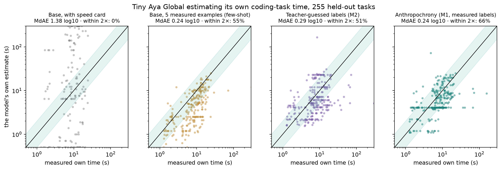

# Anthropochrony: Measuring and Correcting Human-Time Bias in LLM Self-Estimates

**Ask a coding model how long a task will take and it answers in human time. We measured the gap on 1,465 tasks and fixed most of it.**

_Built for the Lexsi AI Safety & Alignment Hackathon, Track 1 (Fine-tuning and Data Curation), problems 8 and 2. Independent project. Monperrus and Stenqvist described anthropocentric time bias in LLMs; we did not discover the phenomenon._

**[Write-up](../paper/article.md)** · **[Judge guide](JUDGES.md)** · **[Full tables and reproduction](README-full.md)** · **[Use it in your agent](USAGE.md)** · **[Models on Hugging Face](https://huggingface.co/collections/isHeSatoshi/anthropochrony-models-6af31e769e666b4001e8c5f2)** · **[Data on Hugging Face](https://huggingface.co/collections/isHeSatoshi/anthropochrony-data-6af31e776d6f33265b0c33a8)** · **[Run it on your CPU](#run-it)**



Tell a coding agent (`CohereLabs/tiny-aya-global`, 3.35B) to write a small Python function and its decoding loop finishes in about eight seconds. Ask the same model how long that task will take and it says seven minutes, or two hours. It answers on a human developer's clock. Across 1,465 executable tasks, the base model overestimated its own runtime by 55x on held-out tasks (median 424 s vs ~8 s real). Adding a speed card with its decoding throughput barely helped because the model mostly ignored the number, leaving a 24x typical error and 0.4% of estimates within 2x of real time.

That gap breaks job queues, timeout tripwires, and edge-to-datacenter routing whenever an orchestrator uses the model's self-estimate.

## What the user sees

On the reference speed card (`REF`, 96 tok/s decode, 26,000 tok/s prefill, 0.967 s per-call latency), here are seven held-out `test` tasks in seconds:

| Task | Real (s) | Base, human prompt (`E0`) | Base + speed card (`E1`) | Feature regressor (`B2`) | Tuned verbal (`M1`) | Workload + formula (`M1-Struct`) |
|---|--:|--:|--:|--:|--:|--:|
| `HumanEval/138` (even-sum check) | 2.3 | 424 | 0.5 | 3.7 | 3.7 | 4.8 |
| `HumanEval/95` (dict-case check) | 1.9 | 424 | 0.5 | 4.4 | 4.1 | 4.3 |
| `HumanEval/41` (car collisions) | 8.5 | 300 | 0.5 | 5.1 | 4.1 | 3.9 |
| `HumanEval/116` (sort by ones) | 3.3 | 424 | 0.5 | 5.3 | 3.7 | 3.3 |
| `BigCodeBench/845` (text similarity) | 11.2 | 424 | 0.5 | 15.8 | 16.0 | 15.2 |
| `BigCodeBench/903` (linear regression) | 11.3 | 300 | 0.5 | 8.5 | 7.7 | 7.9 |
| `BigCodeBench/222` (cumulative sum plot) | 12.8 | 424 | 0.5 | 11.4 | 6.7 | 15.2 |

On a desktop CPU running 4-bit `llama.cpp` (`Q4_K_M`, 20 tok/s decode, 210 tok/s prefill) across eight multi-requirement coding tasks (`PROJ-8`):

| Project task | Real CPU wall-clock | Base self-estimate | Tuned verbal (`M1`) |
|---|--:|--:|--:|
| `PROJ8-csv-report` | 99 s (1.6 min) | 424 s (7.1 min) | 126 s (2.1 min) |
| `PROJ8-notes-api` | 123 s (2.0 min) | 1,039 s (17.3 min) | 150 s (2.5 min) |
| `PROJ8-url-shortener` | 129 s (2.1 min) | 424 s (7.1 min) | 126 s (2.1 min) |
| `PROJ8-snake` | 162 s (2.7 min) | 2,546 s (42.4 min) | 126 s (2.1 min) |
| `PROJ8-todo-cli` | 194 s (3.2 min) | 2,546 s (42.4 min) | 150 s (2.5 min) |
| `PROJ8-lru-cache` | 199 s (3.3 min) | 1,039 s (17.3 min) | 132 s (2.2 min) |
| `PROJ8-markdown` | 226 s (3.8 min) | 2,546 s (42.4 min) | 126 s (2.1 min) |
| `PROJ8-bank-ledger` | 271 s (4.5 min) | 8,818 s (147 min) | 270 s (4.5 min) |

## How it works


We ran `tiny-aya-global` (3.35B) as a sandboxed coding agent across 1,465 Python tasks (`K=8` trajectories, up to 3 attempts each) and recorded token counts, attempts, and execution times. `CuratorKIT 0.1.23` filtered and balanced 6,077 SFT rows across hardware speed cards (`train` tasks only; `CLASS` held out as an unseen task family). `AlignTune 0.1.32` trained rank-16 QLoRA adapters on measured labels (`M1`) and frontier-teacher guesses (`M2`, `DeepSeek-V4-Pro`). `AuditKIT 1.1.6` scored all estimators against pre-registered gates (`prereg-v1`), re-measuring each SFT checkpoint on its own held-out trajectories (`own` targets).

Inspecting `M1`'s outputs exposed why verbal fine-tuning hits a ceiling. `M1` predicts its own output tokens better than 5-shot prompting (`0.268` vs `0.313` log10 error on `test`; `0.314` vs `0.476` on unseen `CLASS`), yet fails at division because it writes the headline time before the token count (`0.272` log10 bare division error). On 1.5 tok/s hardware, `M1` wrote "550 tokens at 1.5 tok/s ≈ 2.1 min" when 550 / 1.5 is 6.1 minutes. `M1-Struct` keeps `M1`'s predicted tokens and attempts, drops the verbal time, and computes seconds with the exact timing formula using train-only execution medians and zero retraining.

## Results

Typical error is median $|\log_{10}(\text{estimate} / \text{real})|$ (multiplier $10^{\text{MdAE}}$ in parentheses; 0.30 is 2.0x, lower is better). We lead with the unseen multi-method class family (`test_ood`, `CLASS`, n=93) alongside familiar task families (`test`, n=255) on `REF`:

| Estimator | Target | Unseen family `CLASS` (n=93) MdAE | `CLASS` within 2x | Familiar `test` (n=255) MdAE | `test` within 2x |
|---|---|--:|--:|--:|--:|
| `E0` Base, human prompt | `base` | 1.62 (41.6x) | 0.0% | 1.76 (57.5x) | 0.4% |
| `E1` Base + speed card | `base` | 1.20 (15.8x) | 1.1% | 1.38 (23.7x) | 0.4% |
| `E2` 5-shot base model | `base` | 0.50 (3.18x) | 30.1% | 0.24 (1.74x) | 55.3% |
| `B1` Per-family lookup table | `base` | 0.34 (2.17x) | 46.2% | **0.12 (1.33x)** | 81.6% |
| `B2` Static feature regressor (GBDT) | `base` | **0.13 (1.35x)** | **81.7%** | 0.14 (1.37x) | **82.7%** |
| `B4` `DeepSeek-V4-Pro` (closed frontier) | `base` | 0.29 (1.97x) | 52.7% | 0.24 (1.75x) | 65.1% |
| `M2` Tuned on teacher guesses | `own` | 0.29 (1.93x) | 50.5% | 0.29 (1.94x) | 51.4% |
| `M1` Tuned on curated measured runs | `own` | 0.30 (2.00x) | 50.5% | 0.24 (1.75x) | 65.9% |
| `M1-Struct` `M1` workload + timing formula | `own` | 0.27 (1.86x) | 58.1% | 0.21 (1.63x) | 71.8% |

The per-family lookup table (`B1`) and static feature regressor (`B2`) beat the tuned model on familiar tasks, and `B2` also achieves the lowest point error on the unseen `CLASS` family (`0.13`, Spearman $\rho = 0.32$). Among language-model estimators, 5-shot prompting (`E2`) ties verbal SFT on familiar tasks (`0.24`) and breaks on the unseen family (`0.50`, `30.1%` within 2x). `M1-Struct` cuts unseen-family error to `0.27` (`58.1%` within 2x, lifting Spearman $\rho$ 4.6x over verbal `M1` from `0.08` to `0.37`), beats `DeepSeek-V4-Pro` (`B4`) on both splits, and tracks hardware speed when throughput shifts 64x down to slow edge hardware or local CPU:

| Hardware regime | Metric | Base (`E1`) | Tuned verbal (`M1`) | `M1-Struct` |
|---|---|--:|--:|--:|
| Slow hardware (`extrap-low`, 1.5 tok/s, `test`) | MdAE (within 2x) | 1.60 (23.1%) | 0.49 (24.7%) | **0.16 (73.7%)** |
| Slow hardware (`extrap-low`, 1.5 tok/s, `CLASS` OOD) | MdAE (within 2x) | 0.58 (17.2%) | 0.73 (11.8%) | **0.25 (67.7%)** |
| Speed elasticity across cards (`1.00` is exact) | Slope on `test` / `CLASS` | 0.12 / 0.13 | 0.80 / 0.79 | **1.01 / 0.98** |
| Live desktop CPU (`X10`, `llama.cpp` 20 tok/s, n=100) | MdAE (within 2x) | 0.94 (3.0%) | 0.28 (52.0%) | **0.22 (63.0%)** |
| Live consumer GPU (`X10`, same 100 tasks, RTX 4060 Ti, 100 tok/s) | MdAE (within 2x) | 1.67 (1.0%) | 0.24 (61.0%) | 0.24 (60.0%) |
| CPU-to-GPU speedup, same 100 tasks (actual 5.95x) | Predicted speedup (within 2x) | 1.11x (1.0%) | 3.04x (44.0%) | **5.29x (82.0%)** |

On the live `X10` rows the base model is asked without a speed card (`E0`). Sources: `results/extra-analyses.json` (`x10_cpu_deployment_struct`, `x10_gpu_deployment_struct`, `x10_hardware_tracking`).

## Where this goes

Ordering a 30-job queue on unseen `CLASS` tasks by shortest predicted duration (`SJF`) brings mean completion time to `1.18x` the oracle with `M1-Struct` (tied with frontier `B4` at `1.18x`), ahead of `E2` (`1.21x`), `B2` (`1.25x`), verbal `M1` (`1.28x`), and `FIFO` (`1.38x`). Adding `val`-calibrated split-conformal intervals (`M1-Struct+CP`) raises fresh-trajectory 80% interval coverage from `17.7%` to `75.8%` on `test` (`64.9%` on `CLASS`), cuts timeout false aborts on passing runs 10.5x from `13.9%` to `1.3%` while saving `19.9%` of failed-run GPU time, and cuts 15-second edge-vs-datacenter SLA violations from `31.2%` to `6.3%` at `26.4%` lower cost than always-datacenter (`$2.04` vs `$2.77` per 1,000 runs). Self-hosting `M1-Struct` on an L40S (`$1.80/h`, `31.2 req/s`) costs `$16.01` per million batched estimates against `$452.20` for `gpt-5-mini` and `~$1,700` for `DeepSeek-V4-Pro`.

## Run it

```bash
uv sync && make figures                  # regenerate tables and figures from released data on CPU
uv run python scripts/fetch_release.py   # pull public Hub datasets and adapters
make demo                                # launch the 4-tab local Gradio CPU workbench
uv run anthropochrony estimate --task task.md --speed S,P --human   # ask a local llama-server
```

[`docs/USAGE.md`](USAGE.md) shows how to serve the released GGUF, measure your speed card, and use the estimate as an agent timeout.

## Limits

We trained one seed (`S0`) per model under the hackathon compute cap ($30.2 spent in total), so small gaps between estimators are noisy. The uncurated ablation `M3` had held-out `CLASS` tasks leaked into its training pool (`40` SFT rows from `6` `ClassEval` tasks in `raw_extra`) and was not retrained, so we draw no conclusions from `M3`. `M1-Struct` was designed post-hoc after inspecting `M1`'s verbal arithmetic errors and was not pre-registered. Pre-registered hypothesis `H1` was not met as stated because adding a speed card alone stopped hour-scale units while leaving 1.38 log10 error. We do not host a live Hugging Face Space; the 4-tab Gradio workbench runs locally on CPU via `make demo`. All experiments test a single 3.35B subject model (`CohereLabs/tiny-aya-global`), and IFEval strict accuracy dipped 5.0 points after fine-tuning (`75.0%` to `70.0%`, first 200 prompts) while `pass@1` held steady (`-2.2` to `+3.0` pp 95% CI).
