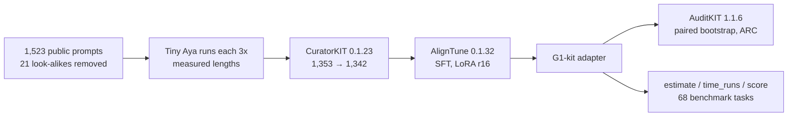

# Anthropochrony: a 3B model that knows how long its own answers take

An adapter for Cohere Labs' Tiny Aya Global (3.35B), built end to end by CuratorKIT → AlignTune → AuditKIT from measurements of the model itself, estimates the model's own running time on a public benchmark with a typical miss of 1.55x. The published self-estimates of GPT-5.5 and Claude Opus 4.8 miss theirs by 3.47x and 2.87x.

**Author:** [@isHeSatoshi](https://huggingface.co/isHeSatoshi) (solo) · **Code:** https://github.com/isHeSatoshi/anthropochrony · **Models:** [HF collection](https://huggingface.co/collections/isHeSatoshi/anthropochrony-self-time-models-6af986a95a140f4184fae18f) · **Data and logs:** [HF collection](https://huggingface.co/collections/isHeSatoshi/anthropochrony-self-time-data-6af986a99994d1dfbbad03aa)

> **For judges: one minute.**
> Asked how long a task will take them, GPT-5.5 and Claude Opus 4.8 answer on a human clock and say about three times too long on the 68 single-turn tasks of the public MetaTime benchmark (12% and 25% of their estimates within 2x). We ran Tiny Aya Global on public prompts, gated the measurements with CuratorKIT (1,353 → 1,342 prompts), trained a LoRA adapter, `G1-kit`, with AlignTune, and evaluated it with AuditKIT. With its machine's speed stated, the same model goes from a median absolute log error of **1.71** (5.5x off, 4% within 2x) to **0.44** (1.55x off, 72% within 2x, 95% CI 0.38 to 0.51) against its own timed runs. It is closer than GPT-5.5 on 60 of 68 tasks and closer than Claude Opus 4.8 on 55, and both paired 95% intervals exclude zero, which was the success criterion pushed to GitHub before the first estimate.
>
> The caveats matter. Each model is judged on its own clock, and ours is told its speed; asked cold it scores 1.53, worse than both frontier models. Claude Opus 4.8 ranks tasks better (r 0.81 against 0.71). There was one training run, and the adapter costs about 2 points of ARC accuracy when switched on. Checking the numbers takes two minutes on a CPU: `uv sync --locked && uv run pytest && uv run python scripts/run_notebook.py`.

## Tracks and problem statements

- Track 1: Fine-tuning and Data Curation (CuratorKIT → AlignTune → AuditKIT).
- Problem statement 2, *Replacing a closed-model API*: a small open model replaces frontier models on a question they are often asked (how long a job will take), with better accuracy and lower cost (§8).
- Other: self-knowledge and calibration, measured against the model's own clock.

The write-up contains no harmful or NSFW content.

## Abstract

Language models estimate their own running time on a human clock. They say "a few minutes" for work they finish in seconds, because their training text describes how long people take. These estimates feed job queues, timeouts, routing between machines and what users are told. On the 68 single-turn tasks of the public MetaTime benchmark, the published self-estimates of GPT-5.5 and Claude Opus 4.8 are typically 3.47x and 2.87x off their measured times.

We taught Cohere Labs' Tiny Aya Global (3.35B) its own clock with the track's full pipeline and no teacher model. The untrained model answered each of 1,523 public instruction prompts three times, after we removed 21 prompts that resembled a benchmark task, and we recorded the length of every answer. CuratorKIT gated the 1,353 training prompts (1,342 passed). AlignTune trained a LoRA adapter, `G1-kit`, to answer the time question in two steps: the tokens it expects to read and write, then the seconds at the machine speed stated in its prompt. AuditKIT evaluated the result.

The tasks, the benchmark's question and parser, the metrics and the success criterion were pushed to GitHub before the first estimate. Against its own timed runs, the same model's median absolute log error falls from 1.71 to 0.44 (typical miss 5.5x → 1.55x; within 2x 4% → 72%). It is closer than GPT-5.5 on 60 of 68 tasks and closer than Claude Opus 4.8 on 55, with both paired 95% intervals excluding zero, so the declared criterion is met. When told another machine's speed, its estimates scale with it across a 270-fold range. AuditKIT's paired bootstrap confirms the gain (mean log error 1.78 → 0.50, p = 0.001) and also finds a cost: ARC accuracy drops by about 2 points (Easy 73.0% → 71.1%, Challenge 42.2% → 40.2%), so the adapter should be switched on only for the time question. A thousand estimates cost 3 to 5 cents of GPU time, against at least 57 to 60 cents at frontier list prices.

Each model is judged on its own clock, and ours is told its speed; asked cold, it scores 1.53, worse than both frontier models. Claude Opus 4.8 ranks tasks better (r 0.81 against 0.71). The study covers one training run, one model, one consumer GPU and English single-turn tasks. All compute was local and cost nothing.

## 1. Problem and approach

### 1.1 Why this problem

Systems that run models need to know how long work will take: to order a queue, to decide when a run has hung, to send a task to a phone or a server, or to tell a customer when to expect an answer. More and more often they ask the model, and the model replies with a human's time. MetaTime (anonymous ICLR 2027 submission, OpenReview `CAQeizWcB2`) measured this for frontier models, and Monperrus and Stenqvist call it anthropocentric time bias. We did not discover the problem. What we add is the observation that a model's running time costs nothing to measure, so the model can label its own training data, and the track's pipeline can clean that data, train on it and audit the result.

We asked four questions. Can a 3B open model, trained by CuratorKIT → AlignTune only on measurements of itself on public prompts, estimate its own time on unseen benchmark tasks better than frontier models estimate theirs? This is the primary question, with a criterion fixed in advance. Does the estimate follow the hardware when a different speed is stated? How much of the gain comes from the adapter rather than the stated speed, a calibrated average, or what the untrained model already knows? And what does the adapter cost in general ability?

### 1.2 Declared in advance

[`docs/PREREGISTRATION.md`](../docs/PREREGISTRATION.md) holds every declaration word for word, with the commit that pushed it. The first entry (commit [`077c0bf`](https://github.com/isHeSatoshi/anthropochrony/commit/077c0bf6d688f36611048226fede108702c000f0), 2026-11-14 05:23 UTC) fixed the 68 tasks, the benchmark's question and parser, the target (median of 5 timed runs), the metrics and the success criterion: lower median absolute log error than both frontier models, with the paired 95% interval excluding zero. That criterion was first applied to an earlier adapter trained by our own PyTorch loop rather than by the track's libraries; that adapter is not part of this submission, and the log keeps its records. `G1-kit` was declared with every setting before training ([`ae0e22a`](https://github.com/isHeSatoshi/anthropochrony/commit/ae0e22a2159b5dd62bd7cae0136fda190eadcd40)), its cost method before AuditKIT ran ([`1fdef8e`](https://github.com/isHeSatoshi/anthropochrony/commit/1fdef8e42add503ee2fc460bab445ee81fcd890f)), and its headline and secondary rows before they were run ([`2327466`](https://github.com/isHeSatoshi/anthropochrony/commit/2327466f0e5850b3577e1a979d6189addc89de92)). Because the benchmark had already been used once, all `G1-kit` rows are post-hoc in the strict sense.

### 1.3 Approach

We collect public prompts, drop anything resembling a benchmark task, run the untrained model three times on each and record the prompt and response token counts. CuratorKIT gates this pool. AlignTune then teaches the model to answer the time question as `Prompt: about 380 tokens. Response: about 520 tokens.` followed by `Time: 15.4 seconds`. Each training example states a machine speed $(S, P)$, the writing and reading rates in tokens per second, drawn from a wide range, and the time in the target answer is $t = n_{\text{in}}/P + n_{\text{out}}/S$ computed from the measured counts. Replay examples, in which the target is the model's own ordinary response, keep the predicted lengths from drifting. On the benchmark we state the speed measured on this GPU, ask the benchmark's question about each task's short description, read the time with the benchmark's parser and compare it with the median of five timed runs of the same model.

On this machine the speed formula reproduces measured wall time almost exactly (median absolute log error 0.007 for `G1-kit`'s runs), so the real difficulty is predicting how much the model will write.

### 1.4 Related work

MetaTime (OpenReview `CAQeizWcB2`; artifact `anonymous.4open.science/r/Time-Estimation-B286`) measures frontier models' estimates of their own time on single-turn, agentic and long-horizon suites. Its Table 22 trains Qwen3-8B on the same 68 single-turn tasks and reaches a best raw-duration correlation of 0.44. Garikaparthi et al. (arXiv 2604.00010) wrote the single-turn suite. Monperrus and Stenqvist name anthropocentric time bias in coding agents. AgentTime and related benchmarks study agent trajectories, which we do not run. The calibrated range in §7.5 uses split-conformal prediction (Vovk et al.; Romano, Patterson and Candès 2019).

## 2. Hackathon repos and how they connect



One run chains the three libraries (`scripts/metatime/curate.py` → `train_aligntune.py` → `audit.py`). CuratorKIT writes the ids of the prompts that passed, AlignTune trains only on those and saves the adapter, and AuditKIT loads that adapter for both its benchmark evaluation and its lm-eval run. Our own scripts ask the benchmark question with the same adapter, time its runs and score it with the benchmark's metrics.

**CuratorKIT 0.1.23** gates the measured pool before training. Each training prompt becomes an Alpaca-format sample with the model's first measured response as output and the measured lengths as metadata. We used the `Curator`/`CuratorConfig` pipeline with its JSONL reader, `SchemaGate`, `ExactDeduplicator`, `MinHashDeduplicator` (threshold 0.7, seed 20261115), `SecretsGate`, the `messages` exporter, and its manifest, provenance record and HF README writer. Our own rule runs as a `preprocessing_fn` hook and drops a prompt when any measured run stopped at the 2,048-token cap, since that label is only a lower bound, or when the response is empty. Cleaning is off (`clean=False`) because the labels were measured on the exact prompt text.

**AlignTune 0.1.32** trains `G1-kit` through `create_sft_trainer` with the TRL backend, PEFT LoRA, `assistant_only_loss`, gradient checkpointing, bf16, a cosine schedule with warm-up, seeds and `group_by_length`. We pass the conversations to its trainer directly, because its data manager folds the system turn, which carries the stated speed, into the user turn. After training, a check on the collator's real tensors confirms that the loss covers the answer tokens and nothing else.

**AuditKIT 1.1.6** evaluates the untrained model and `G1-kit` on the 68 tasks through `evaluate` with a callable model and three custom scorers built with `@scorer` and `Direction` (absolute log error of the parsed time against the untrained model's median timed run, within 2x, and parsed). We also used `RunConfig` fingerprints, `compare(...).significance()` for the paired bootstrap, and `run_lmeval` for zero-shot ARC-Easy and ARC-Challenge with the adapter loaded through `peft=`. Every answer AuditKIT collects matches the answer `estimate.py` wrote for the same task. AgentTune, SafeTune and CircuitKIT belong to other tracks and were not used.

## 3. Models and licenses

| Model | Role | Version and license |
|---|---|---|
| `CohereLabs/tiny-aya-global` (3.35B, dense) | Base model and executor of every timed run | revision `af89d219b53ed9b13b8a4645f9c8028973510324`, bf16, PyTorch `transformers`, unquantized on GPU; CC-BY-NC-4.0 + Cohere Labs Acceptable Use Policy |
| `G1-kit` | Our LoRA adapter (r 16, 121 MB) | this work; CC-BY-NC-4.0 |
| Q4_K_M GGUFs of the base model and merged `G1-kit` | CPU demo (llama.cpp `b12110`) | this work; CC-BY-NC-4.0 |
| GPT-5.5, Claude Opus 4.8 | Closed-model baselines: published per-task estimates and times from the MetaTime artifact (snapshot 8 Oct 2026); not called by us | proprietary; numbers only |
| `BAAI/bge-small-en-v1.5` | Frozen encoder for one baseline regressor | pinned in `uv.lock`; MIT |

There is no teacher model. Every training label is a measurement of the base model itself.

## 4. Data, benchmarks and licenses

| Source | License | Train | Held out | Passed CuratorKIT |
|---|---|--:|--:|--:|
| `databricks/databricks-dolly-15k` | CC-BY-SA-3.0 | 494 | 56 | 490 |
| `HuggingFaceH4/no_robots` | CC-BY-NC-4.0 | 393 | 53 | 391 |
| `sahil2801/CodeAlpaca-20k` | CC-BY-4.0 | 289 | 38 | 288 |
| `openai/gsm8k` | MIT | 87 | 13 | 86 |
| 100 coding tasks from this project's earlier study (`isHeSatoshi/anthropochrony-tasks`) | CC-BY-NC-4.0 | 90 | 10 | 87 |
| **Total** | | **1,353** | **170** | **1,342** |

We sampled 1,551 prompts at pinned revisions (`scripts/metatime/build_pool.py`), kept 1,544 after length limits and deduplication, and removed 21 in the leak check, leaving 1,523. The untrained model ran each prompt three times (bf16, model-card sampling, 2,048-token cap), 4,569 runs in all, and the training label is the median response length. Pool and benchmark are English only, although Tiny Aya Global covers about 70 languages.

The test set is the 68 single-turn tasks of the MetaTime artifact (12 code generation, 8 creative, 8 debugging, 8 Q&A, 12 reasoning, 10 summarization, 10 writing). We do not redistribute them: the scripts download the artifact at run time, and the committed records contain task ids, numbers and our model's answers but no task text. Before training, we removed every pool prompt with a TF-IDF cosine similarity of 0.25 or more to any benchmark prompt or description (21 prompts, such as short stories, a haiku, a Fibonacci function and palindrome checks). No benchmark task, response or duration was used for training, model selection or calibration. ARC-Easy and ARC-Challenge (English, zero-shot) serve as a retention check, not as the focus task.

CuratorKIT removed 11 prompts:

| Stage | In → out | Removed and why |
|---|--:|---|
| Reader + our cap hook | 1,353 → 1,343 | 10 prompts with a run stopped at the 2,048-token cap (4 Dolly, 2 no_robots, 1 CodeAlpaca, 1 GSM8K, 2 of ours) |
| `SchemaGate`, `ExactDeduplicator`, `MinHashDeduplicator` (0.7) | 1,343 → 1,343 | none |
| `SecretsGate` | 1,343 → 1,342 | 1 "Base64 High Entropy String" in one of our coding tasks |

The pool had already been deduplicated and leak-checked, so the deduplicators confirmed it rather than changed it. The cap rule matters more than its count suggests, because those 10 prompts have the longest answers, and a lower-bound label would teach the model to under-estimate. The full report is `curatorkit/report.json` in the [dataset](https://huggingface.co/datasets/isHeSatoshi/anthropochrony-metatime-data).

## 5. Metrics

Each metric compares an estimate $\hat t$ with the measured time $t$ (median of the timed runs) for each task. Scoring uses the benchmark's own parser, and no LLM judge is involved.

| Metric | Better | Why |
|---|---|---|
| Median absolute log error, $\mathrm{median}\,\lvert\ln(\hat t/t)\rvert$ (primary, from the benchmark) | lower | Times span about 1 s to 50 s here and minutes for hosted models; a ratio is fair across deployments. 0.69 is a factor of 2 |
| Typical factor off, $e^{\text{error}}$ | lower | The same number in plain words |
| Median estimate/actual ratio | closer to 1 | Separates systematic bias from noise |
| Pearson r on log durations | higher | Whether long tasks are told apart from short ones |
| Within 2x | higher | Good enough to set a timeout or a queue order |
| Mean absolute error (s) | lower | Depends on deployment speed, so not comparable across models |
| Parsed | higher | An unreadable answer is a miss |
| Paired bootstrap difference (5,000 draws over tasks) | negative | The declared test |
| Response-length drift on held-out prompts | near 0 | Should not get worse: how much the model writes |
| ARC-Easy, ARC-Challenge accuracy | not lower | Should not get worse: general ability |

## 6. Method

**Training examples.** Each training prompt yields four estimate examples and one replay example, so 1,342 prompts give 5,368 estimate and 1,342 replay examples. An estimate example combines a stated speed from one of four deployment profiles (CPU, edge GPU, datacenter GPU, accelerator; writing speeds from 2 to 2,500 tokens a second, never inside the held-out band of 150 to 260), one of six speed-line phrasings (a seventh, used for every reported estimate, is never trained on), either the short description or the full prompt, a weighted choice of question wording, and the answer computed from the measured lengths. Stated speeds are rounded to two significant digits, as at test time.

**Training.** AlignTune SFT with the TRL 1.7.1 backend: LoRA r 16, alpha 32, dropout 0.05 on all seven attention and MLP projections (30.2M trainable parameters); learning rate 2e-4, cosine, 5% warm-up, weight decay 0.01; 2 epochs; batch 1 with 16 accumulation steps; 1,536-token limit; bf16; answer-only loss; no packing; seed 0. The run took 840 optimizer steps and 2.19 hours (7,867 s) on an RTX 4060 Ti, with peak memory about 10 GB, and the training loss fell from 1.49 to 0.25. The rank, alpha, learning rate and epochs come from this project's earlier coding-task study. The post-training label check failed once after the adapter was saved, because the collator had cut one replay sequence longer than 1,536 tokens and the check compared it with the uncut labels. We fixed the check to compare only the kept part and confirmed on a one-step rerun (16 sequences) that the loss covers the answer tokens only; the adapter was not retrained.

**Inference and timing.** Requests run one at a time in PyTorch bf16, greedy for estimates and with model-card sampling for timed runs. The stated speed was measured on this GPU: 30 and 3,300 tokens a second (writing, reading) for `G1-kit` with the adapter unmerged, and 34 and 5,700 for the untrained model. Each system ran every task five times with the GPU to itself, and `G1-kit`'s estimates were produced before its timed runs. A single run differs from the median of the others by about 7% (median absolute log error 0.065 for `G1-kit`), which sets the floor for any estimator. AuditKIT's runs use greedy answers with 64 new tokens and score both arms against the untrained model's timed runs; lm-eval runs zero-shot with batch 16.

**Ablations.** Every control in §7.5 was declared before it ran; [`docs/METATIME.md`](../docs/METATIME.md#every-row) has every row.

## 7. Results

### 7.1 Before and after, against the frontier models

| System | Estimate/actual | Median abs. log error [95% CI] | Factor off | r (log) | Within 2x |
|---|--:|--:|--:|--:|--:|
| GPT-5.5 (published) | 3.47x | 1.24 [1.10, 1.42] | 3.47x | 0.55 | 12% |
| Claude Opus 4.8 (published) | 2.87x | 1.06 [0.90, 1.14] | 2.87x | 0.81 | 25% |
| Tiny Aya, untrained, benchmark question as is | 5.61x | 1.74 [1.54, 1.99] | 5.70x | 0.32 | 7% |
| **Before:** Tiny Aya, untrained, speed stated | 5.39x | 1.71 [1.59, 1.90] | 5.53x | 0.41 | 4% |
| **After:** Tiny Aya + `G1-kit` (primary) | 0.73x | **0.44** [0.38, 0.51] | **1.55x** | 0.71 | **72%** |
| `G1-kit`, full prompt | 0.91x | 0.39 [0.27, 0.48] | 1.48x | 0.79 | 85% |
| `G1-kit`, no speed stated | 0.23x | 1.53 [1.33, 1.70] | 4.60x | 0.15 | 12% |

All systems parsed 68 of 68 answers. Each `G1-kit` row is scored against `G1-kit`'s own five timed runs. The primary row's mean absolute error is 7.3 s, against 92.2 s for GPT-5.5 and 30.5 s for Claude Opus 4.8.

| Paired difference, ours minus theirs | GPT-5.5 | Claude Opus 4.8 |
|---|--:|--:|
| `G1-kit` | −0.80 [−1.00, −0.63], closer on 60/68 | −0.62 [−0.72, −0.45], closer on 55/68 |
| `G1-kit`, full prompt | −0.85 [−1.08, −0.68], 61/68 | −0.67 [−0.85, −0.47], 60/68 |
| `G1-kit`, no speed stated | +0.28 [+0.01, +0.51], 30/68 | +0.47 [+0.25, +0.71], 17/68 |


Both paired intervals for the primary row exclude zero, so the declared criterion is met. `G1-kit` is also closer than both frontier models in each of the seven task categories, with median errors of 0.54 (code), 0.60 (creative), 0.39 (debugging), 0.44 (Q&A), 0.56 (reasoning), 0.41 (summarization) and 0.28 (writing); with 8 to 12 tasks per category this is descriptive only. Scored against the untrained model's runs instead, the same answers reach 0.45 [0.37, 0.59], because the adapter leaves ordinary answer lengths almost unchanged (+1.1% on held-out prompts). On raw durations `G1-kit` reaches a correlation of 0.56, where MetaTime's trained Qwen3-8B reaches 0.44; the models and machines differ, so only the correlation is comparable.

### 7.2 Sample answers

At a stated speed of 30 and 3,300 tokens a second (task text not reproduced):

| Task | `G1-kit` answer | `G1-kit` measured | Untrained answer | GPT-5.5 est. / actual | Opus 4.8 est. / actual |
|---|---|--:|---|--:|--:|
| `code_fizzbuzz` | `Prompt: about 380 tokens. Response: about 210 tokens.` `Time: 7.16 seconds` | 10.8 s | `"1 minute"` | 8 s / 7.2 s | 15 s / 4.5 s |
| `code_palindrome` | `... Response: about 210 tokens.` `Time: 7.13 seconds` | 16.0 s | `2 minutes` | 120 s / 7.5 s | 30 s / 9.9 s |
| `code_lru_cache` | `... Response: about 330 tokens.` `Time: 11.1 seconds` | 37.3 s | `2 minutes` | 180 s / 15.6 s | 120 s / 24.9 s |
| `code_btree` | `... Response: about 1100 tokens.` `Time: 36.4 seconds` | 54.2 s | `5 minutes` | 1,500 s / 33.2 s | 120 s / 81.4 s |

These four coding tasks are the ones shown in earlier drafts, not a fresh pick, and they are among `G1-kit`'s larger misses (0.30x to 0.67x of the measured time, against a median of 0.73x over all 68 tasks). The untrained model answers in round human units.

### 7.3 What AuditKIT found

Against the untrained model told its speed, AuditKIT measures a mean absolute log error of 1.78 → 0.50 and a within-2x share of 4.4% → 76.5%, both with paired bootstrap p = 0.001, and all 136 answers match the ones `estimate.py` wrote. AuditKIT averages the per-task error where the benchmark takes the median (0.45 on the same answers), and both find the gain. Its capability run finds a real cost: ARC-Easy falls from 73.0% to 71.1% (p = 0.004) and ARC-Challenge from 42.2% to 40.2% (p = 0.04) over all 3,548 questions, a pooled drop of 62.8% → 60.9% (p = 0.001).

AuditKIT caches runs by a fingerprint that does not see adapter weights, so each run here uses a fresh cache; its default pooled ARC test also mispairs Easy and Challenge questions, so we pair by task and id (the default result is kept in `results/metatime-audit.json`).

### 7.4 The estimate follows the stated hardware

We asked `G1-kit` again with four other machines' speeds, scoring it against its measured runs replayed through the speed formula rather than runs on those machines. Its error stays between 0.40 and 0.47 across a 270-fold range of writing speeds (0.47, 0.47, 0.44, 0.44 and 0.40 at 1.5/10, 8/60, 30/3,300, 190/19,000 and 400/40,000 tokens a second). The estimates move with the machine: 22.3x longer at the slowest speed and 13.2x shorter at the fastest. The untrained model gives about the same answer at every speed, so any good row of its own is a coincidence of scale. At slow speeds the stated time ranks tasks worse than the stated token count put through the formula, which suggests the model knows how much it will write better than it can divide by a speed; computing the time outside the model removes that weakness.

### 7.5 What the adapter adds

The stated speed alone does nothing for the untrained model: it scores 1.71, and 59 of its 68 answers are "1 minute" or "2 minutes". Five measured examples in its prompt bring it to 1.29. `G1-kit`, in turn, needs the speed. Asked exactly as the frontier models were, it scores 1.53 and loses to both, yet the token count it states still scores 0.52 through the formula on the 56 answers that give one. It knows how much it will write but cannot know how fast the machine is unless told. Wording and sampling matter little: the paper's question wording scores 0.40, the median of 16 samples 0.44, and the stated tokens through the formula 0.45.

Predictors that never call the model miss by about 2.5x (constant 0.95, TF-IDF 0.95, sentence encoder 0.90), because benchmark responses are about 2.4 times longer than pool responses. The untrained model already carries most of the information: a linear probe on its hidden state scores 0.66 from the question and 0.36 when read just before it answers the full prompt, slightly better than `G1-kit` with the full prompt (0.39). The adapter makes the model say what its internal state already predicts. The frontier error, for its part, is mostly one of scale. Dividing each Claude Opus 4.8 estimate by a constant fitted on the other 67 tasks' outcomes would score 0.27, and a single number for every task, chosen with the outcomes, would score 0.38. Both need measured outcomes on the benchmark, which our training replaces with measurements on public prompts.

A 10th-to-90th percentile range from 16 sampled answers holds only 53% of measured times. A split-conformal range calibrated on the 170 held-out prompts, with its rule pushed before it was computed, is the stated time divided and multiplied by 2.79; it holds 91% of measured times (2.11 and 85% from the full prompt). This is a safe bound rather than a sharp one, and since the benchmark tasks do not exactly resemble the calibration prompts, the coverage is an observation on 68 tasks, not a guarantee.

### 7.6 What should not get worse

On the 170 held-out pool prompts, `G1-kit`'s ordinary responses are as long as the untrained model's (median drift +1.1%), and its estimates score 0.41 from the description and 0.36 from the full prompt (constant 0.56, best text regressor 0.48). General ability does suffer slightly. With the adapter on, ARC-Easy falls from 73.0% to 71.1% and ARC-Challenge from 42.2% to 40.2%, both statistically significant; training only on time questions and self-replays is not enough to keep multiple-choice accuracy intact. Because `G1-kit` is a LoRA, a deployment can switch it on only for the time question, as AuditKIT's runs did, and answer everything else with the untrained weights.

### 7.7 Negative results and the deployed model

Four things did not work: `G1-kit` without the stated speed (1.53), the untrained model with the speed (1.71) or five examples (1.29), sampled ranges (53% coverage for a nominal 80%), and a hosted Hugging Face Space, which needs a paid plan on this account (HTTP 402), so the demo runs locally.

A Q4_K_M GGUF of `G1-kit` merged into the base model runs the local demo on CPU (llama.cpp `b12110`, 4 threads, 17 tokens a second writing and 110 reading). In one spot check on a palindrome prompt of our own, `G1-kit` stated 21.6 s, the run took 22.1 s, and the untrained model said 120 s. That is one example, not a benchmark result.

## 8. Cost and ROI

Everything ran on one local NVIDIA RTX 4060 Ti 16 GB. Labelling, training (2.19 GPU-hours), estimates, timed runs and AuditKIT runs, together with the earlier adapter's jobs, fall in the window from 2026-11-14 05:16 to 2026-11-15 15:37 UTC. At a public on-demand rate of $0.11 to $0.19 an hour, that window would cost at most $6.5 (34.4 hours). The cash cost was $0.

AuditKIT recorded `G1-kit`'s 68 greedy answers: 35,440 prompt tokens (521 per answer), 1,511 answer tokens (22 per answer) and 62.3 seconds, one request at a time.

| Estimator | Per 1,000 estimates | Basis |
|---|--:|---|
| Tiny Aya + `G1-kit`, this GPU | **$0.03 to $0.05** | 0.25 GPU-hours × $0.11 to $0.19 an hour ([getdeploying.com](https://getdeploying.com/gpus/nvidia-rtx-4060-ti), Nov 2026) |
| GPT-5.5 / Claude Opus 4.8, same tokens | $3.27 / $3.16 | 521 prompt and 22 answer tokens at list prices |
| GPT-5.5 / Claude Opus 4.8, bare question | $0.60 / $0.57 | 75 prompt and 8 answer tokens |

The frontier figures are lower bounds, since they use our tokenizer's counts and exclude hidden reasoning tokens. Even the bare question costs 12 to 21 times our estimate, and our estimate is the more accurate one. Training cost $0.24 to $0.42 at the same rate and pays for itself within the first 1,000 estimates. Prices: [OpenAI](https://developers.openai.com/api/docs/models/gpt-5.5) and [Anthropic](https://www.anthropic.com/pricing), Nov 2026.

## 9. Limitations

The contest is not like for like. The frontier models were asked cold and never trained for this question, while ours was trained on its own measurements and told its speed; asked the same way they were, `G1-kit` is worse than both. A hosted model's time also includes provider load and hidden reasoning, whereas ours ran alone on a local GPU. Claude Opus 4.8 ranks tasks better than `G1-kit` (r 0.81 against 0.71, with overlapping intervals), and one outcome-fitted correction would put it ahead of us. On raw error, a single number chosen with the outcomes would score 0.38, slightly better than our 0.44, so our gain lies in ranking and in not needing outcomes. A hidden-state probe matches the adapter when both see the full prompt.

`G1-kit` was trained once, with seed 0, so the recipe's spread is unmeasured, and with no run without CuratorKIT, curation's effect is not isolated. The adapter costs about 2 ARC points when switched on. Its rows were fixed before they ran but after an earlier adapter had used the benchmark. The study covers one model, one GPU, 68 English single-turn tasks and computed targets for other speeds; the frontier rows are the artifact's published numbers, and there is no hosted demo.

## 10. With more credits

| Planned work | Expected before → after |
|---|---|
| Ask GPT-5.5 and Claude Opus 4.8 the same question with their measured speed stated, the missing control for our largest caveat | Their error falls from 1.06-1.24 towards 0.5-0.8; ours stays ahead on error but not on ranking |
| Five seeds of the pipeline, plus the pipeline without CuratorKIT | Seed spread about ±0.05; small curation effect on this pool, larger on noisier, capped data |
| Add general instruction data to the replay set and rerun AuditKIT's ARC check | ARC within 0.5 points of the untrained model, time error unchanged |
| Run MetaTime's agentic and long-horizon suites with Tiny Aya as the agent | Larger errors for everyone; our first study suggests the token-and-attempt formula keeps us within about 2x |
| Train and test in other Tiny Aya languages with a multilingual pool from Aya datasets | Similar error per language if labels are measured per language |
| Real runs on CPU and datacenter hardware instead of computed targets | Errors near the computed rows (§7.4) |

## 11. Artifacts

- Models ([collection](https://huggingface.co/collections/isHeSatoshi/anthropochrony-self-time-models-6af986a95a140f4184fae18f)): the adapter [`anthropochrony-tiny-aya-global-lora-g1-kit`](https://huggingface.co/isHeSatoshi/anthropochrony-tiny-aya-global-lora-g1-kit), the GGUFs [`anthropochrony-tiny-aya-global-g1-kit-gguf`](https://huggingface.co/isHeSatoshi/anthropochrony-tiny-aya-global-g1-kit-gguf), and the base model.
- Data and logs ([collection](https://huggingface.co/collections/isHeSatoshi/anthropochrony-self-time-data-6af986a99994d1dfbbad03aa)): [`anthropochrony-metatime-data`](https://huggingface.co/datasets/isHeSatoshi/anthropochrony-metatime-data) holds the training pool with per-row licenses, measured labels and responses, the leak check, the CuratorKIT report with passed and rejected ids, the AlignTune log, the AuditKIT report and per-task benchmark records without task text.
- Code: https://github.com/isHeSatoshi/anthropochrony.
- Demo: `space/`, a local Gradio app that measures your CPU's speed, asks the untrained model and `G1-kit` how long your task will take, then runs and times it.

## 12. Reproduction

| Path | Contents |
|---|---|
| `scripts/metatime/build_pool.py`, `gen_labels.py` | Pool sampling and leak check; measured labels |
| `scripts/metatime/curate.py`, `train_aligntune.py`, `audit.py` | The CuratorKIT, AlignTune and AuditKIT stages |
| `scripts/metatime/estimate.py`, `time_runs.py`, `probe.py` | Estimates, timed runs, hidden-state probe |
| `scripts/metatime/score.py`, `report.py`, `figure.py`, `metrics.py` | Scoring with the benchmark's parser, tables, figure |
| `results/metatime.json`, `results/metatime/`, `results/metatime-audit.json` | Every number and per-task record |
| `notebooks/benchmark_head_to_head.ipynb`, `tests/` | Recompute the rows from the records on CPU |
| `space/` | Local demo |
| `docs/METATIME.md`, `docs/PREREGISTRATION.md`, `docs/JUDGES.md` | Full results, declarations, judge's guide |

The checks need only a CPU:

```bash
git clone https://github.com/isHeSatoshi/anthropochrony.git
cd anthropochrony
curl -LsSf https://astral.sh/uv/install.sh | sh   # if uv is not installed
uv sync --locked
uv run pytest                              # expect: 22 passed
uv run python scripts/run_notebook.py      # expect: notebook executed without errors
uv run python scripts/metatime/report.py   # prints every table of docs/METATIME.md
```

The GPU steps (one 16 GB GPU) are in [`docs/METATIME.md`](../docs/METATIME.md#reproduce). Times depend on the machine, so a rerun elsewhere gives other durations; each model is always compared with its own runs.
## 13. Work done outside the hackathon

All work was done during the hackathon (9 to 15 November 2026). Earlier in the same hackathon the project ran a first study on 1,465 Python coding tasks, which is not part of these results and remains at commit [`aa450e4`](https://github.com/isHeSatoshi/anthropochrony/tree/aa450e4c6a2fd6094b800d75fe26ad4216888796). This work reuses its training recipe, its ways of stating a machine's speed and 100 of its training tasks. No adapter or data from outside the hackathon is used.

## 14. Author, acknowledgements and LLM use

[@isHeSatoshi](https://huggingface.co/isHeSatoshi) did the design, code, experiments and write-up alone. Thanks to Cohere Labs (Tiny Aya Global), Lexsi Labs (CuratorKIT, AlignTune, AuditKIT), the MetaTime authors for publishing per-task frontier estimates and times, and the authors of Dolly-15k, CodeAlpaca-20k, no_robots and GSM8K. No grants or paid compute were used.

LLM usage: an AI coding assistant (Factory's Droid) helped write code, run experiments on the local machine and draft documentation under the author's direction. Every number comes from the committed result files and logs, and the protocol entries were pushed before the runs they describe. No LLM labelled data or judged outputs.

## References

- MetaTime: anonymous ICLR 2027 submission, OpenReview `CAQeizWcB2`; artifact `https://anonymous.4open.science/r/Time-Estimation-B286` (snapshot 8 Oct 2026).
- Garikaparthi et al., arXiv 2604.00010 (the single-turn task suite).
- Monperrus and Stenqvist, anthropocentric time bias in coding agents.
- Romano, Patterson and Candès (2019), Conformalized Quantile Regression.
- Cohere Labs, Tiny Aya Global. Lexsi Labs, CuratorKIT, AlignTune, AuditKIT.
