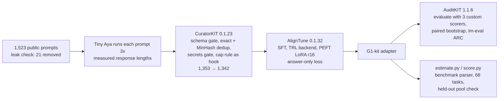
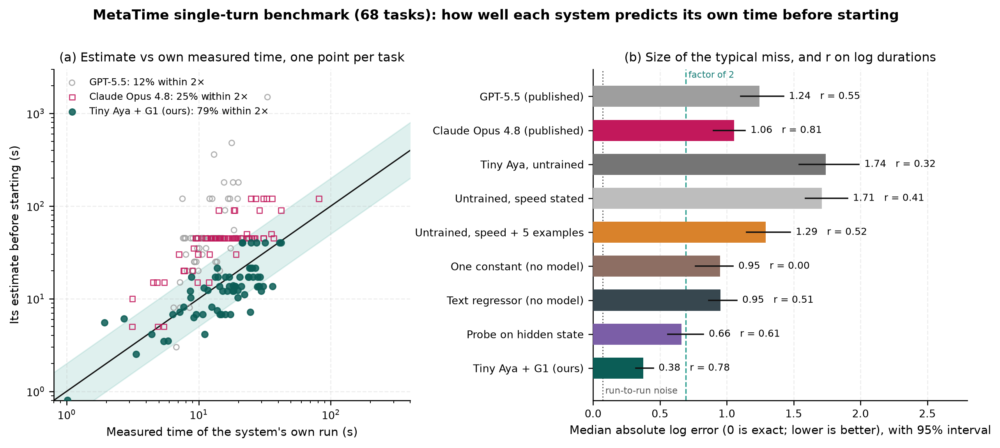

# Anthropochrony: a 3B model that knows how long its own answers take

**Claim.** Trained on measurements of itself, Cohere Labs' Tiny Aya Global (3.35B) estimates its own running time on a public benchmark with a typical miss of 1.46x, where the published self-estimates of GPT-5.5 and Claude Opus 4.8 miss theirs by 3.47x and 2.87x.

**Team:** [@isHeSatoshi](https://huggingface.co/isHeSatoshi) (solo) · **Code:** https://github.com/isHeSatoshi/anthropochrony · **Models:** [HF collection](https://huggingface.co/collections/isHeSatoshi/anthropochrony-self-time-models-6af986a95a140f4184fae18f) · **Data and logs:** [HF collection](https://huggingface.co/collections/isHeSatoshi/anthropochrony-self-time-data-6af986a99994d1dfbbad03aa)

> **For judges: one minute.**
> - **Problem.** Ask a model how long a task will take it and it answers on a human clock. On the 68 single-turn tasks of the public MetaTime benchmark, GPT-5.5 and Claude Opus 4.8 say about three times too long for nearly everything (12% and 25% of their estimates within 2x).
> - **Before → after (same model, same question).** Tiny Aya Global told its machine's speed: median absolute log error **1.71** (5.5x off, **4%** within 2x). With our adapter `G1`: **0.38** (1.46x off, **79%** within 2x, 95% CI 0.32 to 0.45). Closer than GPT-5.5 on 62 of 68 tasks and than Claude Opus 4.8 on 61; both paired 95% intervals exclude zero, which is the success criterion we pushed to GitHub before the first estimate.
> - **Pipeline.** CuratorKIT gates the measured training pool, AlignTune trains the LoRA, AuditKIT evaluates it on the benchmark and on ARC (`G1-kit`, §7.3). `G1-kit` scores 0.45 (76% within 2x), inside the spread of `G1`'s three seeds, and also beats both frontier models with paired intervals that exclude zero. It costs about 2 points of ARC accuracy.
> - **Honest caveats.** Each model is judged on its own clock. Ours is told its speed (an adapter that is told nothing, `G1-fixed`, scores 0.42). Claude Opus 4.8 ranks tasks as well as ours. The primary seed is the best of three (0.37, 0.43, 0.50 on the same runs). `G1-kit` costs about 2 points of ARC accuracy when switched on. One GPU, English only.
> - **Check it in 2 minutes, CPU only:** `uv sync --locked && uv run pytest && uv run python scripts/run_notebook.py`.

## Tracks and problem statements

- Track 1: Fine-tuning and Data Curation (CuratorKIT → AlignTune → AuditKIT).
- Problem statement 2, *Replacing a closed-model API*: a small open model replaces frontier models on a task they are usually asked to do (estimating how long a job will take), with better accuracy and a cost comparison (§8).
- Other: self-knowledge and calibration. A model that can say how long its own work will take, measured against its own clock.

No harmful or NSFW content appears in this write-up.

## Abstract

Ask a language model how long a task will take it and it answers on a human clock: "a few minutes" for work it finishes in seconds, because the text it learned from describes how long people take. Those estimates feed real decisions, such as job queues, timeouts, routing between machines and what users are told. On the 68 single-turn tasks of the public MetaTime benchmark, the published self-estimates of GPT-5.5 and Claude Opus 4.8 are typically 3.47x and 2.87x off their own measured times (12% and 25% within 2x).

We taught Cohere Labs' Tiny Aya Global (3.35B) its own clock, with no teacher model and no paid labels. We ran the untrained model three times on each of 1,523 public instruction prompts (Dolly-15k, CodeAlpaca-20k, no_robots, GSM8K and 100 coding tasks of ours), after removing 21 prompts that resembled a benchmark task, and recorded how long its answers were. A LoRA adapter learns to answer "how long will this take you?" with the work first and the time second: the tokens it expects to read and write, then the seconds at the machine speed stated in its prompt.

Before any estimate existed we pushed the task list, the benchmark's own question and parser, the metrics and the success criterion to GitHub. Before → after on the same model: median absolute log error 1.71 → 0.38 (typical miss 5.5x → 1.46x; within 2x 4% → 79%). Ours is closer than GPT-5.5 on 62 of 68 tasks and than Claude Opus 4.8 on 61, and both paired 95% intervals exclude zero, so the declared criterion is met. Told another machine's speed, the estimates scale with it across a 270-fold range. An adapter told nothing, asked exactly as the frontier models were, scores 0.42.

The track's pipeline builds a second adapter end to end: CuratorKIT gates the training pool (1,353 → 1,342 prompts), AlignTune trains the LoRA, and AuditKIT evaluates it. It scores 0.45 (76% within 2x), inside the spread of the first adapter's three seeds, and also beats both frontier models. AuditKIT's paired bootstrap confirms the gain over the untrained model (mean log error 1.78 → 0.50, p = 0.001) and finds a cost: ARC accuracy falls by about 2 points (Easy 73.0% → 71.1%, Challenge 42.2% → 40.2%), so the adapter is best switched on only for the time question. 1,000 estimates cost 3 to 5 cents of GPU time; the same question at frontier list prices costs at least 57 to 60 cents.

Limits: each model is judged on its own clock; Claude Opus 4.8 ranks tasks as well as ours; our primary seed is the best of three (0.37, 0.43, 0.50). One model, one consumer GPU, English, single-turn tasks. All compute was local, at no cost.

## 1. Problem and approach

### 1.1 Why this problem

Estimates of how long a piece of work will take drive decisions in systems that run models: how to queue jobs, when a run has hung and should be stopped, whether a task goes to a phone or a server, what to tell a customer. People increasingly ask the model itself. The model answers with a human's time, because that is what its training text describes. MetaTime (anonymous ICLR 2027 submission, OpenReview `CAQeizWcB2`) measured this for frontier models: on its single-turn suite GPT-5.5 and Claude Opus 4.8 say about three times too long for nearly every task. Monperrus and Stenqvist call this anthropocentric time bias. We did not discover it.

A model's own running time is measurable for free: run it and count. So this is a case where the training data does not have to be bought or annotated. The model can label its own data.

### 1.2 Research questions

1. Can a 3B open model, trained only on measurements of its own answer lengths on public prompts, estimate its own wall-clock time on unseen benchmark tasks better than frontier models estimate theirs? (Primary, with a criterion fixed in advance.)
2. Does the estimate follow the hardware when a different machine speed is stated?
3. How much of the gain is the adapter, and how much is calibration of the average, the stated speed, or information the untrained model already carries?
4. Does the same recipe hold when every stage runs through the track's libraries, and does capability on a general benchmark survive?

### 1.3 Declared in advance

The protocol is in [`docs/PREREGISTRATION.md`](../docs/PREREGISTRATION.md), word for word, with the commit that pushed each entry. The first entry (commit [`077c0bf`](https://github.com/isHeSatoshi/anthropochrony/commit/077c0bf6d688f36611048226fede108702c000f0), 2026-11-14 05:23 UTC) fixed the 68 tasks, the benchmark's own question and parser, the target (median of 5 timed runs), the metrics, the primary estimator (`G1` seed 0, stated speed, description only), the comparison and the success criterion: **lower median absolute log error than both frontier models, with the paired 95% interval excluding zero**. Every later addition (secondary rows, `G1-fixed`, the pool-calibrated range, the CuratorKIT → AlignTune → AuditKIT adapter) was committed and pushed before it was run, and is marked post-hoc where it came after the first results.

### 1.4 Approach

1. **Measure.** Collect public prompts, drop anything that looks like a benchmark task, run the untrained model 3 times on each, record prompt and response token counts.
2. **Train.** Teach the model to answer the time question in two steps, work then time: `Prompt: about 380 tokens. Response: about 520 tokens.` then `Time: 15.4 seconds`. Each training example states a machine speed $(S, P)$, writing and reading tokens per second, drawn from a wide range, and the time in the answer is computed from the measured token counts: $t = n_{\text{in}}/P + n_{\text{out}}/S$. Replay examples (the prompt with the model's own ordinary response) keep its ordinary answers, and so the lengths being predicted, unchanged.
3. **Ask.** On the benchmark, state the speed measured on this GPU, ask the benchmark's own question about the task's short description, read the time with the benchmark's own parser, and compare with the median of five timed runs.

On this machine the speed formula reproduces measured wall time to within 3% (median absolute log error 0.015 for the untrained model's runs), so the whole difficulty is predicting how much the model will write.

### 1.5 Related work

- **MetaTime** (anonymous ICLR 2027 submission, OpenReview `CAQeizWcB2`; public artifact `anonymous.4open.science/r/Time-Estimation-B286`) measures frontier models' estimates of their own time on single-turn, agentic and long-horizon suites. Its Table 22 trains Qwen3-8B on the same 68 single-turn tasks; the best row reaches a raw-duration correlation of 0.44.
- **Garikaparthi et al.** (arXiv 2604.00010) wrote the 68-task single-turn suite.
- **Monperrus and Stenqvist** name anthropocentric time bias in coding agents.
- **AgentTime** and related runtime-estimation benchmarks study agent trajectories; we only run single-turn tasks.
- Split-conformal prediction (Vovk et al.; Romano, Patterson and Candès 2019) for the calibrated range in §7.6.

## 2. Hackathon repos used and how they connect



The three libraries are chained in one run (`scripts/metatime/curate.py` → `train_aligntune.py` → `audit.py`): CuratorKIT writes the list of passed prompt ids, AlignTune trains only on those prompts and saves the adapter, and AuditKIT loads that adapter for both its benchmark evaluation and its lm-eval capability run. This pipeline produces the adapter `G1-kit`. The headline adapter `G1` and its variants were trained earlier with the same examples by our own PyTorch/PEFT loop (`train.py`); §6.4 lists every difference.

### CuratorKIT 0.1.23

How we used it: a quality gate on the measured training pool, before training (`scripts/metatime/curate.py`).

- Each training-split prompt becomes one Alpaca-format sample: the prompt as `instruction`, the model's own first measured response as `output`, the three measured lengths as metadata.
- Features: `Curator`/`CuratorConfig` pipeline with its JSONL reader, `SchemaGate` (token limits), `ExactDeduplicator`, `MinHashDeduplicator` (threshold 0.7, seed 20261115), `SecretsGate`, a `preprocessing_fn` hook, the `messages` exporter, and its manifest, provenance record and HF README writer.
- Our rule runs as the hook: drop a prompt when any measured run stopped at the 2,048-token generation cap (its label is a lower bound, not a measurement) or its response is empty.
- `clean=False`, because the labels were measured on the exact prompt text and cleaning would change it.
- Counts before and after are in §4.4.

### AlignTune 0.1.32

How we used it: the SFT trainer for `G1-kit` (`scripts/metatime/train_aligntune.py`).

- Features: `create_sft_trainer` with the TRL backend, PEFT LoRA (`use_peft`, `lora_r`, `lora_alpha`, `lora_dropout`, `lora_target_modules`), `assistant_only_loss`, gradient checkpointing, bf16, cosine schedule with warm-up, seeds, `group_by_length`.
- The dataset is the CuratorKIT-passed prompts only. We hand the conversations to its trainer directly, because its data manager folds the system turn into the user turn, and the system turn carries the stated speed.
- After training, the script checks on the collator's real tensors that the loss covers the answer tokens and nothing else.

### AuditKIT 1.1.6

How we used it: evaluation of the untrained model and `G1-kit` on the 68 benchmark tasks, and the capability check (`scripts/metatime/audit.py`).

- Features: `evaluate` with a callable model and three custom scorers built with `@scorer` and `Direction` (absolute natural-log error of the time read by the benchmark's own parser against the untrained model's median timed run; within 2x; parsed), `RunConfig` fingerprints, `compare(...).significance()` (paired bootstrap per metric), and `run_lmeval` for ARC-Easy and ARC-Challenge, zero-shot, with the adapter loaded through `peft=`.
- Every greedy answer AuditKIT collects is checked against the answer `estimate.py` wrote for the same task, so the two scoring paths agree.
- Each run gets a fresh cache directory, because AuditKIT replays cached results by run fingerprint, and the fingerprint does not see the adapter weights.

### Not used

AgentTune, SafeTune and CircuitKIT belong to other tracks. Our linear probe on hidden states (§7.5) is a plain scikit-learn ridge regression.

## 3. Models and licenses

| Model | Role | Version | License |
|---|---|---|---|
| `CohereLabs/tiny-aya-global` (3.35B, dense) | Base model for every adapter; executor of every timed run | revision `af89d219b53ed9b13b8a4645f9c8028973510324`, bf16, PyTorch `transformers`, no quantization on GPU | CC-BY-NC-4.0 + Cohere Labs Acceptable Use Policy |
| `G1` (seeds 0, 1, 2), `G1-fixed`, `G1-kit`, 150- and 450-prompt adapters | Our LoRA adapters (r 16, 121 MB each) | this work | CC-BY-NC-4.0 (inherits the base model's terms) |
| Q4_K_M GGUFs of the base model and of `G1` merged | CPU demo (llama.cpp `b12110`) | this work | CC-BY-NC-4.0 |
| GPT-5.5, Claude Opus 4.8 | Closed-model baselines: their published per-task estimates and times from the MetaTime artifact; we did not call them | as published in the artifact (snapshot 8 Oct 2026) | proprietary; numbers only |
| `BAAI/bge-small-en-v1.5` | Frozen sentence encoder for one baseline regressor | as pinned in `uv.lock` | MIT |

There is no teacher model. Every training label is a measurement of the base model itself.

## 4. Data, benchmarks and licenses

### 4.1 Training pool

| Source | License | Train | Held out (`val`) | Passed CuratorKIT |
|---|---|--:|--:|--:|
| `databricks/databricks-dolly-15k` | CC-BY-SA-3.0 | 494 | 56 | 490 |
| `HuggingFaceH4/no_robots` | CC-BY-NC-4.0 | 393 | 53 | 391 |
| `sahil2801/CodeAlpaca-20k` | CC-BY-4.0 | 289 | 38 | 288 |
| `openai/gsm8k` | MIT | 87 | 13 | 86 |
| 100 `train` coding tasks of this project's earlier study (`isHeSatoshi/anthropochrony-tasks`) | CC-BY-NC-4.0 | 90 | 10 | 87 |
| **Total** | | **1,353** | **170** | **1,342** |

Prompts were sampled at pinned revisions (`scripts/metatime/build_pool.py`): 1,551 sampled, 1,544 after length limits and duplicate removal, 21 removed by the leak check, 1,523 kept. Labels: each prompt run 3 times by the untrained model (bf16, model-card sampling, 2,048-token cap), 4,569 runs in total. The training label is the median response length.

Languages: English only, in the pool and in the benchmark. Tiny Aya Global covers about 70 languages; we did not test the others (§9).

### 4.2 Benchmark and leak check

The test set is the 68 single-turn tasks of the MetaTime artifact (12 code generation, 8 creative, 8 debugging, 8 Q&A, 12 reasoning, 10 summarization, 10 writing). We do not redistribute the tasks; the scripts download the artifact at run time, and the committed records hold task ids, numbers and our model's answers, never task text.

Leak check before training: every pool prompt with TF-IDF cosine similarity of 0.25 or more to any of the 68 benchmark prompts or descriptions was removed (21 prompts: short stories, a haiku, a Fibonacci function, palindrome checks and similar). CuratorKIT's exact and MinHash deduplication then ran within the training split. No benchmark task, response or duration was used for training, model selection or calibration.

### 4.3 General capability benchmarks (retention check)

ARC-Easy and ARC-Challenge (English, zero-shot, accuracy) through AuditKIT's lm-eval engine, with `G1-kit` off and on. These check that the adapter did not break general ability; they are not the focus task. The held-out pool check (§7.7) also measures whether ordinary response lengths changed.

### 4.4 CuratorKIT filtering

| Stage | In | Out | Removed | Why |
|---|--:|--:|--:|---|
| Reader + our hook | 1,353 | 1,343 | 10 | A measured run stopped at the 2,048-token cap, so the label is a lower bound (4 Dolly, 2 no_robots, 1 CodeAlpaca, 1 GSM8K, 2 of our tasks) |
| `SchemaGate` | 1,343 | 1,343 | 0 | |
| `ExactDeduplicator` | 1,343 | 1,343 | 0 | |
| `MinHashDeduplicator` (0.7) | 1,343 | 1,343 | 0 | |
| `SecretsGate` | 1,343 | 1,342 | 1 | "Base64 High Entropy String" in one of our coding tasks |
| `MessagesExporter` | 1,342 | 1,342 | | |

The pool was already deduplicated and leak-checked when it was built, so CuratorKIT's deduplicators confirm rather than change it. The cap rule matters more than the counts suggest: those 10 prompts are the longest answers, where a lower-bound label would teach the model to under-estimate. Full report: `curatorkit/report.json` in the [dataset](https://huggingface.co/datasets/isHeSatoshi/anthropochrony-metatime-data).

## 5. Metrics, and why these

All accuracy metrics compare an estimate $\hat t$ with the measured time $t$ (median of the timed runs) per task.

| Metric | Better | Why |
|---|---|---|
| Median absolute log error, $\mathrm{median}\,\lvert\ln(\hat t/t)\rvert$ (primary; the benchmark's) | lower | Times span 0.6 s to 45 s on our machine and seconds to minutes for hosted models; a ratio metric is fair across deployments and robust to a few huge misses. $e^{0.69} = 2$, so 0.69 is a factor of 2 |
| Typical factor off, $e^{\text{error}}$ | lower (1.0x is perfect) | The same number in plain words |
| Median estimate/actual ratio (the benchmark's) | closer to 1 | Separates systematic over- or under-estimation from noise |
| Pearson r on log durations (the benchmark's) | higher | Whether the estimator tells long tasks from short ones, independent of scale |
| Within 2x | higher | An operational threshold: good enough to set a timeout or a queue order |
| Mean absolute error in seconds | lower | Reported for completeness; depends on how fast a deployment is, so not comparable across models |
| Parsed | higher | An unreadable answer counts as a miss |
| Paired bootstrap difference (5,000 draws over tasks) | negative = ours lower | The declared test |
| Response-length drift on held-out prompts | near 0 | What should not get worse: the adapter must not change how much the model writes |
| ARC-Easy, ARC-Challenge accuracy | not lower | What should not get worse: general ability |

Scoring uses the benchmark's own parser. No LLM judge is involved.

## 6. Method

### 6.1 Training examples (shared by every adapter)

From `scripts/metatime/train.py`, used unchanged by `train_aligntune.py`:

- 4 estimate examples per training prompt. Each has a stated speed drawn from one of four deployment profiles (CPU, edge GPU, datacenter GPU, accelerator: writing speeds from 2 to 2,500 tokens a second, reading speed a profile-dependent multiple of it), never inside the held-out band of 150 to 260 tokens a second; one of six speed-line phrasings (the seventh, used for every reported estimate, is never trained on); a task view (the short description or the full prompt); a weighted choice of question wording; and the answer computed from the measured lengths at that speed. Stated speeds are rounded to two significant digits, as at test time.
- 1 replay example per prompt: the prompt with the model's own measured response as target.
- Seeds per prompt are fixed, so `G1` and `G1-kit` see the same estimate examples for the same prompts.

### 6.2 `G1` (headline) and its variants: our PyTorch/PEFT loop

LoRA r 16, alpha 32, dropout 0.05 on all seven attention and MLP projections (30.2M trainable parameters); AdamW, learning rate 2e-4 with warm-up and cosine decay, weight decay 0.01; 2 epochs, 846 optimizer steps (micro-batch 8, 2 accumulation steps; 5,412 estimate and 1,353 replay examples); bf16; replay responses cut to their first 128 tokens. Seeds 0 (primary, fixed in advance), 1 and 2. Training took 73 to 75 minutes per seed on the RTX 4060 Ti.

`G1-fixed`: the same, but no system prompt and every answer computed at one speed, the untrained model's measured speed on this GPU (34 tokens a second writing, 5,700 reading). Training-size ablation: 150 and 450 of the 1,353 prompts, seed 0.

### 6.3 `G1-kit`: CuratorKIT → AlignTune → AuditKIT

CuratorKIT as in §2 and §4.4. AlignTune SFT, TRL 1.7.1 backend: LoRA r 16, alpha 32, dropout 0.05 on the same seven projections; learning rate 2e-4, cosine, 5% warm-up, weight decay 0.01; 2 epochs; batch 1 with 16 accumulation steps; sequence limit 1,536 tokens; bf16; gradient checkpointing; answer-only loss; no packing; seed 0. 1,342 prompts give 5,368 estimate and 1,342 replay examples. Training took 840 optimizer steps and 2.19 hours (7,867 s) on the RTX 4060 Ti, peak memory about 10 GB; the training loss was 1.49 at the first log and 0.25 at the last. The post-training label check stopped the first run after the adapter was saved: one replay sequence was longer than 1,536 tokens, the collator had cut it, and the check compared it with the uncut labels. We fixed the check to compare only the kept part and confirmed on a one-step rerun of the same pipeline that the loss covers the answer tokens and nothing else (16 sequences inspected). The training summary was rebuilt from the run's log. AuditKIT settings: greedy, 64 new tokens, the stated speed as measured on this GPU with the adapter off at the start of each estimate run (34 and 5,700 tokens a second for the untrained arm, 35 and 5,900 for `G1-kit`), scored against the untrained model's 5 timed runs; lm-eval zero-shot, batch 16, bf16.

### 6.4 Differences between `G1` and `G1-kit`, named before training

The curated subset (1,342 instead of 1,353 prompts); complete replay responses instead of their first 128 tokens; TRL's batching (batch 1 × 16) instead of ours. Everything else is the same.

### 6.5 Inference and timing

One request at a time, PyTorch bf16, model-card sampling for timed runs (greedy for estimates), 2,048-token cap. The deployment's speed is measured once per executor and stated rounded to two digits: 30 and 3,300 tokens a second for `G1` (adapter unmerged), 34 and 5,700 for the untrained model. Five timed runs per task for the untrained model and for `G1`, three for `G1-fixed` (merged). A repeat run differs from the median of the others by about 7%, the floor for any estimator here.

### 6.6 Ablations and controls

Every row was declared before it was run: the untrained model with and without the stated speed and with five measured examples in its prompt; three predictors that never call the model (a constant, a TF-IDF regressor, a sentence-encoder regressor); a linear probe on the untrained hidden state; `G1` shown the full prompt, with the paper's question wording, without the stated speed, read through its stated token count, as the median of 16 samples, and against the untrained model's runs; four other machines' speeds; seeds 1 and 2; 150 and 450 training prompts. Full table: [`docs/METATIME.md`](../docs/METATIME.md#every-row).

## 7. Results

### 7.1 Same model before and after, against the frontier models

| System | Median estimate/actual | Median abs. log error [95% CI] | Typical factor off | r (log) | Within 2x | MAE (s) | Parsed |
|---|--:|--:|--:|--:|--:|--:|--:|
| GPT-5.5 (published) | 3.47x | 1.24 [1.10, 1.42] | 3.47x | 0.55 | 12% | 92.2 | 68/68 |
| Claude Opus 4.8 (published) | 2.87x | 1.06 [0.90, 1.14] | 2.87x | 0.81 | 25% | 30.5 | 68/68 |
| Tiny Aya, untrained, benchmark question as is | 5.61x | 1.74 [1.54, 1.99] | 5.70x | 0.32 | 7% | 92.0 | 68/68 |
| **Before:** Tiny Aya, untrained, speed stated | 5.39x | 1.71 [1.59, 1.90] | 5.53x | 0.41 | 4% | 70.9 | 68/68 |
| **After: Tiny Aya + `G1` (primary)** | 0.74x | **0.38** [0.32, 0.45] | **1.46x** | 0.78 | **79%** | 6.6 | 68/68 |
| `G1-fixed`, no speed stated, untrained model's runs | 0.74x | 0.42 [0.37, 0.47] | 1.52x | 0.77 | 76% | 6.0 | 68/68 |
| `G1-fixed`, no speed stated, its own runs (merged) | 0.82x | 0.40 [0.27, 0.46] | 1.49x | 0.73 | 82% | 5.9 | 68/68 |
| `G1` predicting the untrained model's runs | 0.78x | 0.37 [0.26, 0.50] | 1.45x | 0.80 | 79% | 5.7 | 68/68 |
| `G1-kit` (CuratorKIT → AlignTune), untrained model's runs | 0.69x | 0.45 [0.37, 0.59] | 1.57x | 0.75 | 76% | 6.2 | 68/68 |
| `G1-kit`, shown the full prompt, untrained model's runs | 0.85x | 0.32 [0.25, 0.43] | 1.38x | 0.82 | 84% | 5.3 | 68/68 |

| Paired comparison (ours minus theirs, median abs. log error) | Difference | 95% CI | Tasks where ours is closer |
|---|--:|--:|--:|
| `G1` vs GPT-5.5 | −0.87 | [−1.06, −0.70] | 62/68 |
| `G1` vs Claude Opus 4.8 | −0.68 | [−0.79, −0.51] | 61/68 |
| `G1-fixed` (no speed) vs GPT-5.5 | −0.82 | [−1.02, −0.67] | 62/68 |
| `G1-fixed` (no speed) vs Claude Opus 4.8 | −0.64 | [−0.74, −0.47] | 59/68 |
| `G1-kit` vs GPT-5.5 | −0.79 | [−1.01, −0.59] | 60/68 |
| `G1-kit` vs Claude Opus 4.8 | −0.60 | [−0.74, −0.40] | 57/68 |



The declared criterion is met. `G1` is also closer than both frontier models in each of the seven task categories (8 to 12 tasks each, descriptive only):

| Median abs. log error | code (12) | creative (8) | debugging (8) | Q&A (8) | reasoning (12) | summarization (10) | writing (10) |
|---|--:|--:|--:|--:|--:|--:|--:|
| GPT-5.5 | 2.27 | 1.20 | 1.42 | 0.80 | 1.06 | 1.04 | 1.54 |
| Claude Opus 4.8 | 1.17 | 0.91 | 1.21 | 0.53 | 0.99 | 1.17 | 1.09 |
| Tiny Aya + `G1` | 0.62 | 0.28 | 0.47 | 0.45 | 0.33 | 0.36 | 0.28 |

The paper's own trained estimator on these tasks (Qwen3-8B, Table 22) reaches a best raw-duration correlation of 0.44; `G1` reaches 0.66. Models and machines differ, so only the correlation is comparable.

### 7.2 Sample inputs and outputs

Task ids are the benchmark's; task text is not reproduced. Stated speed 30 and 3,300 tokens a second.

| Task | `G1` answer | `G1` measured (median of 5) | Untrained answer | GPT-5.5 estimate / actual | Claude Opus 4.8 estimate / actual |
|---|---|--:|---|--:|--:|
| `code_fizzbuzz` | `Prompt: about 380 tokens. Response: about 200 tokens.` `Time: 6.78 seconds` | 10.7 s | `"1 minute"` | 8 s / 7.2 s | 15 s / 4.5 s |
| `code_palindrome` | `... Response: about 220 tokens.` `Time: 7.45 seconds` | 13.8 s | `2 minutes` | 120 s / 7.5 s | 30 s / 9.9 s |
| `code_lru_cache` | `... Response: about 400 tokens.` `Time: 13.5 seconds` | 27.7 s | `2 minutes` | 180 s / 15.6 s | 120 s / 24.9 s |
| `code_btree` | `... Response: about 1200 tokens.` `Time: 40.1 seconds` | 42.2 s | `5 minutes` | 1,500 s / 33.2 s | 120 s / 81.4 s |

`G1` guesses short (median 0.74x of the measured time) but tells long tasks from short ones; the untrained model answers in round human units.

### 7.3 The pipeline adapter: CuratorKIT → AlignTune → AuditKIT (`G1-kit`)

`G1-kit` is the same recipe as `G1`, built end to end by the track's three libraries and declared, with every setting, before it was trained (§1.3). Each stage's output is the next stage's input: CuratorKIT's list of passed prompt ids, AlignTune's saved adapter, AuditKIT's two evaluations of that adapter.

| Stage | Library | Result |
|---|---|---|
| Curate | CuratorKIT 0.1.23 | 1,353 → 1,342 training prompts (10 with a capped measured run, 1 secrets hit; §4.4) |
| Train | AlignTune 0.1.32 | 840 steps, 2.19 hours, training loss 1.49 → 0.25; loss on answer tokens only, checked on the collator's tensors |
| Evaluate on the benchmark | AuditKIT 1.1.6, 3 custom scorers | Mean absolute log error 1.78 → 0.50 and within 2x 4.4% → 76.5% against the untrained model told its speed, paired bootstrap p = 0.001 for both; 68/68 answers parsed in both arms, and all 136 answers identical to the ones `estimate.py` wrote |
| Evaluate capability | AuditKIT 1.1.6, lm-eval | ARC-Easy 73.0% → 71.1% (−1.9 points, p = 0.004); ARC-Challenge 42.2% → 40.2% (−2.0 points, p = 0.04); all 3,548 questions, zero-shot |
| Score with the benchmark's metrics | `score.py` | Median absolute log error 0.45 [0.37, 0.59], 1.57x, r 0.75, 76% within 2x; paired −0.79 [−1.01, −0.59] against GPT-5.5 and −0.60 [−0.74, −0.40] against Claude Opus 4.8 |

What it shows:

- **The pipeline reproduces the recipe.** Against the same timed runs, `G1`'s three seeds score 0.37, 0.43 and 0.50; `G1-kit` scores 0.45, inside that spread. Shown the full prompt it scores 0.32 (`G1`: 0.33); on the held-out pool prompts 0.41 and 0.36 (`G1`: 0.38 and 0.32). With one seed per pipeline we cannot say whether curation helped or hurt; on this pool, which was already deduplicated and leak-checked, it changed 11 of 1,353 prompts.
- **It also clears the declared bar.** Both paired intervals against the frontier models exclude zero (closer on 60 and 57 of 68 tasks), though `G1-kit` is not the primary estimator and was added after the first results.
- **AuditKIT and `score.py` agree.** AuditKIT averages the per-task error (0.50) where the benchmark takes the median (0.45); both measure the same 68 answers, and both find the gain over the untrained model.
- **The capability check found a real cost.** ARC accuracy falls by about 2 points with the adapter on, a small drop that is statistically significant on both tasks (§7.7). This is the trade-off a narrow adapter makes on this recipe.

Two details of AuditKIT matter for anyone rerunning this. It caches results by a run fingerprint that does not see adapter weights, so each run here gets a fresh cache directory; otherwise the adapter run would replay the untrained one. And `compare(...).significance()` pairs lm-eval questions by id, which restarts at 0 in each task, so its pooled ARC test paired ARC-Easy questions with ARC-Challenge ones (n 2,376 instead of 3,548; it reported −2.1 points, p = 0.002). We pair by task and id with AuditKIT's own bootstrap (`audit.py`); the default result is kept in `results/metatime-audit.json`.

### 7.4 Finding: the estimate follows the stated hardware

Asked with four other machines' speeds (targets are the measured runs replayed through the speed formula, not runs on those machines):

| Stated speed (writing, reading tok/s) | `G1` error | `G1` within 2x | `G1` estimate vs its estimate at this machine's speed | Untrained error |
|---|--:|--:|---|--:|
| 1.5, 10 | 0.46 | 68% | 22.1x longer (targets 22x longer) | 1.39 |
| 8, 60 | 0.34 | 93% | 4.29x longer | 0.38 |
| 30, 3,300 (this machine) | 0.38 | 79% | same | 1.71 |
| 190, 19,000 | 0.39 | 81% | 6.33x shorter | 3.42 |
| 400, 40,000 | 0.36 | 81% | 13.4x shorter | 4.16 |

The untrained model gives the same answer at every stated speed, so its one good row (8 tok/s) is a coincidence of scale.

### 7.5 Finding: what the adapter adds, and what it does not

- **The stated speed alone does nothing.** The untrained model with the speed stated scores 1.71; 59 of its 68 answers are "1 minute" or "2 minutes". Five measured examples in its prompt move it to 1.29.
- **`G1` needs the stated speed, unless trained for one machine.** Without it `G1` scores 1.77. `G1-fixed` (post-hoc, declared before training) is asked exactly as the frontier models were and scores 0.42, 0.40 against its own timed runs.
- **Predictors that never call the model miss by about 2.5x** from the description (constant 0.95, TF-IDF 0.95, sentence encoder 0.90), because benchmark responses are about 2.4 times longer than pool responses and they cannot tell.
- **The untrained model already carries the information.** A linear probe on its hidden state scores 0.66 from the question; read just before it answers the full prompt, 0.36, about the same as `G1` shown the full prompt (0.32). The adapter makes the model say what its internal state already predicts.
- **The frontier error is mostly one of scale.** Dividing each Claude Opus 4.8 estimate by one constant fitted on the other 67 tasks' outcomes would bring it to 0.27, below `G1`. That constant needs measured outcomes, which is what our training supplies.

### 7.6 Finding: a calibrated range

The 10th to 90th percentile of 16 sampled answers is too narrow: it holds 50% of measured times, not 80%. A split-conformal range calibrated on the 170 held-out pool prompts (post-hoc; rule pushed before it was computed) is the stated time divided and multiplied by 2.52 and holds 93% of the benchmark's measured times. Its edge (2.52x) is still closer than the frontier models' typical miss.

### 7.7 What should not get worse

- **Response length.** On the 170 held-out pool prompts the fine-tuned models' ordinary responses are as long as the untrained model's: median drift +0.5% (`G1`), +0.0% and +1.7% (seeds 1 and 2), +0.6% (`G1-fixed`) and +1.1% (`G1-kit`). This is why an adapter's estimates can be scored against the untrained model's runs.
- **Held-out pool check before the benchmark.** From the description `G1` scores 0.38 on the held-out prompts (constant 0.56, best text regressor 0.48), the same as on the benchmark.
- **General ability: a small, significant loss.** With `G1-kit` switched on, ARC-Easy accuracy falls from 73.0% to 71.1% and ARC-Challenge from 42.2% to 40.2% (zero-shot, all 3,548 questions; paired bootstrap p = 0.004 and 0.04; normalized accuracy falls by 2.0 and 3.2 points). The adapter is trained only on time questions and on replays of the model's own answers, and that is not enough to keep multiple-choice accuracy intact. Because it is a LoRA, a deployment can switch it on only for the time question, as AuditKIT's runs did, and answer everything else with the untrained weights, which removes the loss. ARC was measured for `G1-kit` only.

### 7.8 Seeds and training size

| Adapter (against the untrained model's runs) | Error | r | Within 2x | Paired vs GPT-5.5 | Paired vs Claude Opus 4.8 |
|---|--:|--:|--:|--:|--:|
| `G1` seed 0 (primary) | 0.37 | 0.80 | 79% | −0.87 | −0.68 |
| seed 1 | 0.43 | 0.76 | 71% | −0.82 [−1.02, −0.60] | −0.63 [−0.74, −0.44] |
| seed 2 | 0.50 | 0.78 | 75% | −0.74 [−0.95, −0.59] | −0.55 [−0.68, −0.38] |
| 450 prompts | 0.41 | 0.64 | 78% | −0.84 | −0.65 |
| 150 prompts | 2.95 | −0.06 | 3% | | |
| `G1-kit`, CuratorKIT → AlignTune, 1,342 prompts, seed 0 | 0.45 | 0.75 | 76% | −0.79 [−1.01, −0.59] | −0.60 [−0.74, −0.40] |

The primary seed, fixed before any result, is the best of three; the fair number for the recipe is the average, 0.43. `G1-kit` (0.45) is inside the seed spread. With 150 prompts the adapter learns the length but not the division: its stated token count through the formula scores 0.64, its stated time 2.95.

### 7.9 What did not work

- The untrained model with the stated speed (1.71) or five in-prompt examples (1.29).
- `G1` without the stated speed (1.77).
- Sampled ranges (50% coverage for a nominal 80%).
- 150 training prompts (stated time 2.95).
- A public Hugging Face Space: Docker and Gradio Spaces need a paid plan on this account (HTTP 402), so the demo runs locally (§11).

### 7.10 On the deployed, quantized model

A Q4_K_M GGUF of `G1` merged into the base model runs in the local demo on CPU (llama.cpp `b12110`, 4 threads: about 16.5 tokens a second writing and 100 reading). One spot check on a palindrome prompt of our own: `G1` stated 22.9 s, the measured run took 20.5 s, the untrained model said 120 s. That is one example, not a benchmark result; the benchmark numbers are for bf16 on the GPU.

## 8. Cost and ROI

**Compute used.** Everything ran on one local NVIDIA RTX 4060 Ti 16 GB. Training the seven adapters took 7.5 GPU-hours; all GPU jobs (labels, training, timing, estimates, audit) fit in the window from 2026-11-14 05:16 to 2026-11-15 12:47 UTC. Cash cost: $0. At a public on-demand rate for this GPU ($0.11 to $0.19 an hour, [getdeploying.com](https://getdeploying.com/gpus/nvidia-rtx-4060-ti), Nov 2026), the whole window would cost at most $6.0 (31.5 hours).

**Cost per 1,000 estimates.** The method was declared before AuditKIT ran (§1.3). AuditKIT recorded the tokens and wall time of `G1-kit`'s 68 greedy answers: 35,440 prompt tokens (521 per answer: our system prompt, the chat template and the benchmark question), 1,511 answer tokens (22 per answer) and 62.3 seconds on the RTX 4060 Ti, one request at a time with the adapter unmerged.

| Estimator | Per 1,000 estimates | How it is counted |
|---|--:|---|
| Tiny Aya + `G1-kit`, this GPU | **$0.03 to $0.05** | 0.25 GPU-hours (0.92 s per answer) × $0.11 to $0.19 an hour |
| GPT-5.5, same tokens as ours | $3.27 | 521 prompt and 22 answer tokens × $5 and $30 per million |
| Claude Opus 4.8, same tokens as ours | $3.16 | the same tokens × $5 and $25 per million |
| GPT-5.5, the bare question only | $0.60 | 75 prompt and 8 answer tokens (the benchmark question, the untrained model's answer length) |
| Claude Opus 4.8, the bare question only | $0.57 | the same |

All frontier numbers are lower bounds: they use our tokenizer's counts and leave out any hidden reasoning tokens, which we cannot see. Even the strictest one, the bare question as the frontier models were asked, costs 12 to 21 times what our estimate costs, and our estimate is the more accurate one (§7.1). The one-off cost is small: training `G1-kit` took 2.19 GPU-hours ($0.24 to $0.42 at the same rate), which the saving pays back within the first 1,000 estimates. Prices: [OpenAI](https://developers.openai.com/api/docs/models/gpt-5.5) and [Anthropic](https://www.anthropic.com/pricing) list prices, Nov 2026.

## 9. Limitations

- **Not a like-for-like contest.** The frontier models were asked cold and never trained for this question; ours is trained on its own measurements and (for `G1`) told its speed. `G1-fixed` removes the stated speed but knows one machine only and was added after the first results.
- **Easier clock.** A hosted model's time includes provider load and hidden reasoning; ours runs alone on a local GPU.
- **Ranking is not better than Claude Opus 4.8's** (r 0.78 against 0.81), and one outcome-fitted correction would bring Opus level or ahead.
- **Raw error is no better than one well-chosen number** for this suite on this machine (0.37); the gain is in ranking and in not needing outcomes.
- **The adapter adds little over a probe** when both see the full prompt.
- **Primary seed is the best of three.** Average over seeds 0.43.
- **The adapter costs some general ability.** `G1-kit` loses about 2 points on ARC-Easy and ARC-Challenge when switched on (§7.7); `G1` was not measured on ARC.
- **One model, one GPU, 68 single-turn tasks, English only.** The benchmark's agentic and long-horizon suites were not run. The other-speed rows use computed targets.
- **The frontier rows are the artifact's published numbers**; we did not rerun those models.
- **The benchmark adapters were scored against the untrained model's runs** except `G1` and `G1-fixed`, which also have their own timed runs.
- **No hosted demo** (§7.9).

## 10. With more credits

| Planned work | Why | Expected before → after |
|---|---|---|
| Ask GPT-5.5 and Claude Opus 4.8 the same question with their measured speed stated, on the same 68 tasks | The missing control for the biggest caveat; MetaTime's Table 10 shows a stated pace helps them on long-horizon tasks | Their error falls from 1.06-1.24 towards 0.5-0.8; we expect `G1` to stay ahead on error but not on ranking |
| Time each extra adapter on its own runs (seeds 1-2, `G1-kit`) | Removes the "scored against the untrained model's runs" caveat | Same numbers within about 0.05, since response-length drift is under 2% |
| Run the agentic and long-horizon MetaTime suites with Tiny Aya as the agent | Multi-step work is where estimates matter most | Larger errors for everyone; our first study's coding agent suggests the token-and-attempt formula keeps us within about 2x |
| Train and test in the other Tiny Aya languages (multilingual pool from Aya datasets) | The model is multilingual; response length per language differs | Similar error per language if labels are measured per language; worse if trained only in English |
| Real runs on other hardware (CPU, a datacenter GPU) instead of computed targets | Confirms the stated-speed rows | Errors near the 0.34-0.46 of the computed rows |
| Five seeds per configuration and a curated-vs-uncurated comparison at matched settings | Puts error bars on our own rows and isolates the CuratorKIT effect | Seed spread about ±0.05; curation effect small on this pool, larger on noisier, capped data |

## 11. Artifacts

- **Models** ([collection](https://huggingface.co/collections/isHeSatoshi/anthropochrony-self-time-models-6af986a95a140f4184fae18f)): [`anthropochrony-tiny-aya-global-lora-g1-s0`](https://huggingface.co/isHeSatoshi/anthropochrony-tiny-aya-global-lora-g1-s0) (headline), [`-lora-g1-fixed`](https://huggingface.co/isHeSatoshi/anthropochrony-tiny-aya-global-lora-g1-fixed), [`-lora-g1-kit`](https://huggingface.co/isHeSatoshi/anthropochrony-tiny-aya-global-lora-g1-kit) (the CuratorKIT → AlignTune adapter), [`-g1-gguf`](https://huggingface.co/isHeSatoshi/anthropochrony-tiny-aya-global-g1-gguf) (Q4_K_M of the base model and of `G1` merged), and the base model.
- **Data, logs, benchmark records** ([collection](https://huggingface.co/collections/isHeSatoshi/anthropochrony-self-time-data-6af986a99994d1dfbbad03aa)): [`anthropochrony-metatime-data`](https://huggingface.co/datasets/isHeSatoshi/anthropochrony-metatime-data): training pool with per-row licenses, measured labels and responses, the leak check, the CuratorKIT report with passed and rejected ids, every training log, the AuditKIT report, and the per-task benchmark records (no task text).
- **Code**: https://github.com/isHeSatoshi/anthropochrony.
- **Demo**: `space/` in the repository, a Gradio app that measures your CPU's speed, asks the untrained model and `G1` how long your task will take, then runs it and times it; it also shows the benchmark results. It runs locally (§12); a hosted Space was not possible on a free account.

## 12. Reproduction and repository layout

| Path | What it is |
|---|---|
| `scripts/metatime/build_pool.py` | Samples the public prompts at pinned revisions and removes look-alikes of benchmark tasks |
| `scripts/metatime/gen_labels.py` | Runs the model on the pool and records response lengths |
| `scripts/metatime/curate.py` | CuratorKIT stage |
| `scripts/metatime/train.py`, `train_aligntune.py` | Our PyTorch/PEFT loop (`G1`), and the AlignTune stage (`G1-kit`) |
| `scripts/metatime/estimate.py`, `time_runs.py`, `probe.py` | Asking the time question, timed runs, the hidden-state probe |
| `scripts/metatime/score.py`, `report.py`, `figure.py`, `metrics.py` | Scoring with the benchmark's parser, tables, figure F9 |
| `scripts/metatime/audit.py` | AuditKIT stage |
| `results/metatime.json`, `results/metatime/`, `results/metatime-audit.json` | Every number, the per-task records, the AuditKIT report |
| `notebooks/benchmark_head_to_head.ipynb`, `tests/` | Recompute the rows from the records (CPU) |
| `space/` | Local demo |
| `docs/METATIME.md`, `docs/PREREGISTRATION.md`, `docs/JUDGES.md` | Full results, the declarations, a judge's guide |

CPU only, no benchmark download needed:

```bash
uv sync --locked
uv run pytest                              # recomputes the published rows and ours from the committed records
uv run python scripts/run_notebook.py      # the notebook: rows, paired comparison, figure
uv run python scripts/metatime/report.py   # every table of docs/METATIME.md
```

The GPU steps (one 16 GB GPU, PyTorch, `transformers`, `peft`; CuratorKIT, AlignTune and AuditKIT for the pipeline) are listed in [`docs/METATIME.md`](../docs/METATIME.md#reproduce). Timed runs need the GPU to themselves, and times depend on the machine, so a rerun elsewhere gives other durations; the comparison is always each model against its own runs.

## 13. Declaration of work done outside the hackathon

All work was done during the hackathon (9 to 15 November 2026). Before this benchmark work, during the same hackathon, the project ran a first study on 1,465 Python coding tasks; it is not part of this submission's results and stays readable in the repository history at commit [`aa450e4`](https://github.com/isHeSatoshi/anthropochrony/tree/aa450e4c6a2fd6094b800d75fe26ad4216888796). This work reuses from it the training recipe (rank, alpha, learning rate, epochs), the ways of stating a machine's speed, and 100 of its training tasks as pool prompts. No pretrained adapter or data from outside the hackathon is used.

## 14. Teammates, acknowledgements and LLM use

- **Author:** [@isHeSatoshi](https://huggingface.co/isHeSatoshi), solo: design, code, experiments, write-up.
- **Acknowledgements:** Cohere Labs (Tiny Aya Global), Lexsi Labs (CuratorKIT, AlignTune, AuditKIT), the MetaTime authors for publishing per-task frontier estimates and times, and the authors of Dolly-15k, CodeAlpaca-20k, no_robots and GSM8K. No grants or paid compute.
- **LLM usage statement:** An AI coding assistant (Factory's Droid) helped write code, run experiments on the local machine and draft documentation, under the author's direction. Every number in this write-up comes from the committed result files and logs; the protocol entries were committed and pushed before the runs they describe. No LLM was used to label data or to judge outputs.

## References

- MetaTime: anonymous ICLR 2027 submission, OpenReview `CAQeizWcB2`; artifact `https://anonymous.4open.science/r/Time-Estimation-B286` (snapshot 8 Oct 2026).
- Garikaparthi et al., arXiv 2604.00010 (the single-turn task suite).
- Monperrus and Stenqvist, anthropocentric time bias in coding agents.
- Romano, Patterson and Candès (2019), Conformalized Quantile Regression.
- Cohere Labs, Tiny Aya Global. Lexsi Labs, CuratorKIT, AlignTune, AuditKIT.
