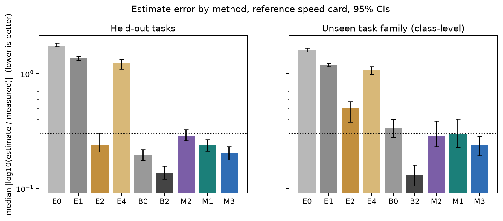
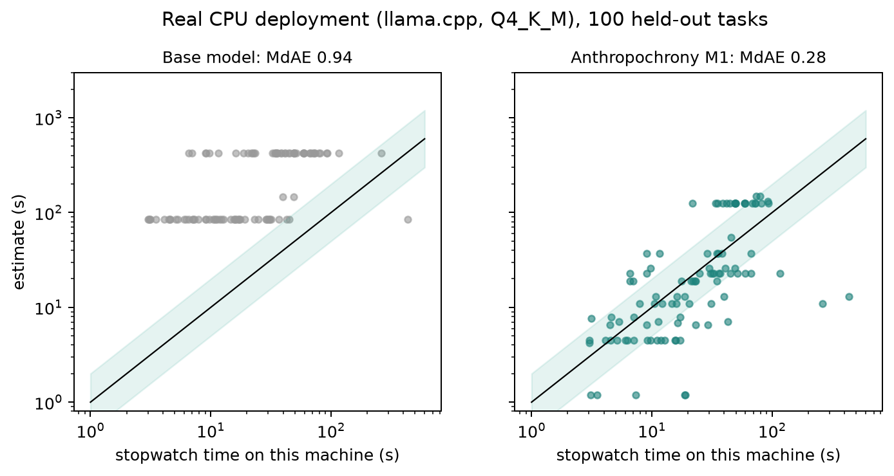
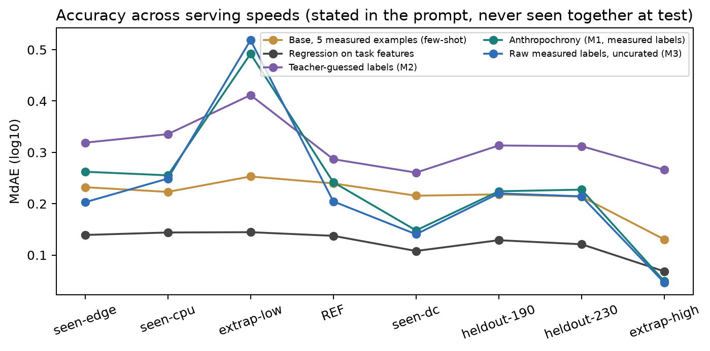

# Anthropochrony: Measuring and Correcting Human-Time Bias in LLM Self-Estimates

*Can a small coding model learn how long its own work will take? We measured it, trained it on its own measurements, and checked what the training cost. All results below come from one training seed, and several of them are weaker than we hoped.*

**Team:** [@isHeSatoshi](https://huggingface.co/isHeSatoshi)
**Code:** https://github.com/isHeSatoshi/anthropochrony
**Track 1 (Fine-tuning and Data Curation), problem #8 (data-scarce domains), with the #2 ROI comparison.**

---

## 1. Problem statement and approach, in brief

Ask a language model "how long will this take you?" and it often answers in the units of a person's workday: minutes to hours, sometimes days. A coding agent that finishes in seconds will say "about 2 hours". Monperrus and Stenqvist call this *anthropocentric time bias*. We use the word **anthropochrony** as a project name for the same idea: measuring a model's own runtime with human clocks. We do not claim the phenomenon is new, and we do not claim a first measurement of it.

What we study is the repair. Can a small open model learn to estimate its **own** completion time, given the serving speed written in its prompt, without getting worse at coding and without changing what it says about human developers?

**Setting.** Subject model: `CohereLabs/tiny-aya-global` (pinned revision `af89d219`). Task: 1,465 Python tasks with executable tests (HumanEval+, MBPP+, BigCodeBench, ClassEval, LeetCodeDataset, CodeContests, TACO). The model runs each task in a small agent loop: up to 3 attempts, test output fed back after a failure. Time for one run is a formula over what the run did:

`time = Σ over attempts ( new prompt tokens / prefill speed + output tokens / decode speed + test wall time ) + per-call latency`

Because the speeds are stated in the system prompt (a "speed card"), the same measured run gives a correct label for any card. We sampled 8 runs per task, took the median, and used that as the target. Fine-tuning data is "task + speed card → the model's own measured time".

**Pipeline** (all three hackathon libraries, chained): CuratorKIT builds and filters the task pool and the SFT sets; AlignTune trains a LoRA adapter; AuditKIT scores every estimator.

**What we found, in one paragraph.**

- Un-tuned Tiny Aya Global *without* a speed card answers with a median of about 7 minutes for tasks it finishes in about 8 seconds (a 55× overestimate on average). *With* a speed card it stops using hours but is erratic: median error is 1.4 orders of magnitude and 0% of answers are within 2×.
- Fine-tuning on its own measured times (**M1**) brings the median error to 0.24 log10 (66% of answers within 2×) on held-out tasks and 0.30 on a task family it never saw.
- That is **not** better than simply showing the base model five measured examples in the prompt (0.24 in-distribution), but it is much better on the unseen family (0.30 vs 0.50), and it holds up at held-out speeds.
- A plain gradient-boosted regressor over text features (**B2**) beats every language-model estimator in-distribution (0.14). So the model "knows" less about its own speed than a feature-based predictor.
- Training on *measured* labels beat training on *teacher-guessed* labels (0.24 vs 0.29, Holm-adjusted p < 0.001), but *uncurated* measured labels did as well or better than curated ones (0.21), so our curation did not help.
- Coding ability and human-frame answers did not change measurably (pass@1 difference CI [-2.2, +3.0] points). IFEval strict accuracy fell 5 points on 200 prompts, which is within noise for one seed but not a clean pass; ARC-Challenge did not move.
- On a plain desktop CPU with a 4-bit GGUF, the tuned model's estimates are within 2× of the measured wall-clock for 52% of 100 held-out tasks (base: 3%).

Figure 1 shows the main comparison.

*Figure 1. The model's own time estimate (y) against the median of 8 measured runs (x), reference speed card, 255 held-out tasks. The green band marks "within 2×". Panels, left to right: base with speed card (E1); base with five measured examples (E2); trained on teacher-guessed labels (M2); trained on measured labels (M1).*

**Why it matters.** (1) *Honest self-reports*: a model that reports its own work in human time reports something false. (2) *Planning and budgeting*: agents use time estimates to schedule and to decide how much to attempt. (3) *Oversight*: an estimate is a tripwire; if a run goes far past what the model said it would take, a supervisor can stop it. Section 7 simulates (2) and (3).

### 1.1 The metrics we chose, and why

All error metrics use `err = log10(estimate / measured median time)` per task, computed against the model's *own* re-measured runs.

- **MdAE (median |err|), primary.** Times span three orders of magnitude, so an additive error would be dominated by long tasks. The median is robust to the heavy tails that a few very slow tasks produce. MdAE = 0.30 means "typically within 2×".
- **Share within 2×** and **within 10×.** The version of MdAE a user can act on.
- **Spearman ρ.** Can the estimate at least *rank* tasks? Needed for scheduling.
- **GM ratio** (geometric-mean estimate ÷ measured): signed bias. This is the number behind "off by 55×".
- **Anthropocentric-unit rate**: share of self-answers stated in hours, days, weeks or months.
- **Parse rate**: a non-answer counts as infinite error, so a model cannot look good by refusing.
- **Noise ceiling**: the best an estimator could do, leave-one-out over the 8 runs (median |err| ≈ 0.03). Run-to-run variance is small, so the label is learnable in principle.
- **pass@1 and |log token ratio|**: did the fine-tune change coding behavior?
- **Human-frame answer drift**: do answers about "how long would a human developer take" stay the same?

Confidence intervals are 95% percentile bootstraps over tasks (10,000 resamples). Tests are paired Wilcoxon, Holm-corrected over the three confirmatory comparisons. Everything was pre-registered (`docs/PREREGISTRATION.md`, git tag `prereg-v1`) before any fine-tuned model saw test data. §7 of that file lists every deviation with its date.

---

## 2. Hackathon repos used

| Repo (version) | What we used it for | Where |
|---|---|---|
| **CuratorKIT 0.1.23** | Readers for each source dataset; `SchemaGate`; MinHash near-duplicate removal for tasks; exact dedup of SFT examples; rejection reasons and manifests; `messages` export for trainers | `src/anthropochrony/curate/` |
| **AlignTune 0.1.32** | LoRA SFT (TRL backend, `assistant_only_loss`, rank 16, α 32, 2 epochs); adapter publishing | `src/anthropochrony/train/`, `jobs/` |
| **AuditKIT 1.1.6** | `evaluate` with a callable vLLM model and custom scorers for every estimate; `run_lmeval` for IFEval and ARC-Challenge; run fingerprints | `src/anthropochrony/eval/`, `jobs/eval_estimates.py` |

The curation experiment (M1 curated vs M3 raw) is the data-curation part of problem #8.

**Upstream problems we hit and how we worked around them** (details in `research/lexsi_stack_audit.md`):

1. *CuratorKIT cleaning corrupts code.* The default `strip_html` and `collapse_whitespace` delete `<...>` spans and flatten Python indentation. We passed `clean=False`, raised `max_tokens` on the schema gate, and split by task *before* CuratorKIT so no task's variants straddle a split.
2. *AuditKIT replays stale cache entries.* The disk cache keys a model by its path string and a scorer by its name, not by weights or code. A retrained adapter in the same directory, or an edited scorer, silently returns old results. We give every checkpoint a unique directory, put model/eval-set/code hashes in `RunConfig(extra=...)`, and version scorer names.
3. *AlignTune/TRL default truncation.* With a 512-token default the instruction preamble silently truncates training examples. We set `max_seq_length` explicitly (3,072 after the matched-length rule triggered, see §7), log dropped sequences per family, and check the assistant-only loss mask on the actual collator output.

Also: vLLM crashes when serving LoRA adapters on this architecture (Cohere2), so all fine-tuned inference uses **merged** weights.

---

## 3. Models used and their licenses

| Model | Role | License |
|---|---|---|
| `CohereLabs/tiny-aya-global` @ `af89d219b53ed9b13b8a4645f9c8028973510324` | Subject model; all trajectories, estimates, fine-tunes | CC-BY-NC-4.0 + Cohere Labs Acceptable Use Policy |
| Our LoRA adapters (M1, M2, M3, LR-sweep runs) and GGUF exports | Released artifacts | CC-BY-NC-4.0 (derived from Tiny Aya), AUP applies |
| DeepSeek-V4-Pro | **Teacher** for M2 labels and the B4 baseline (guessed times). Called through the HF Inference Providers; total provider spend about $1.7 | See its model card; used as an API only, no weights redistributed |
| `BAAI/bge-small-en-v1.5` | Text features for the B2 regressor | MIT |
| llama.cpp (b12110) | CPU deployment, GGUF conversion, quantization | MIT |

We did not use an LLM judge to parse estimates: every number was extracted by a regex parser, audited by hand on 60 rows (58 correct; the audit was done by the research agent, not an independent human). Aya Expanse 8B was not run.

---

## 4. Datasets and benchmarks used, and their licenses

| Dataset | Use | License / terms |
|---|---|---|
| HumanEval+ / MBPP+ (EvalPlus) | Task pool | Apache-2.0 |
| BigCodeBench | Task pool (library-using functions; largest family) | Apache-2.0 |
| ClassEval | Task pool (class-level; **held out entirely as the unseen family**) | CC BY-NC 4.0 |
| LeetCodeDataset | Task pool (algorithm functions) | Apache-2.0 tag; problem statements are LeetCode's copyright |
| CodeContests | Task pool (stdin/stdout) | CC-BY-4.0; statements third-party |
| TACO | Task pool (stdin/stdout, used when CodeContests had too few Python-checkable tasks) | Apache-2.0 metadata; statements third-party |
| IFEval (first 200 prompts), ARC-Challenge (full) | Capability retention (AuditKIT `run_lmeval`) | Apache-2.0 / CC-BY-SA-4.0 |
| **Our datasets** | tasks, traces, sft, eval, logs | Metadata CC-BY-NC-4.0. Rows from LeetCodeDataset, CodeContests and TACO are released as IDs plus a loader (`rebuild_task`), with no statement, tests, reference code or paraphrase |

**Why these datasets.** Each family gives a different shape of work: short functions (FUNC), library-heavy functions (LIB), algorithm functions (ALGO_FN), stdin/stdout programs (ALGO_IO) and whole classes (CLASS). We hold **CLASS out completely** (93 tasks) to test whether an estimator that learned "how long my kind of task takes" works on a kind it never saw. Pool after CuratorKIT filtering: 1,465 tasks → 869 train, 114 validation, 255 test, 93 unseen-family test, 134 extra. Near-duplicate groups are assigned whole to one split.

---

## 5. Model artifacts (HF collection)

**Collection:** https://huggingface.co/collections/isHeSatoshi/anthropochrony-models-6af31e769e666b4001e8c5f2

Contents:

| Repo | What it is |
|---|---|
| `anthropochrony-tiny-aya-global-lora-m1-s0` | **Main model.** LoRA r16 on measured, curated labels, seed 0 |
| `anthropochrony-tiny-aya-global-lora-m2-s0` | Control: same tasks and format, teacher-guessed labels |
| `anthropochrony-tiny-aya-global-lora-m3-s0` | Control: measured labels, no quality gates |
| `anthropochrony-tiny-aya-global-lora-lr-0.0001`, `-lr-0.0002` | One-epoch learning-rate sweep runs |
| `anthropochrony-tiny-aya-global-m1-s0-gguf` | Q4_K_M and Q8_0 GGUF of the merged M1 model, plus the base GGUF used in the CPU deployment test |

Each card states base revision, data, metrics, limitations and the AUP. Merged weights are not uploaded as a separate repo; the adapters merge in a few lines (see `scripts/` and the README).

**Serving note.** The merged model must be built in bf16 for the results reported here. An fp32 merge reproduces the PEFT outputs (logit differences < 1e-4), but rounding merged weights to bf16 flips some near-tied digits. In 6 of 50 validation prompts the merged-bf16 greedy output differed from the PEFT output by a digit. The pre-registered parity check allowed at most 2 mismatches; we replaced it with a numeric explanation of each flip (PREREGISTRATION §7, dated before any test data was generated for a fine-tuned model). Treat this as a weakening of the original criterion.

---

## 6. Data artifacts (HF collection)

**Collection:** https://huggingface.co/collections/isHeSatoshi/anthropochrony-data-6af31e776d6f33265b0c33a8

| Repo | Contents |
|---|---|
| `anthropochrony-tasks` | Task manifest (IDs, family, split, source, license), restricted sources as ID + loader, drop reasons |
| `anthropochrony-traces` | Every K=8 trajectory summary for base, M1, M2, M3 (attempts, token counts, exec status, wall times); generated text kept only for unrestricted sources |
| `anthropochrony-sft` | The M1, M2 and M3 training sets (messages, labels, label source) with the user turn redacted for restricted sources |
| `anthropochrony-eval` | Every estimate (all estimators, frames, cards), labels, metrics, hypotheses, simulations, ROI, CPU deployment results |
| `anthropochrony-logs` | Training logs and `trainer_state.json`, job logs, `RUNLOG.md`, gate evidence, budget ledger |

`notebooks/reproduce_results.ipynb` rebuilds every headline number from the released `eval` data on CPU in a few minutes.

---

## 7. Experiments, findings and what else we tested

### 7.1 Approach and rationale

Three design choices carry the study.

1. **Measure, don't guess.** Every label is a median of 8 real runs of the model that is being tuned, converted to time with a stated speed card. A model's tokens-per-answer and number of attempts are properties of *that* model, which is why a teacher's guess or another model's measurements should (and, in M2, did) do worse.
2. **Re-measure after tuning.** Fine-tuning can change how many tokens the model writes. So M1, M2 and M3 were run again (K=8, 2,784 trajectories each) on the test splits, and scored against *their own* new times. Scoring against the base model's times is reported as a robustness check, and gives the same picture (M1: 0.235 vs 0.242).
3. **Seven comparison arms**, so that the headline number is not read against a straw man: the base model with no card (E0), with the card (E1), with five measured examples (E2), asked about "an AI assistant" instead of itself (E3), post-hoc rescaled by speed (E4, the MetaTime rule); constants and per-family medians (B0, B1); an input-only regressor (B2); and a stronger teacher model's guess (B4).

**Training.** LoRA r16, α 32, all attention and MLP projections, 2 epochs, LR 2e-4 (chosen on validation from {1e-4, 2e-4}: validation MdAE 0.39 vs 0.35), 6,077 examples for M1 (5,214 self-frame with a spread of speed cards and phrasings, 863 human-frame preservation examples), one L40S, 380 steps, about 70 minutes. Label text includes an estimate, an interval and a short token-and-speed breakdown.

### 7.2 Main result (reference speed card, 95% CIs)

Median |err| in log10; "within 2×" is the share of tasks within a factor of 2.

| Estimator | `test` (255): MdAE [CI] | within 2× | `test_ood` (93): MdAE | within 2× |
|---|---|---|---|---|
| E0 base, no card | 1.76 [1.73, 1.85] | 0.4% | 1.62 | 0% |
| E1 base + card | 1.38 [1.32, 1.41] | 0.4% | 1.20 | 1% |
| E4 E1 rescaled by speed | 1.24 [1.09, 1.34] | 15% | 1.07 | 22% |
| **E2 base + 5 measured examples** | **0.24** [0.21, 0.30] | 55% | 0.50 | 30% |
| B0 constant | 0.20 [0.18, 0.22] | 69% | 0.34 | 46% |
| B1 family median | 0.12 [0.09, 0.14] | 82% | 0.34 | 46% |
| **B2 text-feature regressor** | **0.14** [0.12, 0.16] | 83% | 0.13 | 82% |
| B4 teacher guess (DeepSeek-V4-Pro) | 0.24 [0.21, 0.26] | 65% | 0.29 | 53% |
| M2 trained on teacher guesses | 0.29 [0.26, 0.33] | 51% | 0.29 | 51% |
| M3 trained on raw measured labels | 0.21 [0.18, 0.23] | 73% | 0.24 | 60% |
| **M1 trained on curated measured labels** | **0.24** [0.21, 0.27] | **66%** | **0.30** [0.23, 0.40] | 51% |
| Noise ceiling | ≈ 0.03 | | | |

*Figure 2. Error by method on held-out tasks and on the unseen task family. Dotted line: the pre-registered 0.30 bar. Lower is better. Error bars: 95% bootstrap.*

How to read this honestly:

- **The base bias is real and specific.** Without a speed card E0 gets a 55× geometric-mean overestimate and 2% of answers use human work units. Adding the card (E1) removes the unit problem but not the error: the median answer is about 5 seconds, close to the median truth, but the spread is huge, so errors still sit around 1.4 orders of magnitude. Rescaling after the fact (E4) barely helps, because the error is not a speed-scale error.
- **M1 meets the pre-registered bars; H1 does not.** (Table below.) H1 asked for a ≥10× overestimate and ≥50% human units for both E0 and E1. E0 satisfies the first part (55×), but only 2.4% use human units, and E1 is not overestimating at all (0.54×). We report H1 as **not met as pre-registered**: the base model's problem with the speed card is noise, not human-scale bias.
- **M1 ties few-shot prompting in-distribution.** E2 reaches 0.24 on `test` with no training. M1 is better on the share within 2× (66% vs 55%), and much better on the unseen family (0.30 vs 0.50) and held-out speeds.
- **A regressor over text features beats every LM estimator in-distribution.** B2 (0.14) and even B1 (family median; 0.12) are better than M1 on `test`. On the unseen family only B2 stays good (0.13); B1 has no family median to use. So "the model knows its own speed" is too generous: most of the learnable signal is in the task text, and it is cheaper to read from a regressor.
- **M1's intervals are not calibrated.** Its stated 80% range covered 19% of fresh runs.
- **M1 collapses toward a few values**: its predictions form visible horizontal bands (Figure 1, right). Spearman ρ is 0.57 on `test` and only 0.08 on the unseen family: the tuned model has a good *scale* but a weak *ranking* out of distribution.

| Hypothesis (pre-registered) | Result | Status |
|---|---|---|
| H1 base bias | E0: 55× GM ratio, 2.4% human units; E1: 0.54× | **Not met** |
| H2 M1 MdAE ≤ 0.30, beats best base prompt | 0.242; Holm p = 0.003 (vs E2) | Met (1 seed) |
| H3 unseen family MdAE ≤ 0.50, beats base | 0.300; Holm p = 0.0002 | Met (1 seed) |
| H4 held-out speeds MdAE ≤ 0.35 and elasticity in [0.8, 1.2] | 0.224; elasticity 0.801 [0.789, 0.825] | Met, barely on elasticity |
| H5 measured beats guessed | M1 0.242 vs M2 0.287; Holm p = 0.0006 | Met (1 seed) |
| H6a pass@1 not worse by > 3 points | difference CI [-2.2, +3.0] | Met |
| H6b human-frame answers unchanged | median ratio 0.0 | Met |

### 7.3 Speeds, families, frames

- **Held-out speeds.** M1's MdAE on the two held-out interpolation cards is 0.224/0.227; on a card faster than anything seen in training (5,000 tokens/s decode) it is 0.05 (M3: 0.05). On a card slower than anything seen (1.5 tokens/s) it fails: 0.49 against E2's 0.25, so the model extrapolates badly toward slower hardware.
- **By family** (M1 / E2 / B2): ALGO_FN 0.22 / 0.27 / 0.09; ALGO_IO 0.20 / 0.18 / 0.10; FUNC 0.28 / 0.39 / 0.24; LIB 0.23 / 0.19 / 0.10.
- **Other frames.** The same model asked in a *plan* frame ("plan this task and say how long the plan will take") has MdAE 0.67 with 94% parse; the *generic* frame ("an AI assistant") is 0.59 against E3's 1.69. Training on direct questions transfers partly; it does not fix plans.
- **Human frame.** M1's answer to "how long would a human developer take" is identical to the base model's for at least half of tasks (median ratio 1.0), and still in human units, as intended (GM ratio 9.7 against the model's own time).

### 7.4 Capability and behavior preserved

| Check | Base | M1 | M2 |
|---|---|---|---|
| pass@1, `test` (255 tasks, K=8) | 0.209 | 0.214 | 0.199 |
| pass@3 (any of 3 attempts), `test` | 0.222 | 0.222 | 0.212 |
| pass@1, `test_ood` | 0.099 | 0.128 | 0.157 |
| median abs. log10 output-token ratio vs base | | 0.10 | 0.10 |
| IFEval prompt-strict / inst-strict (first 200) | 0.750 / 0.830 | 0.700 / 0.796 | 0.735 / 0.821 |
| ARC-Challenge acc / acc_norm | 0.425 / 0.458 | 0.422 / 0.456 | 0.424 / 0.454 |

M1 loses 5.0 points of IFEval prompt-level strict accuracy (0.750 to 0.700) and 3.5 points at instruction level. With 200 prompts the binomial standard error is about 3 points, and this is one seed, so we call it a small possible loss, not a measured one; M2 lost 1.5 points. ARC-Challenge is unchanged within 0.3 points. Retries add almost nothing for this model (pass@3 0.222 against pass@1 0.209 on the base).

M1 pass@1 on `test_ood` is nominally higher than base (0.128 vs 0.099); we do not interpret it. The pre-registered test is non-inferiority on `test`, which holds.

### 7.5 What the estimates are good for (simulation, exploratory)

**Shortest-job-first scheduling.** Using each estimator's predictions to order 1,000 random queues of the held-out tasks, mean completion time relative to the oracle ordering (lower is better; arrival order = 1.69):

B2 1.14 · E2 1.19 · B1 1.21 · M3 1.24 · B4 1.33 · **M1 1.36** · M2 1.51 · E0 1.53 · E1 1.56.

**Tripwire.** Stop a run when it passes `k ×` its own estimate. On the 2,040 held-out runs (1,588 of which fail), M1 at `k = 2` stops 0% of runs that would have passed and saves 18.9% of the time spent on failed runs; at `k = 1.5` it falsely stops 3.5% and saves 24.9%. E1 falsely stops 71–73% of runs at every multiplier from 1 to 3, because many of its estimates are far too small. (Not a deployment claim; the simulation reuses the test trajectories.)

*Figure 4. Left: scheduling simulation. Right: tripwire false-stop rate vs share of failed-run time saved.*

### 7.6 Real deployment on a desktop CPU (X10)

We ran the tuned and base models as Q4_K_M GGUFs in llama.cpp (b12110) on an 8-thread desktop CPU: prefill ≈ 200 tok/s, decode ≈ 20 tok/s. The speed card in the prompt states those measured speeds. We ran 100 held-out FUNC/LIB/ALGO_FN tasks end to end in the agent loop (sandboxed test execution) and compared each model's estimate with the measured wall-clock.

| | Base (Q4_K_M) | Tuned (M1, Q4_K_M) |
|---|---|---|
| Median abs. log10 error | 0.935 | **0.279** |
| Within 2× | 3% | **52%** |
| Parse rate | 99% | 100% |

The first six tasks in the results file (not selected), base estimate / tuned estimate / measured wall-clock:

| Task | Base | Tuned | Measured | Outcome |
|---|---|---|---|---|
| BigCodeBench/778 | 7 min | 23 s | 32.5 s | failed after 3 attempts |
| HumanEval/95 | 7 min | 19 s | 6.5 s | passed on attempt 1 |
| Mbpp/138 | 85 s | 8 s | 17.1 s | failed after 3 attempts |
| BigCodeBench/273 | 7 min | 23 s | 116.1 s | failed after 3 attempts |
| BigCodeBench/507 | 7 min | 23 s | 36.1 s | failed after 3 attempts |
| HumanEval/116 | 7 min | 19 s | 7.0 s | passed on attempt 1 |

The tuned model tracks the order of magnitude but, as the table shows, it stays near one value per family and misses long failing runs (BigCodeBench/273).

Pass rate 0.34; median wall time 22.8 s per task. One estimate costs about 15 s on this CPU (45 s if three are sampled). Some rows ran while other local jobs shared the CPU, which adds contention noise to wall times.

*Figure 5. CPU deployment: estimated vs measured wall-clock, base and tuned.*

### 7.7 Cost comparison (ROI)

We measured our own batch estimate throughput on one HF Jobs L40S ($1.80/h): 6,216 estimate requests in 199 s (31.2 requests/s, 3,677 output tokens/s, mean 867 tokens in and 118 out, 99% mean GPU utilization). Compared at the price of a small closed model (OpenAI GPT-5-mini, $0.25 in / $2.00 out per million tokens, checked 2026-11-10 on developers.openai.com):

| Monthly estimates | Closed API | Self-hosted, saturated GPU |
|---|---|---|
| 10,000 | $4.52 | $0.16 |
| 1,000,000 | $452 | $16 |
| 10,000,000 | $4,522 | $160 |

An always-on L40S ($1,314/month) breaks even with the API at about 2.9 million estimates per month. Caveats: the self-hosted number assumes full batching; the API price ignores hidden reasoning tokens; **we did not measure the closed model's accuracy on this task**, so this compares cost only. The CPU deployment has no per-call bill but takes about 15 s per estimate.

*Figure 3. Estimates and truth across the eight speed cards (REF, three seen, two held-out, two extrapolation).*

### 7.8 Showcase: PROJ-8 tasks

SHOWCASE_PLACEHOLDER

### 7.9 Negative and surprising results (summary)

- H1 as pre-registered did not hold for E1.
- Curation did not help: M3 (raw labels) 0.205 is at least as good as M1 (0.242). The curation step removes tasks with unstable labels and near-duplicates; at this scale that cost more data than it bought in cleanliness.
- Few-shot prompting is a strong, free baseline for in-distribution tasks.
- A feature regressor is better than the tuned language model in-distribution.
- Interval calibration, extrapolation to slower hardware, and OOD rank order are poor.
- Single seed: no seed-to-seed variance was estimated. We cannot rule out that another seed would reverse the M1/M3 order or the M1/E2 tie.

### 7.10 Deviations from the pre-registration

All are listed with dates in `docs/PREREGISTRATION.md` §7. The ones that matter for reading the results: **seed cut** (only seed 0 of M1, M2 and M3; the $30 cap could not fund seeds 1 and 2); **G6 parity criterion** (see §5); **base answers start with the fixed text `Time estimate:`** so that the base model gets a fair chance to answer in a parseable form (this can only favor the base); a per-call latency fallback in the time formula; a 60-row (not 200-row) parser audit; IFEval cut to the first 200 prompts; a failed first lm-eval job ($1.47). No threshold, split or hypothesis was changed.

### 7.11 Exploratory questions we did not run

X2 (hidden-state probe), X4/M6/M9 (cross-model training, Aya Expanse 8B), X7 (self-fulfilling estimates), X8 (success prediction), X9, and variants M4, M5, M7, M8 (GRPO). We prefer to say this than to describe them as future work already underway.

---

## 8. With more credits

The $30 cap, not the design, set the scope. With the extra HF credits for shortlisted teams, in priority order:

1. **Seeds 1 and 2** for M1, M2 and M3, to put an SD under every claim above (about $12 including re-measurement).
2. **M9 / M6**: a 2×2 self/cross design with Aya Expanse 8B, to test whether the labels need to be the model's *own*.
3. **More speed cards below the training range**, since extrapolation to slow hardware was the clearest failure.
4. **A regression head or a hybrid:** since B2 beats the tuned model, feed B2's prediction (or the hidden-state probe, X2) into the prompt and have the LM explain and adjust.
5. **RAFT/GRPO** with a log-error reward to fix interval calibration.
6. **Hardware matrix** for real deployments beyond one CPU, and multi-file repository tasks.

---

## 9. Teammates

Built by [@isHeSatoshi](https://huggingface.co/isHeSatoshi). *(Add co-members here before submission.)*

---

## Appendix: reproduction

`README.md` has the commands. In short: `uv sync && make figures` rebuilds the tables and figures from released data on CPU; `notebooks/reproduce_results.ipynb` checks the headline numbers against the released `metrics.json`. The full pipeline (`make tasks calibrate measure labels baselines sft-data train remeasure eval`) needs HF Jobs L40S time; the total spend for this study was about $TOTAL_USD of a $30 cap.

**References.** Monperrus, M. and Stenqvist, O. on anthropocentric time bias in LLM coding agents; MetaTime and AgentTime as concurrent measurement studies (see `research/related_work.md` and `research/references.bib`). Tiny Aya: Cohere Labs. EvalPlus, BigCodeBench, ClassEval, LeetCodeDataset, CodeContests, TACO, IFEval, ARC.

*Citation.* `Anthropochrony: Measuring and Correcting Human-Time Bias in LLM Self-Estimates`, isHeSatoshi, 2026.
