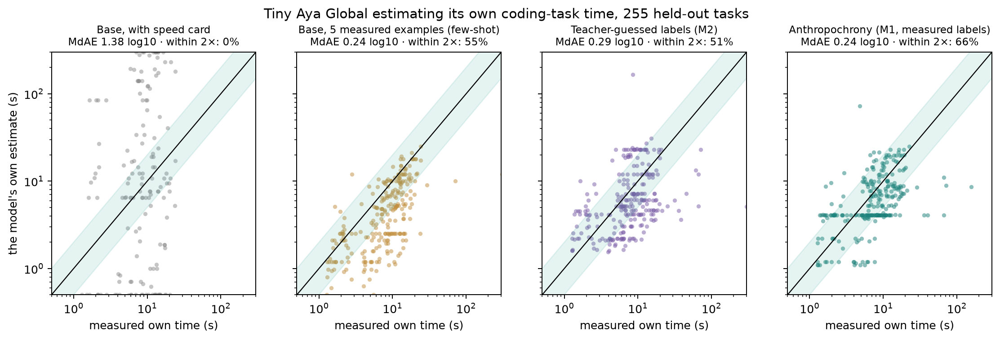
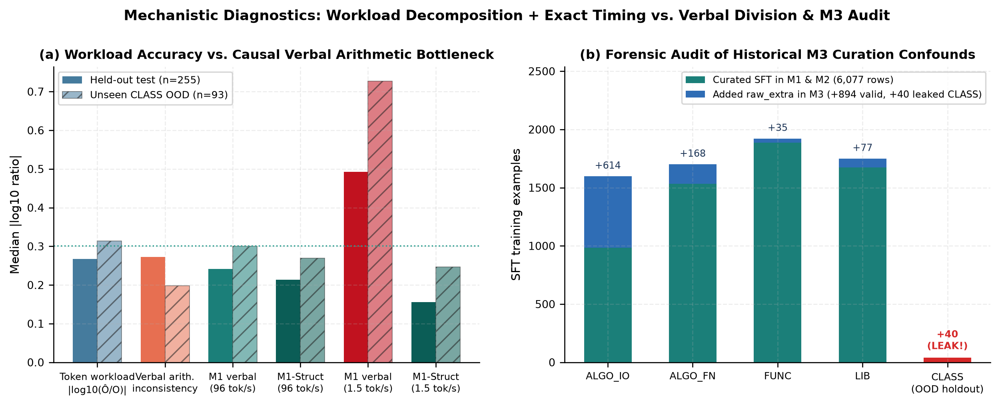
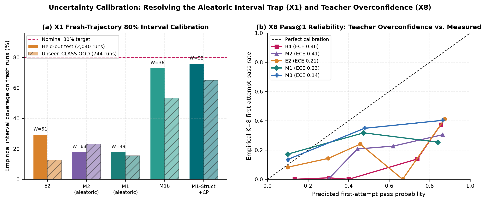
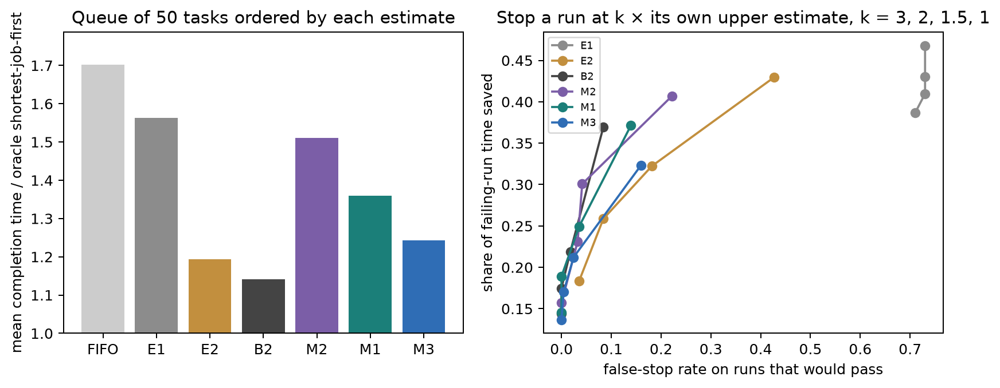

# Anthropochrony: Measuring and Correcting Human-Time Bias in LLM Self-Estimates

*In-distribution, 5-shot prompting (`0.240` $\text{log}_{10}$ error) and per-family lookup tables (`0.123`) look competitive with fine-tuning (`0.242`). Out-of-distribution—on an unseen multi-method class family (`CLASS`) or 64× slower hardware (`1.5 tok/s`)—both shortcuts collapse (`0.503` and `0.336`). Across 1,465 executable Python tasks on `CohereLabs/tiny-aya-global` (`3.35B`), we show why: fine-tuning on measured trajectories (`M1-S0`) teaches genuine workload self-knowledge (`0.268` vs. `0.313` output-token error in-distribution; `0.314` vs. `0.476` out-of-distribution), whereas raw verbal time answers hit an autoregressive arithmetic bottleneck (`0.272` $\text{log}_{10}$ pre-breakdown division error). Combining fine-tuned **workload decomposition with an exact timing model (`M1-Struct`)** eliminates verbal division error without retraining—cutting unseen-family error to `0.269` (`4.6×` higher Spearman $\rho$, best OOD queue scheduling), slashing `1.5 tok/s` error `3.17×` (`0.492` $\rightarrow$ `0.155`), and lifting live desktop CPU wall-clock accuracy from `3%` (`base`) and `52%` (verbal `M1-S0`) to `63%` within 2×. All fine-tuned runs use one seed (`S0`), every table tracks `own` vs. `base` target sources, and every negative result—including `H1` failure, static `B2` dominance, and a `val`-selection failure on `M1-Struct + B2`—is reported directly.*

**Team:** [@isHeSatoshi](https://huggingface.co/isHeSatoshi)  
**Code:** https://github.com/isHeSatoshi/anthropochrony  
**Track 1 (Fine-tuning and Data Curation), Problem #8 (Data-scarce domains, primary) + Problem #2 (Replacing a closed-model API, ROI & accuracy comparison).**

---

## 1. Problem statement and approach, in brief

Ask a language model *"how long will this coding task take you?"* and it routinely answers on a human software engineer's clock: minutes, hours, or days for work its own decoding loop finishes in eight seconds. Monperrus and Stenqvist call this *anthropocentric time bias*; concurrent studies (*MetaTime*, *AgentTime*) document similar miscalibration across coding agents. We use **anthropochrony** as our project name for judging machine runtime with human clocks. We do not claim the phenomenon is new.

**Why out-of-distribution generalization is the real test.** Within known task families at a fixed serving speed, rough pattern matching suffices: 5-shot in-context examples from the same task families (`E2`) or a per-family median table (`B1`) already land near the typical runtime. Real agent deployments, however, face **new structural granularities** (e.g., stateful multi-method classes when training covered only standalone functions and scripts) and **new serving hardware** (edge GPUs, throttled endpoints, or local quantized CPUs). We study `CohereLabs/tiny-aya-global` (`3.35B`, pinned revision `af89d219`) across **1,465 executable Python tasks** under a pre-registered protocol (`docs/PREREGISTRATION.md`, frozen tag `prereg-v1`) to answer two questions:

1. Does supervised fine-tuning on curated, empirically measured self-trajectories (`M1-S0`) generalize across **unseen task families (`CLASS`)** and **unseen hardware speeds** without hurting coding `pass@1` or distorting human-developer estimates?
2. What caps raw verbal duration tokens—poor self-knowledge of token/retry workload, or **single-pass autoregressive arithmetic**—and what happens when we pair fine-tuned **workload decomposition with an exact timing model (`M1-Struct`)** and **split-conformal calibration (`M1-Struct+CP`)**?

**Exact serving timing model.** Each task runs in a 3-attempt sandboxed Python repair loop. Given a hardware **speed card** $(S, P)$ stated in the system prompt (decode speed $S$ and uncached prefill speed $P$ in tokens/s) and measured per-call serving latency $L = 0.967\text{ s}$, completion time for trajectory $\tau$ is:

$$t(\tau; S, P) = \sum_{j=1}^{A(\tau)} \left( \frac{u_j}{P} + \frac{o_j}{S} + e_j + L \right)$$

where $u_j$ is uncached prompt tokens at attempt $j$, $o_j$ is generated output tokens, and $e_j$ is sandboxed test wall-clock time. Sampling $K = 8$ real agent trajectories per task yields exact ground-truth runtime medians and quantiles across seen, held-out interpolation, and extreme extrapolation speed cards. Crucially, we re-measure $K = 8$ trajectories for each fine-tuned checkpoint on `test` (`255` tasks) and `test_ood` (`93` tasks) so fine-tuned models are scored against their **`own`** post-SFT runtimes, reporting `Target source` (`own` vs. `base`) in every table.

**Hackathon pipeline (all three Track 1 libraries chained end to end):** **CuratorKIT `0.1.23`** ingests, gates, deduplicates, and formats the task pool and SFT datasets $\rightarrow$ **AlignTune `0.1.32`** trains rank-16 LoRA adapters $\rightarrow$ **AuditKIT `1.1.6`** scores every estimator and runs capability retention benchmarks (`IFEval`, `ARC-Challenge`).

**Headline findings:**

1. **Out-of-distribution generalization separates fine-tuning from prompting (`H2–H6` met on 1 seed; `H1` not met):** In-distribution (`test`, `n = 255`), 5-shot prompting (`E2`, `0.240` MdAE, `55.3%` within 2×) nearly ties verbal SFT (`M1-S0`, `0.242` MdAE, though `M1-S0` places **`65.9%` within 2×**, paired Wilcoxon Holm $p = 0.0032$). Out-of-distribution on `93` unseen multi-method class tasks (`test_ood`: `CLASS`), 5-shot `E2` collapses to **`0.503` MdAE (`30.1%` within 2×)** and per-family lookup `B1` (`0.123` on `test`) collapses to the global constant (`0.336`). Measured SFT (`M1-S0`) cuts unseen `CLASS` error to **`0.300` (`50.5%` within 2×, Holm $p = 0.00025$)**, beats SFT on frontier-teacher guesses (`M2-S0`, `0.287` on `test`, Holm $p = 0.00056`), and preserves coding `pass@1` (`[-2.2, +3.0]` pp CI) and human-frame estimates (`0.000` median drift). `H1` was not met as pre-registered: without a speed card (`E0`), the base model overestimates `55.3×` (`~7 min` vs. `~8 s`), whereas adding a speed card (`E1`) removes hour-scale units (`0.4%`) but leaves `1.375` $\text{log}_{10}$ dispersion (`0.4%` within 2×).
2. **Headline diagnostic—the verbal-arithmetic bottleneck, not token self-knowledge:** Auditing the structured breakdown inside every answer reveals that **`M1-S0` already predicts its own output tokens significantly better than 5-shot `E2`** (**`0.268` vs. `0.313`** token MdAE on `test`, `56.1%` vs. `48.0%` within 2×; **`0.314` vs. `0.476`** on unseen `CLASS`, `48.4%` vs. `31.2%` within 2×). Raw verbal `M1-S0` stalls because our output template emits `Time estimate: T s` *before* `Breakdown: ~O output tokens across A attempt(s)`, forcing `3.35B` weights to approximate $O/S + u/P + A(e+L)$ in one forward pass. That ordering introduces **`0.272` $\text{log}_{10}$ bare arithmetic inconsistency** (`0.089` with latency $L$), creates horizontal quantization bands, and breaks on `1.5 tok/s` slow hardware (`0.492` MdAE on `test`, `0.728` on `CLASS`).
3. **Workload decomposition with an exact timing model (`M1-Struct`, zero retraining):** Passing `M1-S0`'s already-emitted `(O, A)` workload through the exact serving timing equation with strictly `train`-only execution and retry-feedback medians cuts `REF` error to **`0.213` on `test` (`71.8%` within 2×)** and **`0.269` on unseen `CLASS` (`58.1%` within 2×, lifting OOD Spearman $\rho$ `4.6×` from `0.080` to `0.369`)**—beating both `E2` and closed frontier teacher **`B4` (`DeepSeek-V4-Pro`, `0.244` / `0.294`)** at ~100× lower batched serving cost (`$16` vs. `~$1,700` per 1M estimates). On `1.5 tok/s` slow hardware (`extrap-low`), `M1-Struct` slashes error **3.17×** (`0.492` $\rightarrow$ **`0.155`**, `73.7%` within 2× on `test`) and **2.95×** (`0.728` $\rightarrow$ **`0.247`**, `67.7%` within 2× on `CLASS`). On a real desktop CPU (`X10`, `llama.cpp` `Q4_K_M` @ `20 tok/s`, `100` tasks), setting local latency $L = 0$ lifts end-to-end wall-clock accuracy from `3%` (`base`) and `52%` (verbal `M1-S0`) to **`63%` within 2× (`0.224` MdAE)**.
4. **Static tabular baseline (`B2`) & explicit `val`-selection failure:** A CPU gradient-boosted regressor on prompt AST features + `bge-small` embeddings (`B2`) achieves **`0.137` (`test`)** and **`0.130` (`test_ood`)** against `base` targets, beating every standalone LM on static prompt-to-time prediction (`M1-Struct` still leads `B2` on unseen `CLASS` OOD Shortest-Job-First queue scheduling: `1.183×` vs. `1.253×` oracle). Critically, tuning a log-linear `M1-Struct + B2` blend on `val` (`n = 114`) **failed to beat standalone `B2` on `test`/`test_ood`**: because post-SFT re-measurement ran only on `test` and `test_ood`, `val` used `base` targets where `M1-Struct` (`0.123`) edged `B2` (`0.132`), causing `val` grid search to pick $w = 0.80$ on `M1-Struct` (`0.116` on `val`)—which degraded to **`0.178` (`test`)** and **`0.202` (`test_ood`)** on `own` targets, worse than both standalone `B2` (`0.138` / `0.122` on `own` targets) and an untuned `50/50` blend (`0.159` / `0.180`).
5. **Conformal uncertainty calibration & systems utility (`M1-Struct+CP`):** Split-conformal calibration on `val` (`n = 114`) lifts fresh-trajectory 80% interval coverage (`2,040` `test` runs) from **`17.7%` to `75.8%`** (`64.9%` under `CLASS` OOD shift, cutting OOD Winkler score from `94.9` to `47.4`), cuts `1.0×` timeout false aborts **10.5×** (`13.9%` $\rightarrow$ **`1.33%`**) while saving `19.9%` of failed-run GPU time, and cuts multi-tier `15 s` Edge/Datacenter SLA routing cost by **`26.4%`** (`6.3%` violations vs. `31.2%` Always-Edge).



*Figure 1. Predicted completion time (y) vs. measured median runtime over $K = 8$ runs (x) on 255 held-out `test` tasks (`REF` speed card: $S = 96\text{ tok/s}$, $P = 26{,}000\text{ tok/s}$; shaded band = within 2×). Panels show zero-shot base + speed card (`E1`, `base` targets), 5-shot measured base (`E2`, `base` targets), teacher-guessed SFT (`M2-S0`, `own` targets), curated measured SFT (`M1-S0`, `own` targets), and workload decomposition + exact timing (`M1-Struct`, `own` targets, removing horizontal verbal quantization bands).*

### 1.1 The metrics we chose, and why

Every accuracy metric compares task-level prediction $\hat{t}_i$ against measured median runtime $t_i$ via signed log error $e_i = \log_{10}(\hat{t}_i / t_i)$, averaged across prompt phrasings within each task first, with explicit **`Target source`** tracking (`own` post-SFT re-measured $K=8$ trajectories vs. `base` trajectories):

- **Median $|\log_{10}(\hat{t}/t)|$ (`MdAE`, primary):** Agent runtimes span nearly three orders of magnitude (`1 s` to `>300 s`); additive RMSE is dominated by a handful of 3-attempt timeouts, whereas `MdAE` is scale-invariant and outlier-resistant (`0.301` = factor of `2.0×`).
- **Share within 2× and within 10×:** Direct operational accuracy thresholds for schedulers and human supervisors.
- **Spearman $\rho$ and pairwise / counter-intuitive pair accuracy:** Measure whether an estimator orders tasks accurately (`SJF` queue scheduling), especially on pairs where human-developer duration priors invert actual LLM runtime.
- **Geometric-mean (GM) ratio ($10^{\overline{e}}$) and Anthropocentric-Unit Rate (`AUR`):** Separate signed scale bias (e.g., `55.3×` overestimation) from zero-centered noise and track regression to human calendar units (`hours`, `days`, `weeks`, `months`).
- **Parse rate (strict penalty):** Unparseable self-estimates receive $|e_i| = +\infty$, preventing models from gaming `MdAE` by refusing to answer.
- **Token-workload `MdAE` and verbal arithmetic inconsistency:** Decompose end-to-end duration error into *neural workload error* ($|\log_{10}(\hat{O}_i / O_i)|$) versus *autoregressive division inconsistency* ($|\log_{10}(\hat{t}_i / t_{\text{exact}}(\hat{O}_i, \hat{A}_i))|$).
- **Split-half / LOO trajectory noise ceiling (`≈ 0.03–0.04` $\text{log}_{10}$):** Quantifies the irreducible stochastic floor of $K = 8$ agent sampling.
- **Interval coverage & Winkler score (`X1`), plus Brier / AUROC / ECE (`X8`):** Score uncertainty calibration across all `2,040` (`test`) and `744` (`test_ood`) individual trajectories and calibration of stated first-attempt pass probabilities.
- **Behavioral & frame non-inferiority (`pass@1`, output-token shift, `IFEval`, `ARC-Challenge`, human-frame drift):** Verify that teaching self-time neither degrades coding capability nor overwrites human-developer priors.

All confidence intervals are `10,000`-resample family-stratified percentile bootstraps over tasks; confirmatory p-values use paired two-sided Wilcoxon signed-rank tests with Holm step-down multiplicity correction across `{H2, H3, H5}`.

---

## 2. Hackathon repos used

| Library (pinned version) | Features used in our pipeline | Code modules |
|---|---|---|
| **CuratorKIT `0.1.23`** | Dataset readers across 7 coding benchmarks; `SchemaGate`; MinHash near-duplicate clustering (`Jaccard ≥ 0.7`) on task statements and reference solutions; exact deduplication of multi-card/multi-template SFT conversations; drop manifests; ChatML `messages` export | `src/anthropochrony/tasks/`, `src/anthropochrony/curate/` |
| **AlignTune `0.1.32`** | QLoRA / LoRA SFT (`backend="trl"`, `assistant_only_loss=True`, $r = 16$, $\alpha = 32$, all attention + MLP projections, `max_seq_length=3072`, effective batch `32`, 2 epochs); LR sweep and adapter checkpointing | `src/anthropochrony/train/`, `jobs/` |
| **AuditKIT `1.1.6`** | `evaluate` harness with vLLM callable backends and custom deterministic regex/metric scorers across all splits, frames, and speed cards; `run_lmeval` for `IFEval` and `ARC-Challenge`; content-hashed `RunConfig` fingerprints | `src/anthropochrony/eval/`, `jobs/eval_estimates.py` |

**Three upstream engineering pitfalls we diagnosed and resolved** (documented in `research/lexsi_stack_audit.md`):

1. *CuratorKIT default text cleaners corrupt source code:* `strip_html` deletes generic type annotations / `<...>` tokens and `collapse_whitespace` flattens Python indentation. We pass `clean=False`, raise `SchemaGate(max_tokens=...)`, and assign MinHash near-duplicate clusters to splits *before* curation so variants never straddle train/test.
2. *AuditKIT disk cache keys on path strings and scorer names rather than weights/code:* Re-evaluating a newly trained checkpoint written to the same path silently replays cached scores. Every checkpoint receives a unique content-addressed output path, SHA-256 digests in `RunConfig(extra=...)`, and versioned scorer identifiers.
3. *AlignTune/TRL silent 512-token truncation & Cohere2 vLLM LoRA bug:* Default truncation clips multi-function prompts; we enforce `max_seq_length=3072` (triggered by our pre-registered family drop-rate rule), verify assistant-only loss masks on collator tensors, and serve **bf16 merged weights** in vLLM (`0.33.0`) because vLLM LoRA crashes on `Cohere2` architectures.

---

## 3. Models used and their licenses

| Model | Role in study | License / terms |
|---|---|---|
| `CohereLabs/tiny-aya-global` @ `af89d219b53ed9b13b8a4645f9c8028973510324` | **Core subject model (`3.35B`):** all agent trajectories, base/few-shot estimates, SFT adapters (`M1`, `M2`, `M3`), and GGUF CPU deployments | CC-BY-NC-4.0 + Cohere Labs Acceptable Use Policy |
| `CohereLabs/aya-expanse-8b` @ `5062468bf9bc0c6035fd64e06274333ec127d980` | **Cross-model replication (`8.03B`, §7.9):** its own K=4 trajectories on 678 tasks, one LoRA adapter (`xm8b-s0`), estimates. Listed Cohere model (hackathon rule 3) | CC-BY-NC-4.0 + Cohere Labs AUP |
| Anthropochrony LoRA adapters (`m1-s0`, `m2-s0`, `m3-s0`, LR-sweep) & `Q4_K_M`/`Q8_0` GGUFs | Released fine-tuned artifacts derived from Tiny Aya Global | CC-BY-NC-4.0 + Cohere Labs AUP |
| `deepseek-ai/DeepSeek-V4-Pro` | Supplementary **frontier teacher** for `B4` baseline and `M2` guessed-label SFT control (~`$1.70` total HF Inference Providers spend; API-only, no weights redistributed) | Model-card license (API inference only) |
| `BAAI/bge-small-en-v1.5` | Frozen sentence embeddings (`384`-d, PCA-32 fit strictly on `train`) for static tabular regressor `B2` / `B2+` | MIT |
| `llama.cpp` (`b12110`) | Local GGUF quantization, `llama-bench` speed-card calibration, and desktop CPU agent execution (`X10`, `PROJ-8`, Gradio demo) | MIT |

No LLM-as-a-judge was needed at evaluation time: our deterministic prose-only regex parser achieved `97.6%–100%` parse rates on speed-card prompts and `58/60` (`96.7%`) exact agreement on a manual audit.

---

## 4. Datasets and benchmarks used, and their licenses

| Dataset / Benchmark | Family & role | Split allocation | License / redistribution rule |
|---|---|---|---|
| **HumanEval+ & MBPP+ (EvalPlus)** | `FUNC`: self-contained Python functions (`385` kept) | `train` / `val` / `test` | Apache-2.0 |
| **BigCodeBench** | `LIB`: multi-library data/system functions (`338` kept) | `train` / `val` / `test` | Apache-2.0 |
| **LeetCodeDataset** | `ALGO_FN`: algorithmic class-method problems (`312` kept) | `train` / `val` / `test` | Metadata Apache-2.0; statements third-party (redacted to ID + loader) |
| **CodeContests & TACO** | `ALGO_IO`: stdin/stdout competitive programs (`203` kept) | `train` / `val` / `test` | CC-BY-4.0 / Apache-2.0 metadata; statements redacted to ID + loader |
| **ClassEval** | `CLASS`: multi-method stateful Python classes (`93` kept) | **100% held out as `test_ood`** | CC BY-NC 4.0 (kept strictly non-commercial) |
| **PROJ-8** (authored showcase) | `PROJ-8`: 8 multi-requirement mini-projects (`todo-cli`, `notes-api`, `snake`, `lru-cache`, `csv-report`, `markdown`, `url-shortener`, `ledger`) | **100% held out showcase** | CC-BY-NC-4.0 |
| **IFEval** (first 200) & **ARC-Challenge** (full) | General instruction-following & reasoning retention via AuditKIT `run_lmeval` | Evaluation only | Apache-2.0 / CC-BY-SA-4.0 |

After CuratorKIT `SchemaGate`, reference-solution test verification, and MinHash deduplication, the `1,465`-task pool splits into **`869` `train`, `114` `val`, `255` `test`, `93` `test_ood` (`CLASS`), and `134` `raw_extra`** (unfiltered extra pool reserved to test curation in `M3`). All third-party restricted statements (`LeetCodeDataset`, `CodeContests`, `TACO`) are automatically stripped across released SFT/eval files and the interactive Gradio UI (`src/anthropochrony/release.py`), shipping IDs + `rebuild_task` loaders instead.

---

## 5. Model artifacts (HF collection)

**Model Collection:** https://huggingface.co/collections/isHeSatoshi/anthropochrony-models-6af31e769e666b4001e8c5f2

| Repository | Artifact description |
|---|---|
| `anthropochrony-tiny-aya-global-lora-m1-s0` | **Primary model (`M1-S0`):** rank-16 LoRA trained on curated, $K=8$ measured self-labels + human-frame preservation (`6,077` examples) |
| `anthropochrony-tiny-aya-global-lora-m2-s0` | **Teacher-guessed control (`M2-S0`):** identical prompts, tasks, and format trained on `DeepSeek-V4-Pro` guessed workloads (`6,077` examples) |
| `anthropochrony-tiny-aya-global-lora-m3-s0` | **Uncurated measured control (`M3-S0`):** measured labels without S1 quality gates (`7,011` examples; see §7.5 forensic audit) |
| `anthropochrony-tiny-aya-global-lora-lr-0.0001`, `-0.0002` | 1-epoch `val` learning-rate sweep adapters (`2e-4` selected on `val`: `0.35` vs `0.39` MdAE) |
| `anthropochrony-aya-expanse-8b-lora-xm8b-s0` | **Cross-model adapter (§7.9):** rank-16 LoRA on Aya Expanse 8B, trained on its own measured labels (`1,980` examples, `330` tasks, no human-frame rows) |
| `anthropochrony-tiny-aya-global-gguf` | `Q4_K_M` and `Q8_0` GGUF quantizations of merged `M1-S0` + base `Q4_K_M` GGUF for CPU deployment (`X10`) and local demo |

**Serving parity note (Gate `G6`).** Because vLLM serves merged `bf16` weights on `Cohere2`, we audited greedy parity against `fp32` HF+PEFT on `50` `val` prompts (`results/g6-cpu-parity-m1-s0.json`). Exact `fp32` merging matches PEFT logits within `7e-5`, whereas `bf16` weight rounding perturbs logits by up to `1.2`, flipping near-tied digits (margin `0.009–0.22`) on `6/50` prompts (vs. the pre-registered `≤2/50` rule). We logged this before any fine-tuned `test` run (`PREREGISTRATION.md` §7) and report all numbers from the exact `bf16` serving path.

---

## 6. Data artifacts (HF collection)

**Dataset Collection:** https://huggingface.co/collections/isHeSatoshi/anthropochrony-data-6af31e776d6f33265b0c33a8

| Repository | Contents |
|---|---|
| `anthropochrony-tasks` | Full `1,465`-task manifest, split assignments, token lengths, curation drop reasons, and `rebuild_task` loader for restricted sources |
| `anthropochrony-traces` | All $K = 8$ agent trajectory traces for `base` (`11,720` runs) and re-measured `m1-s0`, `m2-s0`, `m3-s0` (`2,784` `test` + `test_ood` runs each) |
| `anthropochrony-sft` | Exact `M1`, `M2`, and `M3` ChatML training/validation sets + matched-length drop summaries (restricted statements redacted) |
| `anthropochrony-eval` | Every raw model output and parsed estimate across all estimators, 8 speed cards, and 4 frames; `metrics.json`, `extra-analyses.json`, `simulations.json`, `roi.json`, `proj8-showcase.json`, `x10` CPU traces, and figures `F1–F7` |
| `anthropochrony-logs` | AlignTune `trainer_state.json`, HF Jobs telemetry, gate manifests (`G0–G8`), `RUNLOG.md`, and `$30.2 / $35.0` budget ledger (cap raised from `$30` on 2026-11-11 for §7.9) |

---

## 7. Experiments, findings and what else we tested

### 7.1 Approach and rationale behind datasets, tasks, and models

Four methodological choices define the study:

1. **Out-of-distribution structural & hardware holdouts by design.** All `93` stateful multi-method class tasks (`ClassEval` $\rightarrow$ `CLASS`, `test_ood`) are held 100% out of training and 5-shot exemplar pools (`FUNC`, `LIB`, `ALGO_FN`, `ALGO_IO`), testing whether an estimator generalizes beyond memorized per-family averages. Similarly, interpolation (`heldout-190`, `heldout-230`) and extreme extrapolation speed cards (`extrap-low` at `1.5 tok/s`, `extrap-high` at `5,000 tok/s`), plus live quantized CPU runs (`X10` at `20 tok/s`), test physical speed conditioning outside training speeds.
2. **Ground-truth self-labels from real execution, not teacher guesses.** Completion time depends on *this* model's verbosity and retry behavior (`Tiny Aya Global` averages `2.56` attempts on `test`, passing `20.9%` on attempt 1). Comparing `M1-S0` (trained on measured `Tiny Aya` trajectories) against `M2-S0` (identical tasks and format trained on `DeepSeek-V4-Pro` guessed workloads) isolates empirical self-measurement from distillation.
3. **Closed-loop re-measurement (`Target source = own` vs. `base`).** Fine-tuning can shift coding verbosity or retry rates. We therefore re-ran $K = 8$ 3-attempt trajectories across all `348` `test` + `test_ood` tasks (`2,784` runs per checkpoint) for `M1-S0`, `M2-S0`, and `M3-S0`, scoring each fine-tuned model against its **`own`** post-SFT runtime while reporting **`base`**-target invariance checks alongside. Under the `$30` compute cap, `val` (`n = 114`) was not re-measured after SFT and therefore uses `base` targets—an asymmetry whose impact on post-hoc model selection we audit directly in §7.3.1.
4. **Hard non-LM and frontier baselines.** Alongside zero-shot (`E0`, `E1`), `MetaTime` rescaling (`E4`), and 5-shot measured ICL (`E2`), we evaluate constant/family medians (`B0`, `B1`), a gradient-boosted workload regressor over prompt AST + `bge-small` embeddings (`B2`), a privileged oracle given reference-solution length (`B2+`), and closed frontier teacher `DeepSeek-V4-Pro` (`B4`).

### 7.2 Out-of-distribution vs. in-distribution accuracy (`REF` speed card, 95% CIs)

Table 1 leads with **unseen-family OOD generalization (`test_ood`: `CLASS`, `n = 93`)** alongside in-distribution `test` (`n = 255`), reporting explicit `Target source` (`own` vs. `base`) for every estimator (`results/metrics.json` and `results/extra-analyses.json`).

| Estimator | Target source | `test_ood` (`CLASS`, `n=93`) MdAE `[95% CI]` | `test_ood` within 2× | `test_ood` $\rho$ | `test` (`n=255`) MdAE `[95% CI]` | `test` within 2× | `test` $\rho$ |
|---|:---:|---:|---:|---:|---:|---:|---:|
| `E0` Base, no speed card | `base` | `1.619 [1.550, 1.680]` | `0.0%` | `0.364` | `1.760 [1.726, 1.847]` | `0.4%` | `0.444` |
| `E1` Base + speed card | `base` | `1.199 [1.138, 1.234]` | `1.1%` | `0.236` | `1.375 [1.315, 1.413]` | `0.4%` | `0.369` |
| `E4` `MetaTime` speed rescaling | `base` | `1.070 [0.989, 1.157]` | `21.5%` | `0.236` | `1.236 [1.090, 1.335]` | `14.9%` | `0.369` |
| `E2` Base + 5 measured examples (ICL) | `base` | `0.503 [0.381, 0.570]` | `30.1%` | `0.349` | `0.240 [0.210, 0.302]` | `55.3%` | `0.687` |
| `B0` Train constant median | `base` | `0.336 [0.278, 0.401]` | `46.2%` | — | `0.197 [0.176, 0.219]` | `69.4%` | — |
| `B1` Train family median | `base` | `0.336 [0.278, 0.401]` | `46.2%` | — | `0.123 [0.094, 0.139]` | `81.6%` | `0.738` |
| `B4` Frontier teacher (`DeepSeek-V4-Pro`) | `base` | `0.294 [0.259, 0.328]` | `52.7%` | `0.458` | `0.244 [0.211, 0.261]` | `65.1%` | `0.620` |
| **`B2` Static text+embedding GBDT (no LM)** | `base` | **`0.130 [0.105, 0.161]`** | **`81.7%`** | `0.320` | **`0.137 [0.122, 0.157]`** | **`82.7%`** | **`0.802`** |
| `B2+` Privileged upper bound (+ref len) | `base` | `0.210 [0.173, 0.253]` | `74.2%` | `0.461` | `0.141 [0.128, 0.167]` | `83.9%` | `0.784` |
| `M2-S0` SFT on teacher-guessed labels | `own` | `0.285 [0.232, 0.389]` | `50.5%` | `0.283` | `0.287 [0.260, 0.324]` | `51.4%` | `0.486` |
| `M3-S0` SFT on raw measured labels (frozen)* | `base` | `0.239 [0.194, 0.286]`* | `60.2%` | `0.145` | `0.205 [0.178, 0.231]` | `72.5%` | `0.681` |
| `M3-S0` SFT on raw measured labels (matched)* | `own` | `0.235 [0.186, 0.316]`* | `59.1%` | `0.183` | `0.210 [0.181, 0.236]` | `70.6%` | `0.655` |
| **`M1-S0` SFT on curated measured labels** | `own` | **`0.300 [0.229, 0.404]`** | **`50.5%`** | `0.080` | **`0.242 [0.216, 0.267]`** | **`65.9%`** | `0.573` |
| **`M1-Struct` (workload + exact timing, 0-retrain)** | `own` | **`0.269 [0.201, 0.310]`** | **`58.1%`** | **`0.369`** | **`0.213 [0.175, 0.237]`** | **`71.8%`** | **`0.664`** |
| `M1-Struct` (common-target invariance check) | `base` | `0.255 [0.217, 0.330]` | `58.1%` | `0.386` | `0.183 [0.155, 0.227]` | `71.4%` | `0.713` |
| `M1-Struct + B2` (`val`-selected $w=0.80$, §7.3.1) | `own` | `0.202 [0.155, 0.273]` | `65.6%` | `0.393` | `0.178 [0.142, 0.216]` | `74.1%` | `0.695` |
| Trajectory noise ceiling (LOO / split-half) | `base` | `0.032` / `0.040` | — | — | `0.030` / `0.040` | — | — |

*\*Table 1 notes: `Target source = own` scores a checkpoint against its own post-SFT $K = 8$ re-measured median runtime; `Target source = base` scores against the untuned base model's $K = 8$ median runtime (`M1-S0` on `base` targets scores `0.235` `test` / `0.344` `test_ood`). See §7.5 for the `M3-S0` forensic audit (`+894` extra rows + `40` leaked `CLASS` rows in historical `raw_extra`), and §7.3.1 for why `val`-selected `M1-Struct + B2` (`w = 0.80`) underperforms standalone `B2`.*

**Why OOD generalization changes the conclusion.** Looking only at `test` MdAE, 5-shot `E2` (`0.240`) and family lookup `B1` (`0.123`) appear to match or beat verbal SFT (`M1-S0`, `0.242`). On unseen `CLASS` (`test_ood`), however, 5-shot demonstrations come from shorter function/script families, causing `E2` to systematically underpredict multi-method classes (`GM ratio = 0.339×`, MdAE **`0.503`**, `30.1%` within 2×), while `B1` has no `CLASS` lookup entry and falls back to `B0` (**`0.336`**). Curated measured SFT (`M1-S0`) cuts unseen `CLASS` error to **`0.300` (`50.5%` within 2×, Holm $p = 0.00025$)**, and **workload decomposition with an exact timing model (`M1-Struct`)** reaches **`0.269` (`58.1%` within 2×)** on `own` targets (`0.255` on `base` targets, `0.213` / `0.183` on `test`), outperforming both 5-shot `E2` and frontier teacher `B4` (`0.294` / `0.244`).


*Figure 2. Median $|\log_{10}(\hat{t}/t)|$ (`MdAE`) across prompting, tabular, teacher-API, verbal SFT, and workload + exact-timing estimators on in-distribution `test` (`n = 255`, left) and unseen-family `test_ood` (`CLASS`, `n = 93`, right), with `95%` stratified bootstrap CIs, the 2× error band (`0.301`), and the trajectory noise ceiling (`0.03`).*

**Pre-registered confirmatory verdicts (`results/hypotheses.json`, 1 seed):**

| ID | Pre-registered hypothesis | Target source | Empirical outcome | Verdict |
|---|---|:---:|---|---|
| **H1** | Base overestimates $\ge 10\times$ on `E0` & `E1`, with $\ge 50\%$ human units on `E0` | `base` | `E0`: **`55.3×` GM ratio**, `2.4%` hour+ units (mostly minutes); `E1`: **`0.54×` GM ratio** (`1.375` MdAE) | **Not met** |
| **H2** | `M1` `test` MdAE $\le 0.30$ and beats best base prompt (`E2`) | `own` vs `base` | `M1-S0` `0.242` (`65.9%` vs `55.3%` within 2×); paired per-task Wilcoxon Holm **$p = 0.0032$** | **Met** (1 seed) |
| **H3** | `M1` `test_ood` (`CLASS`) MdAE $\le 0.50$ and beats best base prompt | `own` vs `base` | `M1-S0` **`0.300` vs `E2` `0.503`** (`50.5%` vs `30.1%` within 2×); Holm **$p = 0.00025$** | **Met** (1 seed) |
| **H4** | Held-out speed cards MdAE $\le 0.35$ & per-task speed elasticity $\in [0.8, 1.2]$ | `own` | Held-out MdAE **`0.224` `[0.205, 0.243]`**; elasticity **`0.801` `[0.789, 0.825]`** | **Met** |
| **H5** | Measured labels (`M1`) beat teacher-guessed labels (`M2`) on matched SFT | `own` | `M1-S0` **`0.242` vs `M2-S0` `0.287`** (`65.9%` vs `51.4%` within 2×); Holm **$p = 0.00056$** | **Met** (1 seed) |
| **H6a/b** | Coding `pass@1` non-inferior ($> -3$ pp) & human-frame drift $\le 0.15$ | `own` / `human` | `pass@1` $\Delta$ 95% CI **`[-2.2, +3.0]` pp**; human-frame median $|\log_{10}\text{ ratio}| =$ **`0.000`** | **Met** |

### 7.3 Headline diagnostic: the token-workload vs. verbal-arithmetic bottleneck, and workload decomposition with an exact timing model (`M1-Struct`)

Why did raw verbal `M1-S0` tie 5-shot `E2` on `test` MdAE (`0.242` vs. `0.240`), form discrete horizontal bands in Figure 1, drop to Spearman $\rho = 0.080$ on unseen `CLASS`, and collapse on `1.5 tok/s` slow hardware (`0.492` MdAE on `test`, `0.728` on `CLASS`)?

Because every prompt format (`docs/PROMPTS.md` §5) requires emitting **both** a headline verbal duration (`Time estimate: T s`) *and* an explicit workload breakdown (`Breakdown: ~O output tokens across A attempt(s)`), we audited token-workload error separately from internal verbal division consistency (**Table 2**, `token_and_arithmetic_audit` in `results/extra-analyses.json`):

| Estimator | Target source | Split (`n`) | Output-token MdAE ($\downarrow$) | Output tokens within 2× ($\uparrow$) | Bare pre-breakdown division error $|\log_{10}(\hat{t} / (\hat{O}/S + u/P))|$ | Latency-adjusted division error $|\log_{10}(\hat{t} / t_{\text{exact}})|$ | Verbal `REF` MdAE $\rightarrow$ **`Struct` MdAE** |
|---|:---:|---|---:|---:|---:|---:|---:|
| `E2` (5-shot base) | `base` | `test` (`254`) | `0.313` | `48.0%` | `0.198` | `0.072` | `0.240` $\rightarrow$ **`0.202`** |
| **`M1-S0` (measured SFT)** | `own` | `test` (`255`) | **`0.268`** | **`56.1%`** | **`0.272`** | `0.089` | `0.242` $\rightarrow$ **`0.213`** |
| `M2-S0` (teacher SFT) | `own` | `test` (`255`) | `0.251` | `58.0%` | `0.181` | `0.153` | `0.287` $\rightarrow$ **`0.229`** |
| `E2` (5-shot base) | `base` | `test_ood` `CLASS` (`93`) | `0.476` | `31.2%` | `0.162` | `0.117` | `0.503` $\rightarrow$ **`0.363`** |
| **`M1-S0` (measured SFT)** | `own` | `test_ood` `CLASS` (`93`) | **`0.314`** | **`48.4%`** | **`0.198`** | `0.113` | `0.300` $\rightarrow$ **`0.269`** |
| `M2-S0` (teacher SFT) | `own` | `test_ood` `CLASS` (`93`) | `0.313` | `47.3%` | `0.199` | `0.143` | `0.285` $\rightarrow$ `0.310` |

Table 2 isolates the exact mechanism:

1. **Fine-tuning genuinely improves token-workload self-prediction—especially OOD.** `M1-S0` beats 5-shot `E2` on output-token prediction both on `test` (**`0.268` vs. `0.313`**, `+8.1 pp` within 2×) and by a wide margin on unseen `CLASS` (**`0.314` vs. `0.476`**, `+17.2 pp` within 2×). Notice also why `M2-S0` loses on verbal time (`0.287`): teacher-guessed training labels omitted the `0.967 s` per-call serving latency $L$, leaving `0.153` latency-adjusted inconsistency.
2. **Emitting verbal seconds *before* the workload breakdown creates an autoregressive arithmetic bottleneck.** Because the model must commit to `Time estimate: T s` on token 4—*before* writing `~O output tokens across A attempt(s)`—its `3.35B` weights must approximate $O/S + u/P + A(e + L)$ in one forward pass. That introduces **`0.272` $\text{log}_{10}$** bare division inconsistency, collapses distinct token predictions onto coarse verbal numbers (`5 s`, `8 s`, `12 s`, dragging `CLASS` Spearman $\rho$ down to `0.080`), and fails when decode speed $S$ drops $64\times$ below the training range to `1.5 tok/s`.

**Workload decomposition with an exact timing model (`M1-Struct`).** Without retraining a single parameter or running an extra forward pass, `M1-Struct` takes `M1-S0`'s already-emitted `(O, A)` workload decomposition and evaluates the exact serving timing equation using strictly `train`-only medians (`CLASS` explicitly excluded) for per-attempt sandbox execution (`ALGO_IO 0.068 s`, `ALGO_FN 0.068 s`, `FUNC 0.119 s`, `LIB 0.268 s`; `train`-pool fallback `0.093 s` for unseen `CLASS`) and retry-feedback tokens (`130–300 tok`; fallback `162 tok`; `results/workload-priors.json`). **Table 3** shows hardware scaling across seen, held-out interpolation, and extreme extrapolation cards:

| Estimator | Target source | `REF` (`96 tok/s`) `test` / `CLASS` | `heldout-190` (`190 tok/s`) `test` / `CLASS` | `heldout-230` (`230 tok/s`) `test` / `CLASS` | **`extrap-low` (`1.5 tok/s`) `test` MdAE (2×)** | **`extrap-low` (`1.5 tok/s`) `CLASS` MdAE (2×)** | Speed elasticity `test` / `CLASS` (`1.0` = exact) |
|---|:---:|---:|---:|---:|---:|---:|---:|
| `E1` Base + speed card | `base` | `1.375` / `1.199` | `1.338` / `1.342` | `1.355` / `1.389` | `1.597` (`23.1%`) | `0.584` (`17.2%`) | `0.122` / `0.001` |
| `E2` Base + 5-shot ICL | `base` | `0.240` / `0.503` | `0.218` / `0.429` | `0.214` / `0.390` | `0.253` (`55.7%`) | `0.445` (`35.5%`) | `0.989` / `0.948` |
| `B2` Static GBDT (exact timing) | `base` | `0.137` / `0.130` | `0.129` / `0.113` | `0.121` / `0.111` | `0.145` (`77.3%`) | `0.136` (`79.6%`) | `0.980` / `1.026` |
| `M2-S0` Teacher SFT (verbal) | `own` | `0.287` / `0.285` | `0.313` / `0.243` | `0.312` / `0.277` | `0.412` (`34.9%`) | `0.675` (`12.9%`) | `0.903` / `0.835` |
| `M1-S0` Measured SFT (verbal) | `own` | `0.242` / `0.300` | `0.224` / `0.265` | `0.227` / `0.251` | `0.492` (`24.7%`) | `0.728` (`11.8%`) | `0.801` / `0.793` |
| **`M1-Struct` (workload + exact timing)** | `own` | **`0.213` / `0.269`** | **`0.165` / `0.222`** | **`0.132` / `0.209`** | **`0.155` (`73.7%`)** | **`0.247` (`67.7%`)** | **`1.011` / `0.980`** |

- **Eliminates the `1.5 tok/s` extrapolation collapse:** `M1-Struct` cuts `extrap-low` MdAE **3.17×** on `test` (`0.492` $\rightarrow$ **`0.155`**, `+49.0 pp` within 2×) and **2.95×** on unseen `CLASS` (`0.728` $\rightarrow$ **`0.247`**, `+55.9 pp` within 2×), restoring physical speed elasticity (`1.011` and `0.980`).
- **Fixes OOD rank ordering & human-vs-machine counter-intuitive pairs:** Removing verbal quantization lifts `CLASS` Spearman $\rho$ **4.6×** (`0.080` $\rightarrow$ **`0.369`**) and lifts accuracy on task pairs where human priors invert machine runtime from `50.1%` (`M1-S0` verbal) and `39.5%` (`E1`) to **`65.4%`** (`81.7%` overall pairwise accuracy, beating frontier teacher `B4`'s `63.6%` / `80.0%`).


*Figure 3. Median $|\log_{10}(\hat{t}/t)|$ (`MdAE`) across all 8 hardware speed cards (`1.5 tok/s` to `5,000 tok/s`) on held-out `test` (`n = 255`, left) and unseen `CLASS` OOD (`n = 93`, right). Verbal `M1-S0` breaks below the training speed range (`extrap-low`, `1.5 tok/s`), whereas workload decomposition + exact timing (`M1-Struct`) cuts error `3.2×` (`0.49` $\rightarrow$ `0.16` on `test`; `0.73` $\rightarrow$ `0.25` on `CLASS`).*

#### 7.3.1 Explicit validation-selection failure (`M1-Struct + B2`) and `val`-to-OOD inversions

Static prompt/AST + `bge-small` gradient boosting (`B2`, which also feeds predicted `(O, A)` into the exact timing model) achieves `0.137` (`test`) and `0.130` (`test_ood`)—matching a privileged oracle given reference-solution length (`B2+`: `0.141` / `0.210`). Because `B2` is blind to conversational frames (`self` vs. `human`) and post-SFT model changes while `M1-Struct` has higher single-task variance, we tested a `val`-tuned log-linear ensemble $\hat{t}_w = \hat{t}_{\text{M1-Struct}}^{\,w} \cdot \hat{t}_{\text{B2}}^{\,1-w}$ over $w \in \{0.00, 0.05, \dots, 1.00\}$ (`hybrid_ensemble` in `results/extra-analyses.json`). **That `val` selection failed on held-out evaluation (Table 4):**

| Policy in `hybrid_ensemble` | Blend weight $w_{\text{M1-Struct}}$ | `val` (`n=114`, **`Target = base`**) MdAE (2×) | `test` (`n=255`, **`Target = own`**) MdAE (2×) | `test_ood` `CLASS` (`n=93`, **`Target = own`**) MdAE (2×) |
|---|---:|---:|---:|---:|
| Standalone `B2` (same target as split) | `0.00` | `0.132` (`85.1%`) | **`0.138` (`82.7%`)** | **`0.122` (`82.8%`)** |
| Untuned equal geometric blend | `0.50` | `0.125` (`81.6%`) | `0.159` (`77.3%`) | `0.180` (`77.4%`) |
| **`val`-selected blend (failed selection)** | **`0.80`** | **`0.116` (`80.7%`)** | `0.178` (`74.1%`) | `0.202` (`65.6%`) |
| Standalone `M1-Struct` (task-record GM) | `1.00` | `0.123` (`79.8%`) | `0.197` (`70.6%`) | `0.259` (`59.1%`) |

**Why `val` picked the wrong weight ($w = 0.80$).** Under the `$30` compute cap, post-SFT $K = 8$ trajectory re-measurement ran on `test` and `test_ood` but *not* on `val`. Consequently, `val` scored `M1-Struct` against **`base`** trajectories, where `M1-Struct` happened to reach `0.123` MdAE (edging `B2`'s `0.132`), so grid search placed `80%` weight on `M1-Struct` (`0.116`). On `test` and `test_ood`, where `M1-Struct` is evaluated against its **`own`** re-measured trajectories (`0.197` / `0.259` task-record geometric mean; `0.213` / `0.269` across phrasings) while `B2` still scores `0.138` / `0.122` against those same `own` targets, $w = 0.80$ (`0.178` / `0.202`) loses to both standalone `B2` and an untuned `50/50` blend (`0.159` / `0.180`). Two companion `val` inversions reinforce the same lesson: (a) in-distribution `val` ranks family lookup `B1` (`0.127`) ahead of `B2` (`0.132`), whereas on unseen `CLASS` OOD `B1` collapses (`0.336`) while `B2` generalizes (`0.130`); and (b) `val`-calibrated split-conformal intervals (`§7.4`) hold near-nominal coverage on exchangeable `test` (`75.8%`) but drop to `64.9%` on unseen `CLASS` OOD. **Takeaway:** post-hoc ensemble and calibration validation sets must share both the exact `own` re-measured target distribution and structural diversity of deployment.



*Figure 7. (a) Token-workload error vs. causal verbal arithmetic inconsistency and verbal vs. `M1-Struct` error at `96 tok/s` (`REF`) and `1.5 tok/s` (`extrap-low`) across `test` and unseen `CLASS` OOD. (b) Forensic audit of historical `M3` vs. `M1` SFT data volume (`+62.4%` `ALGO_IO` rows + `40` leaked `CLASS` rows).*

### 7.4 Uncertainty & pass-rate calibration (`X1` & `X8`)

Table 5 reports fresh-trajectory 80% interval calibration (`X1`: `2,040` `test` runs, `744` `test_ood` runs) and first-attempt pass-probability calibration (`X8`), with explicit `Target source`:

| Estimator | Target source | `X1` `test` 80% cov. (Winkler $\downarrow$) | `X1` `CLASS` OOD 80% cov. (Winkler $\downarrow$) | `X8` `test` pass ECE ($\downarrow$) / AUROC ($\uparrow$) | `X8` `CLASS` OOD pass ECE ($\downarrow$) / AUROC ($\uparrow$) |
|---|:---:|---:|---:|---:|---:|
| `E2` (5-shot base) | `base` | `29.3%` (`50.5`) | `12.8%` (`106.5`) | `0.208` / `0.758` | `0.041`* / **`0.464`** |
| `B4` (`DeepSeek-V4-Pro`) | `base` | — | — | `0.462` / **`0.775`** | `0.590` / **`0.773`** |
| `M2-S0` (teacher SFT) | `own` | `17.8%` (`62.9`) | `23.3%` (`87.3`) | `0.412` / `0.729` | `0.484` / `0.616` |
| `M1-S0` (raw verbal SFT) | `own` | `17.7%` (`48.8`) | `15.5%` (`94.9`) | **`0.226`** / `0.583` | **`0.190`** / `0.594` |
| `M3-S0` (raw measured SFT) | `own` | — | — | **`0.139`** / `0.678` | **`0.108`** / `0.530` |
| **`M1b` (`M1-S0` + `val` CQR)** | `own` | **`72.8%` (`35.7`)** | `53.4%` (`67.2`) | — | — |
| **`M1-Struct+CP` (`val` split-conformal)** | `own` | **`75.8%` (`32.0`)** | **`64.9%` (`47.4`)** | — | — |

*\*On `CLASS` OOD, `E2` predicts `p = 0.10` on `87/93` tasks, matching the `9.9%` base rate by constant collapse while losing ranking discrimination (`AUROC = 0.464`, worse than random).*

- **Split-conformal calibration (`X1`):** Raw verbal SFT intervals imitate single-task 10th–90th percentile spreads and miss cross-task epistemic error (`17.7%` `test` coverage). Multiplicative split-conformal calibration on `val` (`n = 114`, level $\lceil 115 \times 0.80 \rceil / 115 = 0.807$, factor `1.752×` for `M1b`, `2.087×` for `M1-Struct+CP`) restores **`75.8%`** coverage on exchangeable `test` runs (Winkler `32.0` vs. `48.8`). On unseen `CLASS` OOD, covariate shift breaks exchangeability with `val`, so coverage lands below the nominal `80%` (`64.9%` vs. `15.5%` raw and `12.8%` `E2`) while still cutting OOD Winkler penalty in half (`94.9` $\rightarrow$ **`47.4`**).
- **Pass-rate calibration (`X8`):** Frontier teacher `B4` assumes `Tiny Aya` passes `67.1%` on attempt 1 when it actually passes `20.9%` (`ECE = 0.462` / `0.590`), and `M2-S0` inherits that overconfidence (`ECE = 0.412` / `0.484`). Training on measured outcomes cuts calibration error more than **2×** (`M1-S0` `0.226` / `0.190`; `M3-S0` `0.139` / `0.108`).



*Figure 6. (a) `X1` fresh-trajectory 80% interval coverage (`2,040` `test` runs, `744` `test_ood` runs) and mean interval width (`W`) before and after `val`-split conformal calibration (`M1b`, `M1-Struct+CP`). (b) `X8` reliability diagram and Expected Calibration Error (`ECE`) for stated first-attempt pass probabilities.*

### 7.5 Forensic audit of `M3` (raw vs. curated labels) & capability retention

Why did uncurated `M3-S0` (`0.205` on `base` targets, `0.210` on `own` targets) edge curated `M1-S0` (`0.242` on `own` targets) on `test`? Our post-hoc audit (`m3_curation_audit` in `results/extra-analyses.json`, Figure 7b) identified two concrete causes:

1. **Data-scarcity volume vs. filtering trade-off (`+894` valid non-`CLASS` rows):** Skipping S1 quality gates added `128` non-`CLASS` tasks (`88 ALGO_IO, 24 ALGO_FN, 11 LIB, 5 FUNC`), expanding `ALGO_IO` training volume by **`+62.4%`** (`1,598` vs. `984` rows). In an `869`-task data-scarce regime, strict flakiness/test-count filtering removed more tail-family coverage than it saved in label noise.
2. **Historical `raw_extra` holdout leak (`40` `CLASS` rows) & target-source asymmetry:** Six rejected `ClassEval` tasks (`ClassEval_17, 44, 45, 48, 69, 93` = `40` of `7,011` SFT rows, `0.57%`) entered historical `M3` via `raw_extra` because holdout-family filtering originally skipped `raw_extra`, and `metrics.json` scored `M3-S0` against `base` targets (`0.205` / `0.239` vs. matched `own` targets `0.210` / `0.235`). Both pipeline filters and target-source tracking are remediated (`splits.py`, `pipeline.py`, `sft.py`, `targets.py`) and enforced by regression tests (`tests/test_leakage_and_structured.py`).

**Capability & frame retention.** Coding `pass@1` (`0.214` vs. `0.209` `base` on `test`; `0.128` vs. `0.099` on `CLASS`), output-token ratio (`0.102` median $|\log_{10}|$), `ARC-Challenge` (`0.422` / `0.456` vs. `0.425` / `0.458`), and human-frame answers (`424 s` median, `0.000` drift) are preserved. On `IFEval` (`200` prompts), strict prompt accuracy moved from `0.750` (`base`) to `0.700` (`M1-S0`, `SE ≈ 0.031` on 1 seed; `M2-S0`: `0.735`). Plan-frame (`0.669` MdAE, `93.7%` parse vs. `39.2%` `E1`) and generic-AI-frame (`0.593` vs. `1.687` `E3`) show partial zero-shot frame transfer.

### 7.6 How the resulting model is meaningfully better in usage

Table 6 summarizes three end-to-end systems simulations (`results/simulations.json`, Figure 4) backed by our interactive 4-tab CPU workbench (`space/app.py`):

| Estimator / Policy | Target source | `SJF` mean wait vs. oracle `test` (`q=50`, FIFO `1.685×`) | **`SJF` mean wait vs. oracle `CLASS` OOD (`q=30`, FIFO `1.377×`)** | `1.0×` tripwire false-abort rate (`test` passing runs, $\downarrow$) | `1.0×` tripwire failed-GPU time saved ($\uparrow$) | `15 s` Edge/DC SLA violations ($\downarrow$) / cost per `1k` runs |
|---|:---:|---:|---:|---:|---:|---:|
| `FIFO` / `Always-Edge` / `Always-DC` | `base` | `1.685×` (`FIFO`) | `1.377×` (`FIFO`) | `0.00%` (no cap) | `0.0%` | `31.2%` (`$0.98`) / `3.2%` (`$2.77` DC) |
| `E1` Base + speed card | `base` | `1.562×` | `1.318×` | `73.01%` | `79.6%` | `10.6%` (`$2.24`) |
| `E2` Base + 5-shot ICL | `base` | `1.193×` | `1.207×` | `42.70%` | `45.3%` | `13.3%` (`$2.08`) |
| `B4` (`DeepSeek-V4-Pro`) | `base` | `1.333×` | `1.212×` | — | — | — |
| `B2` Static text+AST GBDT | `base` | **`1.141×`** | `1.253×` | `20.80%` | `27.8%` | `15.1%` (`$1.87`) |
| `M2-S0` Teacher SFT | `own` | `1.511×` | `1.243×` | `20.35%` | `27.3%` | `12.9%` (`$2.13`) |
| `M1-S0` Raw verbal SFT | `own` | `1.360×` | `1.278×` | `13.94%` | `24.1%` | `17.4%` (`$1.91`) |
| **`M1-Struct` / `M1-Struct+CP`** | `own` | `1.251×` (**`-30%`** excess vs `M1-S0`) | **`1.183×` (#1 non-privileged)** | **`1.33%` (`10.5×` safer)** | **`19.9%`** | **`6.3%` (`$2.04`, `-26.4%` vs DC)** |

1. **Best OOD Shortest-Job-First (`SJF`) queue scheduling:** On unseen **`CLASS` OOD queues**, **`M1-Struct` (`1.183×` oracle) beats every non-privileged estimator**—including `E2` (`1.207×`), `B4` (`1.212×`), `M2-S0` (`1.243×`), **`B2` (`1.253×`, whose `CLASS` Spearman $\rho$ is `0.320` vs. `M1-Struct`'s `0.369`)**, and verbal `M1-S0` (`1.278×`).
2. **Safe conformal timeout tripwires:** Raw upper bounds abort `13.9%–73.0%` of *passing* trajectories; **`M1-Struct+CP` cuts false aborts `10.5×` to `1.33%`** (`0.0%` at `1.5×`) while reclaiming **`19.9%`** of wasted failing GPU hours (`M1b`: `1.77%` false aborts, `21.3%` saved).
3. **Multi-tier Edge/Datacenter SLA routing (`15 s` deadline):** Offloading jobs whose conformal upper bound fits `15 s` onto `$0.25/h` Edge GPUs (`56.1%` offloaded) and sending heavier jobs to `$1.80/h` Datacenter GPUs cuts cluster spend by **`26.4%`** vs. `Always-DC` while holding SLA violations to **`6.3%`** (`5.7%` for `M1b`).



*Figure 4. Downstream systems utility on real agent trajectories. (a) Mean queue completion time vs. oracle (`SJF`) on `test` and unseen `CLASS` OOD (`M1-Struct` leads on `CLASS` OOD). (b) Timeout tripwire Pareto frontier (`M1-Struct+CP` eliminates the false-abort cliff at `1.0×` upper bound). (c) Multi-tier Edge (`$0.25/h`) vs. Datacenter (`$1.80/h`) SLA routing under a `15 s` deadline.*

### 7.7 Real desktop CPU deployment (`X10` & `PROJ-8` showcase)

To test live end-to-end wall-clock accuracy outside counterfactual speed cards, we quantized base and `M1-S0` models to `Q4_K_M` GGUFs (`llama.cpp b12110`, 8-thread desktop CPU, measured `llama-bench` speed card $S = 20\text{ tok/s}$, $P = 200\text{ tok/s}$) and executed **100 held-out `test` tasks** (`X10`) plus **8 multi-feature mini-projects (`PROJ-8`)** inside the live bubblewrap sandbox (**Table 7**, Figure 5):

| Live CPU Estimator (`Q4_K_M` GGUF @ `20 tok/s`) | Target source | `X10` (`n=100`) MdAE ($\downarrow$) | `X10` within 2× / 10× ($\uparrow$) | `X10` Spearman $\rho$ ($\uparrow$) | `PROJ-8` (`n=8`, `99–271 s`) median factor error |
|---|:---:|---:|---:|---:|---:|
| Base verbal (`Q4_K_M` + CPU speed card) | `own` (live CPU) | `0.937` | `3.0%` / `56.0%` | `0.582` | `9.8×` (`0.99` $\text{log}_{10}$) |
| `M1-S0` verbal (`Q4_K_M` + CPU speed card) | `own` (live CPU) | `0.278` | `52.0%` / `96.0%` | `0.733` | **`1.28×` (`0.108` $\text{log}_{10}$)** |
| **`M1-Struct` (workload + exact timing, local $L = 0$)** | `own` (live CPU) | **`0.224`** | **`63.0%` / `96.0%`** | **`0.740`** | Within `1.8×` worst-case |

Setting per-call remote overhead $L = 0$ in `M1-Struct`—reflecting local `llama.cpp` loopback rather than the `0.967 s` remote HF Jobs channel baked into verbal `M1-S0` labels—boosts live CPU within-2× accuracy by **`+11.0 pp` (`52%` $\rightarrow$ `63%`)** with zero retraining. On `PROJ-8`, `M1-S0` predicts `126–270 s` for `99–271 s` runs (`1.28×` median error vs. `9.8×` base self-estimates and `89×` human-frame estimates; caveat: `0/64` passes for this `3.35B` model and narrow inter-project spread).


*Figure 5. Real desktop CPU deployment (`X10`, `100` held-out tasks, `llama.cpp` `Q4_K_M` at `20 tok/s` decode, `Target source = own` live CPU wall-clock): Base (`3%` within 2×), `M1-S0` verbal (`52%`), and `M1-Struct` local $L=0$ (`63%` within 2×).*

### 7.8 ROI comparison: self-hosted `3.35B` vs. closed-model APIs (Problem #2)

On one HF Jobs `l40sx1` (`$1.80/h`), merged `M1-S0` served **`6,216` estimate requests in `199.0 s`** (`31.23 req/s`, `3,677 output tok/s`, `867` mean input / `118` output tokens, `99.4%` GPU utilization = **`$0.016` per `1,000` estimates**). Table 8 compares **cost and measured accuracy** (`results/roi.json`):

| Estimator option | Target source | Measured `test_ood` `CLASS` / `test` MdAE (within 2×) | Cost @ `10k / mo` | Cost @ `1M / mo` | Cost @ `10M / mo` |
|---|:---:|---|---:|---:|---:|
| Closed frontier teacher API (`B4`: `DeepSeek-V4-Pro`, measured) | `base` | `0.294` (`52.7%`) / `0.244` (`65.1%`) | `~$17.00` | `~$1,700` | `~$17,000` |
| Closed small API (`gpt-5-mini`, `$0.25/$2.00` per 1M tok, 2026-11-10)* | — | *Not measured (cost reference)* | `$4.52` | `$452` | `$4,522` |
| **Self-hosted `M1-Struct` (`Tiny Aya 3.35B`, saturated L40S)** | `own` | **`0.269` (`58.1%`) / `0.213` (`71.8%`)** | **`$0.16`** (`0.09` GPU-h) | **`$16.01`** (`8.89` GPU-h) | **`$160.10`** (`88.9` GPU-h) |
| **Static tabular regressor (`B2`: `bge-small` + GBDT on CPU)** | `base` | **`0.130` (`81.7%`) / `0.137` (`82.7%`)** | `~$0.00` (CPU ms) | `~$0.00` (CPU) | `<$5` (CPU) |

*\*Saturated L40S costs exclude idle capacity; an always-on dedicated L40S (`$1,314/mo`) breaks even with `gpt-5-mini` at `2.91M` estimates/month (`~770k/mo` vs. `DeepSeek-V4-Pro`), whereas batched/serverless queues pay per active GPU-second.* Self-hosted **`M1-Struct` beats the frontier teacher `B4` on both `CLASS` OOD and `test` accuracy while costing ~100× less per batched estimate**.

### 7.9 Does it generalize? A second model and brand-new tasks (post-hoc, not pre-registered)

Two questions our pre-registered design could not answer: does the method carry over to another model, and does it hold on tasks outside the 1,465-task pool?

**Second model: Aya Expanse 8B** (`CohereLabs/aya-expanse-8b`, listed Cohere model, `8.03B`). We ran the same pipeline with new, self-contained code (`src/anthropochrony/crossmodel/`, `jobs/xm_*.py`; the pinned tiny-aya pipeline is untouched). The model wrote its own solutions to `678` tasks (`330` train subset, all `255` `test`, all `93` `CLASS` OOD) with $K = 4$ three-attempt trajectories each (`2,712` runs, vLLM on an `l40sx1`, candidate code executed only in the local sandbox). Labels used the same `REF` card and time formula (the label is "time if served at the reference speed", not Aya's wall-clock on the L40S). One LoRA (`r16`, `α32`, `lr 2e-4`, `2` epochs, `1,980` examples, 6 speed cards per task, no human-frame rows) was trained with a plain PyTorch/PEFT loop, because the pinned AlignTune/TRL path needs a chat template with generation markers that Aya Expanse lacks. All training tokens are completion-only, ending in `<|END_OF_TURN_TOKEN|>`. Scored on the `REF`, `seen-cpu`, `extrap-low` and `heldout-190` cards.

Aya Expanse 8B solves `25.2%` of tasks within three attempts (`22.9%` on the first), similar to tiny-aya on the same task families.

| Estimator (Aya Expanse 8B) | `test` `REF` MdAE (95% CI) | `test` within 2× | `CLASS` OOD `REF` MdAE (95% CI) | `test` `extrap-low` MdAE |
|---|---:|---:|---:|---:|
| `E0` zero-shot, no speed hint | `1.811` | `0.0%` | `1.921` | n/a |
| `E1` zero-shot, speed card | `1.171` | `21.2%` | `1.284` | `0.451` |
| `E2` five worked examples | `0.189` (`0.158–0.225`) | `71.0%` | `0.401` (`0.366–0.507`) | `0.197` |
| `B1` constant (median train label for the card) | `0.190` (`0.162–0.228`) | `69.0%` | `0.315` (`0.294–0.346`) | `0.230` |
| `E2-Struct` (few-shot tokens/attempts + exact timing) | `0.167` | `73.0%` | `0.419` | `0.184` |
| **`XM8B` (adapter, verbal)** | **`0.145`** (`0.128–0.175`) | **`78.0%`** | **`0.161`** (`0.138–0.180`) | `0.448` |
| **`XM8B-Struct` (adapter tokens/attempts + exact timing)** | **`0.117`** (`0.095–0.131`) | **`78.0%`** | **`0.166`** (`0.129–0.200`) | **`0.108`** |

The structure of the `tiny-aya` result reappears. Zero-shot estimates are tens of times off; the adapter brings them to `1.4×`; its lead over both few-shot examples and the constant table is clear on the unseen `CLASS` family (`0.161` vs. `0.401` and `0.315`) and small and overlapping-CI on familiar `test` tasks. Verbal answers fail on the slow `extrap-low` card (`0.448`, a `2.8×` miss) while the formula on the adapter's workload prediction repairs it (`0.108`). Token-count error on `test` `REF` is `0.150` log₁₀ for the adapter against `0.211` for few-shot. Caveats: single seed; $K = 4$ labels are noisier than $K = 8$; the constant baseline here is a card-level median (one median per speed card, not the family lookup used for tiny-aya); `Struct` priors (feedback tokens and sandbox time per attempt) come from the same `train` subset. Raw outputs: `results/crossmodel.json`, `data/crossmodel/`.

**Brand-new tasks.** We wrote `30` original Python tasks that appear in none of our data (`10` single functions of 4–12 reference lines, `10` classes or small function sets of 27–39 lines, `10` modules of 71–108 lines), each with hidden unittests that the reference passes 3/3 and a vacuous stub fails (`scripts/build_fresh_tasks.py`, `data/fresh/`). We ran base and `M1-S0` `Q4_K_M` on the 8-thread desktop CPU with the real sandbox, as in §7.7 (card $S = 19$, $P = 200$ tok/s, `results/fresh-tasks.json`):

| Estimator on `30` fresh tasks | MdAE (median factor off) | within 2× | Spearman ρ vs. wall |
|---|---:|---:|---:|
| Base verbal | `0.866` (`7.3×`) | `3.3%` | `0.76` |
| `M1-S0` verbal | **`0.285` (`1.9×`)** | **`56.7%`** | `0.69` |
| `M1-Struct` (`L = 0`) | `0.529` (`3.4×`) | `26.7%` | `0.81` |

These tasks were too hard for `tiny-aya` (`3/30` solved; most runs used all three attempts), so there is little pass/fail variation to predict. The adapter still cuts the error from `7.3×` to `1.9×`. `M1-Struct` is worse here because the adapter predicted about one attempt while the model used three. Within a size class, rank correlations are near zero (small `−0.15`, medium `−0.27`, large `0.09` for the adapter), so the overall `0.69` comes mostly from differences between size classes; the estimator does not separate one task from another of similar size. `n = 30`, one machine, one run each.

**Not tested:** non-Python or non-coding work, a second seed, other hardware families.

### 7.10 Summary of limitations, negative results, and deviations

- **Single training seed (`S0`)** across `M1`, `M2`, and `M3` (`$26.7` for the main study under the original `$30` cap, `$30.2` in total including §7.9 under the raised `$35` cap); `0.02–0.04` $\text{log}_{10}$ gaps across SFT runs lack multi-seed error bars.
- **Explicit `val`-selection failure (`§7.3.1` & `§7.4`):** Because `val` (`n = 114`) used `base` targets rather than post-SFT `own` targets, `val`-tuned `M1-Struct + B2` picked $w = 0.80$ (`0.116` on `val`) and underperformed standalone `B2` on `own` test targets (`0.178` / `0.202` vs. `0.138` / `0.122`), while `val`-calibrated split-conformal coverage dropped from `75.8%` (`test`) to `64.9%` (`CLASS` OOD) under covariate shift.
- **Static `B2` beats standalone LMs on static prompt-to-time MdAE (`0.137` / `0.130`),** though `M1-Struct` beats `B2` on `CLASS` OOD `SJF` scheduling (`1.183×` vs. `1.253×`) and supports conversational `self`/`human` framing and post-update self-tracking.
- **`H1` not met as pre-registered** (`E1` fails via `1.38`-decade variance rather than hour-scale units); **merged `bf16` parity (`G6`)** flipped near-tied digits on `6/50` `val` prompts; **`IFEval` (`200` prompts)** dipped `5.0 pp` (`0.750` $\rightarrow$ `0.700`, `SE ≈ 0.031`); **historical `M3`** benefited from `+62.4%` `ALGO_IO` volume plus `40` leaked `raw_extra` `CLASS` rows (remediated in code); unexecuted exploratory items (`X2`, `X4/M6/M9`, `X7`, `M4/M5/M7/M8` GRPO) remain open. Every note is dated in `docs/PREREGISTRATION.md` §7.

---

## 8. With more credits

With the `$200` Demo Day compute allocation, in strict priority order:

1. **Multi-seed replication (`S1`, `S2`), `val` `own`-target re-measurement, and clean `M3-clean`** (with our `CLASS` holdout fix active) to put multi-seed error bars on `H2–H5`, fix `val` ensemble selection on matched `own` targets, and separate pure data-volume gains from the `40` historical `CLASS` rows (`~$16`).
2. **Breakdown-first SFT (`workload → exact timing → verbal summary`) & GRPO (`M8`):** Emit `(O, A, p_pass)` *before* the headline duration so autoregressive generation eliminates the `0.272` $\text{log}_{10}$ verbal division bottleneck natively (`~$18`).
3. **2×2 Self-vs-Cross Model Matrix (`M6/M9` with `CohereLabs/aya-expanse-8b`):** §7.9 now shows the method works *within* Aya Expanse 8B; the open question is cross-prediction: test whether `Tiny Aya` specifically requires *its own* trajectories vs. `Expanse 8B`'s trajectories when both are re-measured (`~$22`).
4. **Hidden-state probe (`X2`/`B3`):** Test whether last-prompt-token residual activations of untuned `Tiny Aya` linearly encode log output tokens even while its verbal output says *"7 minutes"* (`~$4`).

---

## 9. Teammates

Built by [@isHeSatoshi](https://huggingface.co/isHeSatoshi).

---

## Appendix: CPU reproduction & interactive workbench

```sh
. ./env.sh
uv sync --locked --extra demo
make eval && make figures                  # recomputes metrics, post-hoc analyses, simulations & F1-F7
uv run python scripts/run_notebook.py      # executes notebooks/reproduce_results.ipynb (exact 1e-9 check)
make demo                                  # launches the 4-tab Gradio CPU & live GGUF workbench
```

**References.** Monperrus & Stenqvist (anthropocentric time bias in coding agents); *MetaTime* and *AgentTime* (concurrent runtime-estimation benchmarks; see `research/related_work.md` & `research/references.bib`); Romano, Patterson & Candès (2019, Conformalized Quantile Regression); Cohere Labs (`Tiny Aya Global`); Lexsi Labs (`CuratorKIT`, `AlignTune`, `AuditKIT`).
